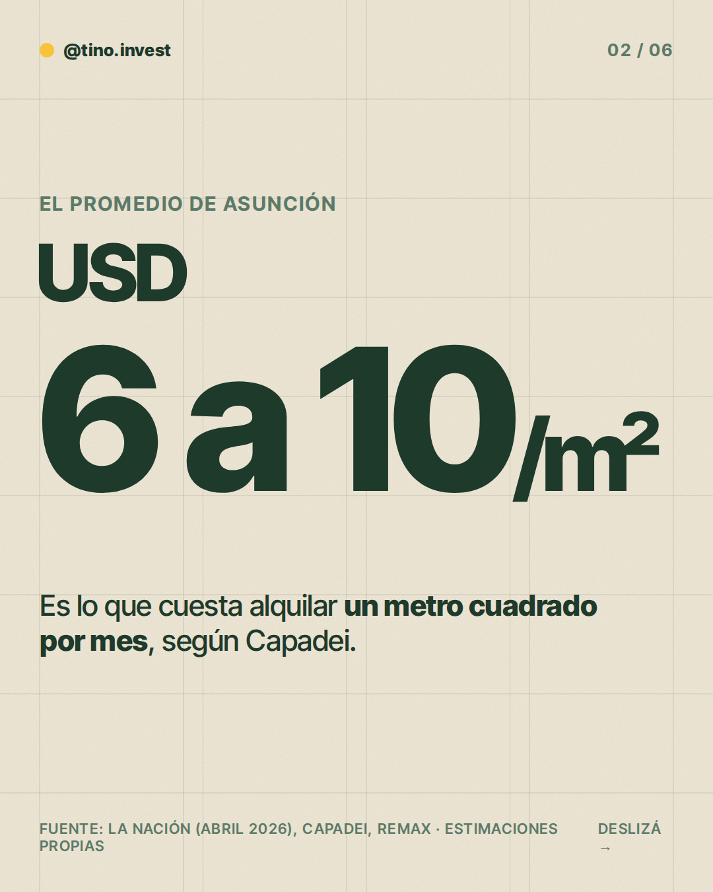
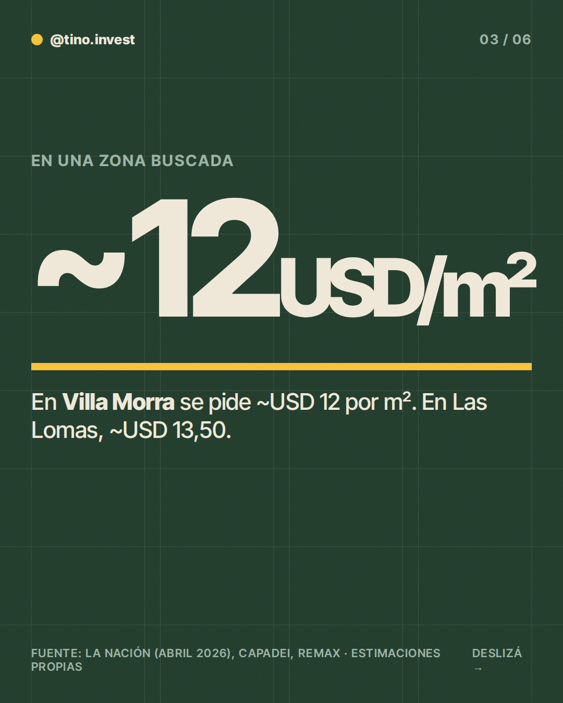
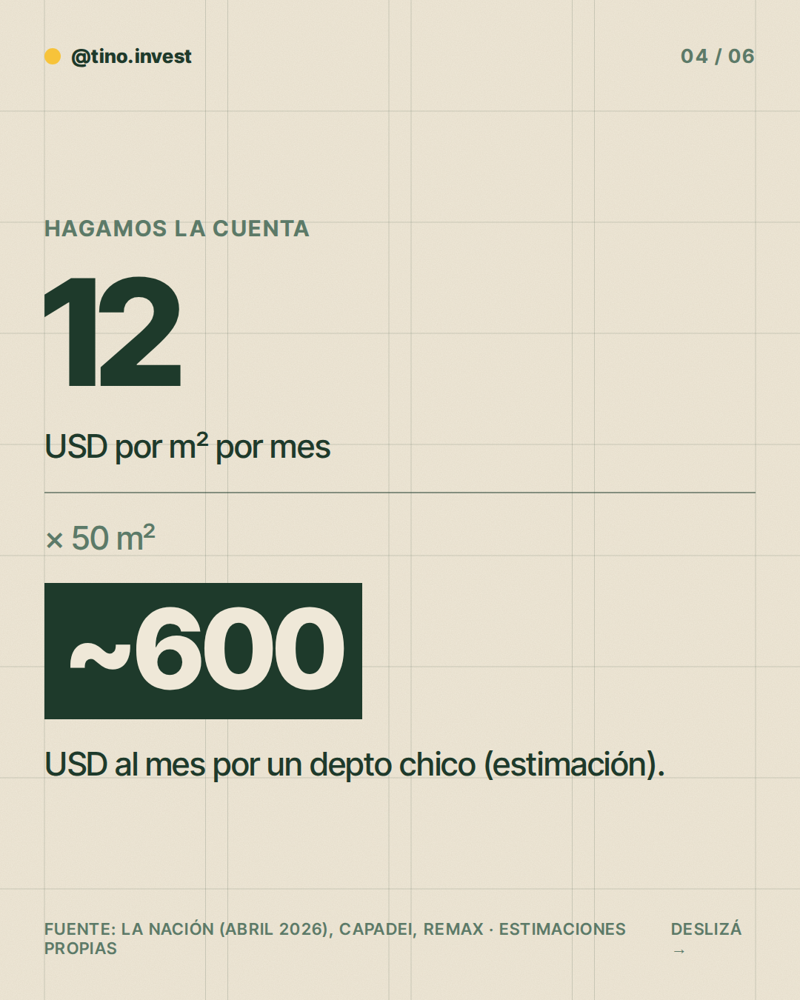
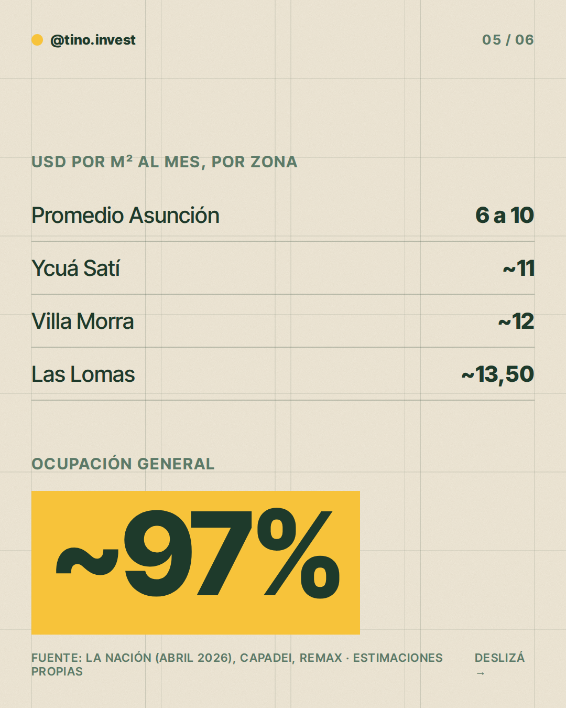
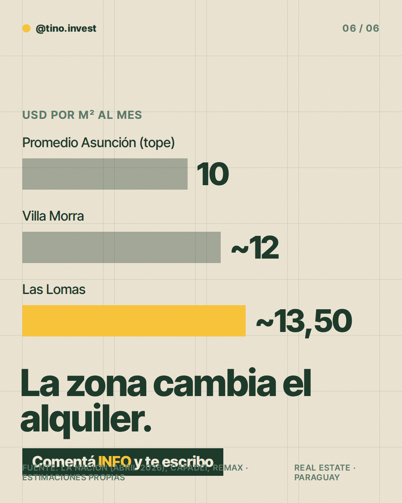

**Pilar:** El dato de la semana · **Tema:** Cuánto cuesta alquilar un m² en Asunción

### Texto (367/500 caracteres)

> ¿Cuánto cuesta alquilar un m² en Asunción?
>
> El promedio ronda USD 6 a 10 por m² al mes.
>
> Pero la zona cambia todo 👇
>
> Villa Morra: ~USD 12/m²
> Las Lomas: ~USD 13,50/m²
>
> Un depto de 50 m² a USD 12 son ~USD 600 al mes (estimación).
>
> Y la ocupación general ronda el 97%.
>
> En los slides está el detalle.
>
> ¿Querés ver cómo da la cuenta en tu caso? Comentá INFO y te escribo.

### Slides

### ¿Qué hago?

- Para publicarlo, comentá `/publicar` en este issue.
- Para descartarlo, cerrá el issue.
- Para cambiar algo, editá `posts/2026-11-02/post.json` y después comentá `/publicar`: los slides se vuelven a armar desde ese archivo antes de publicar.

Investigación y fuentes

# Investigación 2026-11-02 · El dato de la semana

**Tema:** Cuánto cuesta alquilar un m² en Asunción (y cómo cambia según la zona).

## Datos clave
Fuente principal: La Nación (Paraguay), "Barrios exclusivos: conozca precios, la demanda y nuevas reglas del mercado", 13/04/2026.
- Alquiler promedio en Asunción: USD 6 a 10 por m² (Raúl Constantino, presidente de Capadei).
- Las Lomas: ~USD 13,50/m² (rango 12-16); Manorá ~12,50; Villa Morra ~12; Ycuá Satí ~11 (Romina Brasa, Remax).
- Depto de 2 dormitorios de 100 m² en zona premium: USD 1.100 a 1.350/mes (Remax).
- Ocupación general: ~97% (el artículo no identifica al vocero).

## Estimaciones propias
- Ejemplo de 50 m² × USD 12 = ~USD 600/mes: cuenta ilustrativa, el tamaño es supuesto.

## No encontrado
- Precios de venta por m² y rentabilidad: no hay dato confiable, por eso el post no calcula rentabilidad.
- Búsqueda de tipo de cambio/inflación 2026: sin dato útil; no se usa.
- Nota de Última Hora sobre alquileres en G. es de 2023: descartada por desactualizada.

