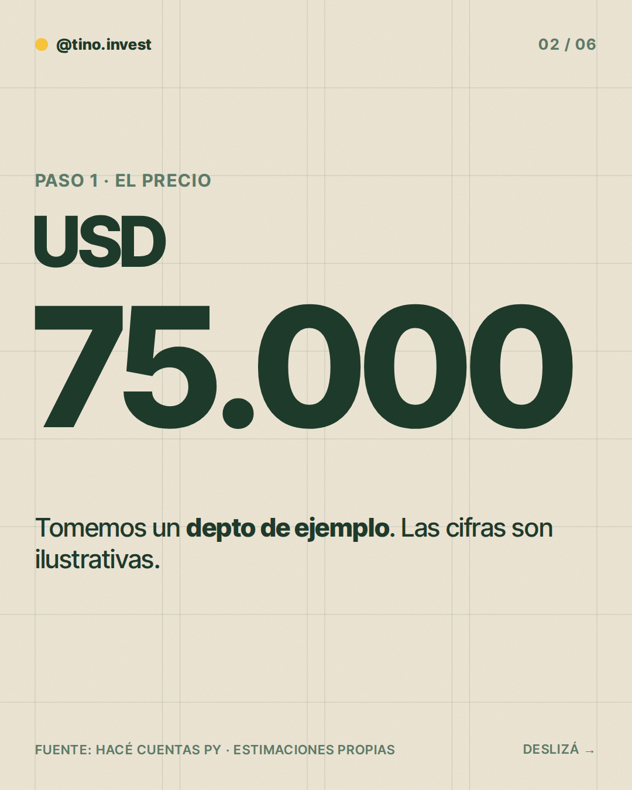
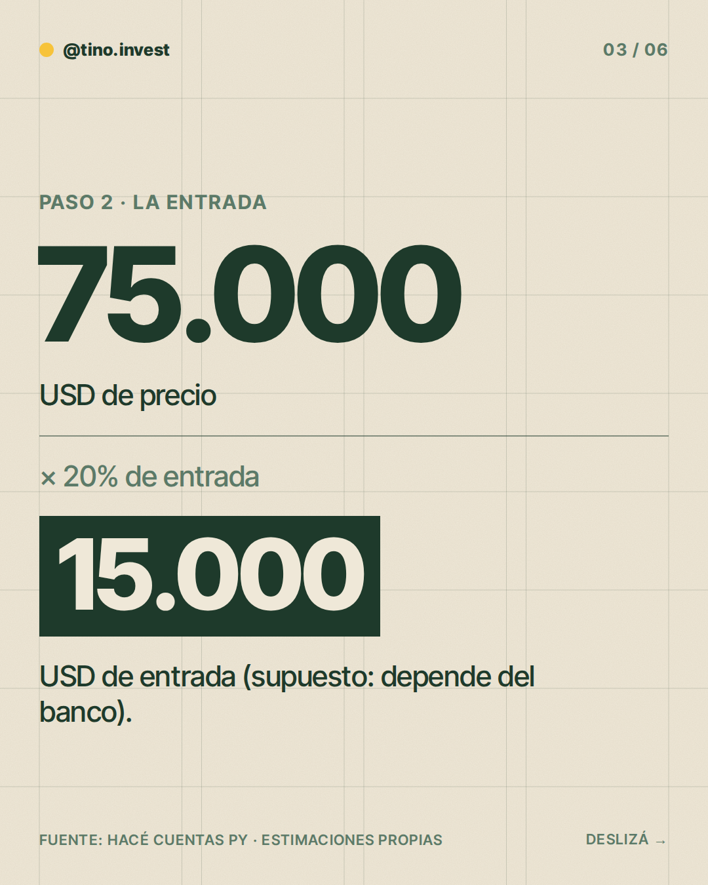
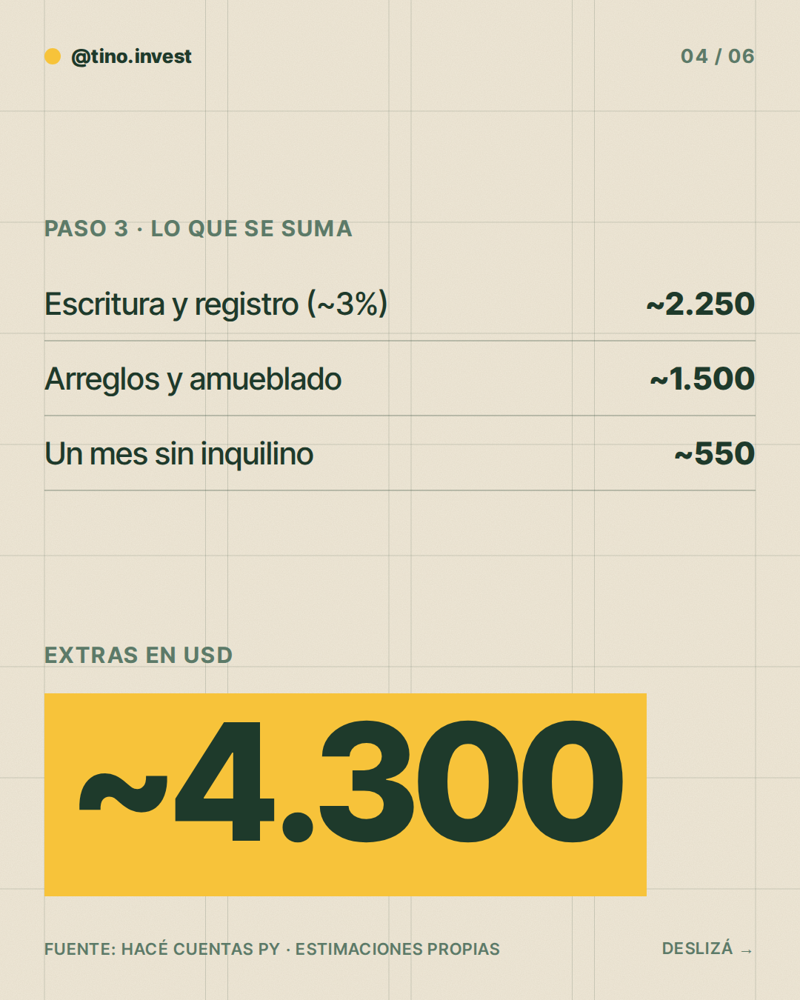
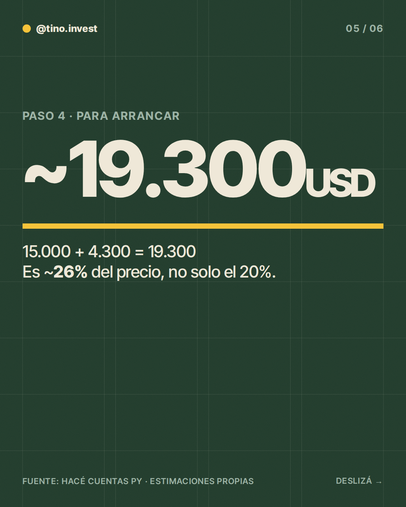
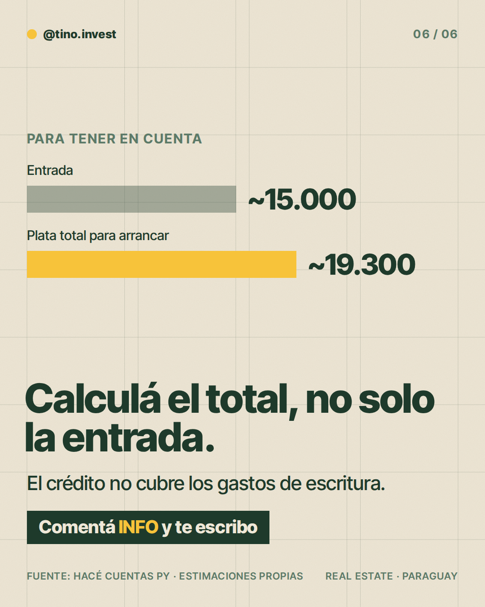

**Pilar:** Primera inversión · **Tema:** Cuánta plata necesitás para arrancar

### Texto (447/500 caracteres)

> ¿Cuánta plata necesitás para comprar tu primer depto?
>
> No es solo el precio 👇
>
> Ejemplo: un depto de ~USD 75.000.
>
> • Entrada (20%): ~USD 15.000
> • Escritura y registro (~3%): ~USD 2.250
> • Arreglos y colchón: ~USD 2.050
>
> Total para arrancar: ~USD 19.300.
> Es ~26% del precio, no 20%.
>
> Los gastos de escritura se pagan aparte, al firmar.
>
> En los slides ves la cuenta paso a paso.
>
> Si estás pensando en tu primera inversión, comentá INFO y lo charlamos.

### Slides

### ¿Qué hago?

- Para publicarlo, comentá `/publicar` en este issue.
- Para descartarlo, cerrá el issue.
- Para cambiar algo, editá `posts/2026-11-03/post.json` y después comentá `/publicar`: los slides se vuelven a armar desde ese archivo antes de publicar.

Investigación y fuentes

# Investigación 2026-11-03 · Primera inversión
Tema: Cuánta plata necesitás para arrancar (del banco de temas).

## Datos con fuente
- Honorarios del escribano: escala de ~2% (operaciones chicas) a ~0,75% (grandes), más IVA, mínimo 5 jornales (Ley 1307/87). Fuente: hacecuentas.com/py (calculadora de terceros, no oficial).
- Inscripción en Registros Públicos y tasa municipal de transferencia: sin monto confiable hallado (una fuente tercera sugiere ~0,8% y ~0,3%, no verificado).
- Los gastos de escritura no los cubre el crédito: se pagan aparte, al firmar. Fuente: hacecuentas.com/py.
- Impuesto inmobiliario ~1% anual sobre avalúo fiscal (varía por municipalidad). Fuente: hacecuentas.com/py.
- Entrega inicial bancaria estándar en Paraguay: NO se encontró dato confiable. El 20% es solo un ejemplo.

## Estimaciones (marcadas como "Estimaciones propias")
- Precio USD 75.000 (ilustrativo, igual que la guía).
- Entrada 20% = USD 15.000 (supuesto).
- Escritura + registro + tasa municipal ~3% (~USD 2.250), rango razonable.
- Reparaciones/amueblado ~USD 1.500 y colchón de 1 mes sin inquilino ~USD 550.
- Total ~USD 19.300 (~26% del precio).

### Comentaron INFO (últimos 7 días)

Nadie por ahora.
