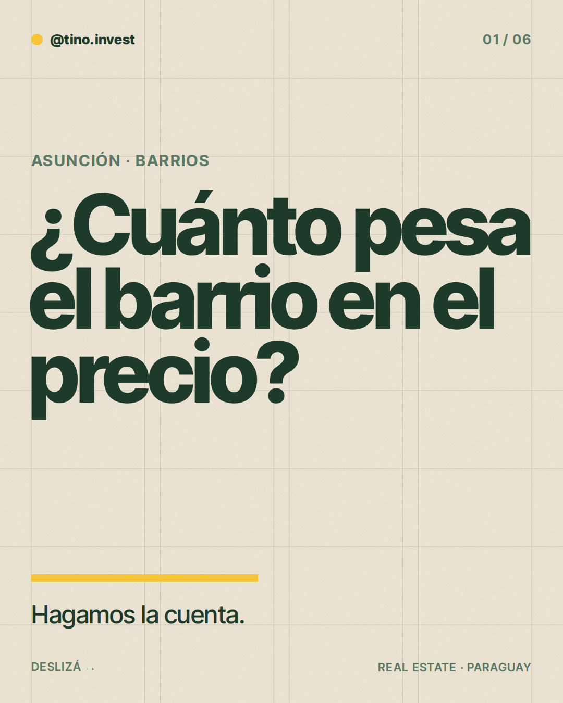
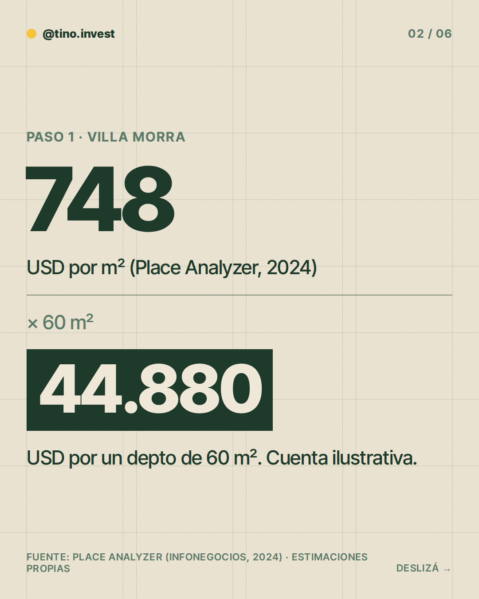
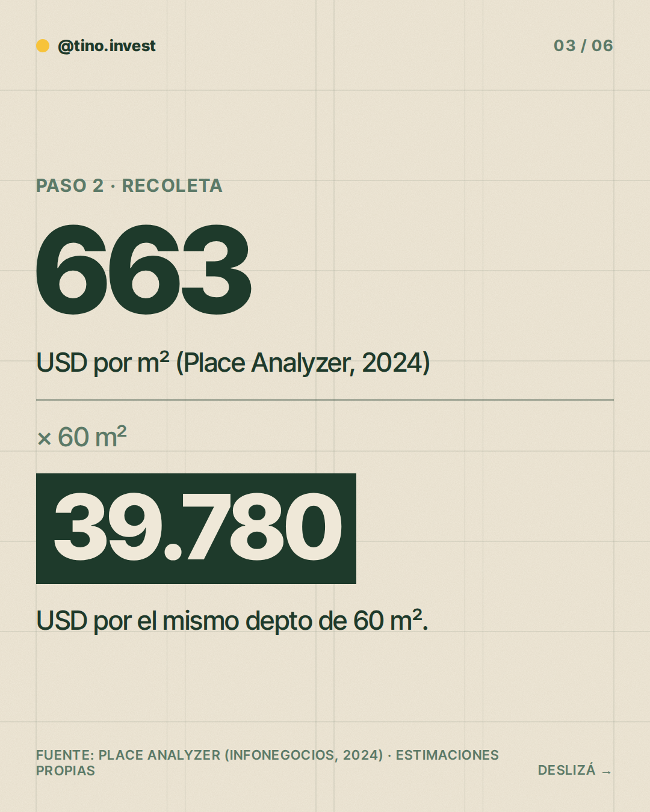
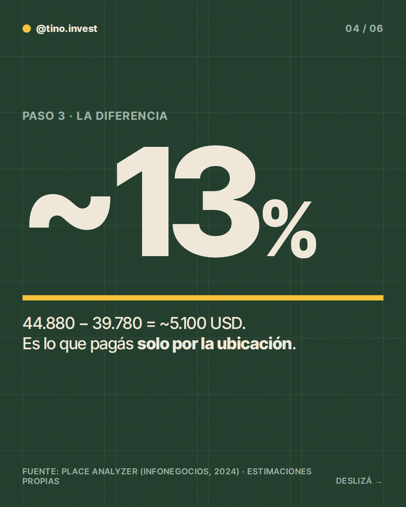
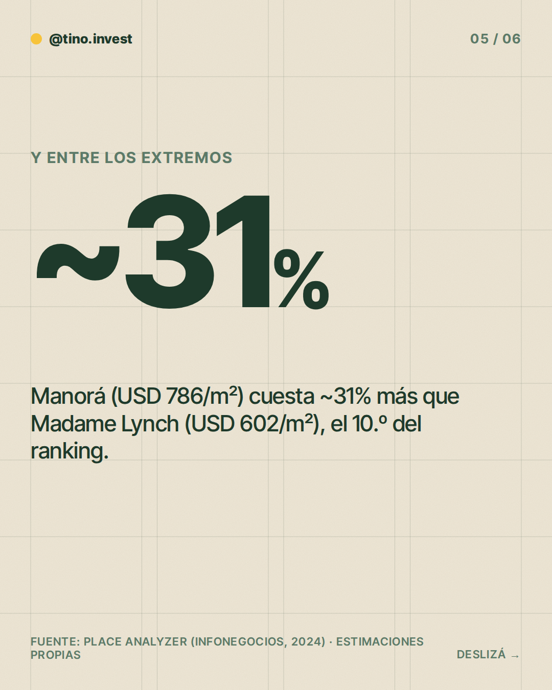
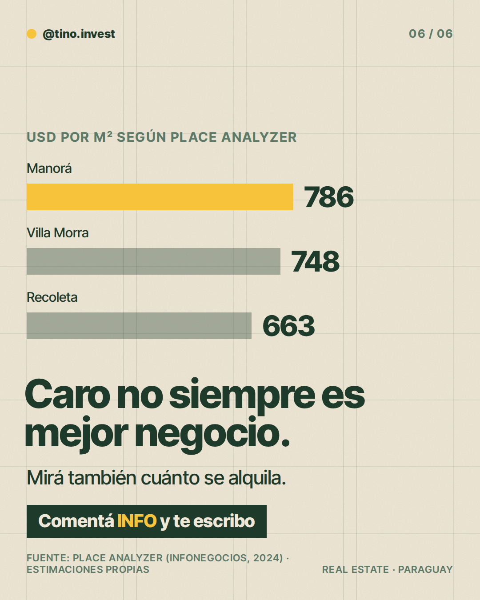

**Pilar:** Barrios y ciudades · **Tema:** Cuánto pesa el barrio en el precio

### Texto (428/500 caracteres)

> ¿Cuánto pesa el barrio en el precio de un depto en Asunción?
>
> Hagamos la cuenta 👇
>
> Según Place Analyzer (2024), el m² en Villa Morra ronda USD 748 y en Recoleta USD 663.
>
> Para un depto de 60 m²:
> ~USD 44.900 vs ~USD 39.800.
>
> Son ~USD 5.100 (~13%) solo por la ubicación.
>
> Ojo: barrio caro no es lo mismo que mejor rentabilidad. Hay que mirar también el alquiler.
>
> En los slides está la cuenta.
>
> Comentá INFO y te paso más detalle.

### Slides

### ¿Qué hago?

- Para publicarlo, comentá `/publicar` en este issue.
- Para descartarlo, cerrá el issue.
- Para cambiar algo, editá `posts/2026-11-04/post.json` y después comentá `/publicar`: los slides se vuelven a armar desde ese archivo antes de publicar.

Investigación y fuentes

# Investigación 2026-11-04 · Barrios y ciudades

**Tema elegido:** Cuánto pesa el barrio en el precio (Villa Morra vs. Recoleta, ranking de barrios de Asunción). Del banco: "Villa Morra, ... Recoleta". No repite los temas recientes (alquiler por m², cuánta plata para arrancar).

## Datos clave
- Place Analyzer vía Infonegocios (2 abr 2024), precios de viviendas en US$/m² (el artículo no aclara venta/terreno/depto ni metodología):
  Manorá 786 · Villa Morra 748 · Las Lomas 742 · Mcal. F. Solano López 713 · Recoleta 663 · San Jorge 662 · Santo Domingo 656 · Mcal. Estigarribia 618 · Ykua Satí 613 · Madame Lynch 602.
  https://infonegocios.com.py/default/cotizacion-exclusiva-manora-villa-morra-y-las-lomas-son-los-barrios-mas-caros-segun-place-analyzer
- La Nación (17 ene 2026): barrios premium (Mburukuja, Villa Morra, Manorá, Santo Domingo, Las Lomas, Ykua Satí, San Cristóbal); centro de Asunción desde ~USD 100.000 (casas antiguas). Sin precio por m² ni rentabilidad.
  https://www.lanacion.com.py/negocios/2026/01/17/mercado-inmobiliario-cuanto-cuesta-alquilar-o-comprar-en-los-barrios-premium-de-asuncion/

## Cálculos propios
- Depto ilustrativo de 60 m²: Villa Morra 748 × 60 = 44.880 · Recoleta 663 × 60 = 39.780 · diferencia ≈ 5.100 (≈ 13%).
- Manorá vs. Madame Lynch: 786 / 602 = 1,31 → ~31% más.

## Estimaciones / límites
- Los 60 m² son un tamaño ilustrativo, no un dato.
- Los valores por m² son de 2024 y de metodología no publicada: sirven para comparar entre barrios, no como precio actual de mercado.
- No se encontró dato confiable y reciente de rentabilidad por barrio; el post lo dice sin inventar cifra.

