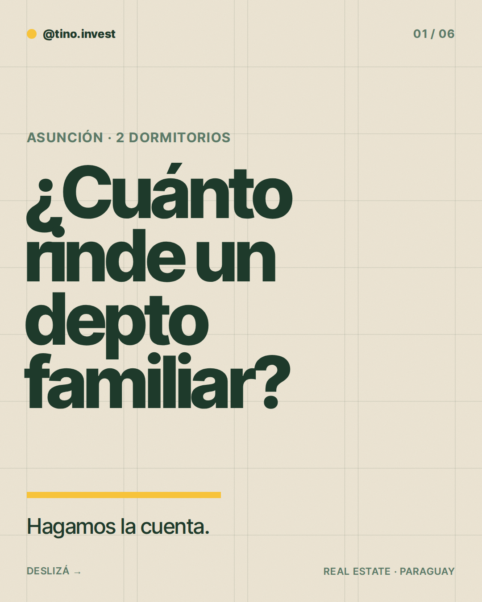
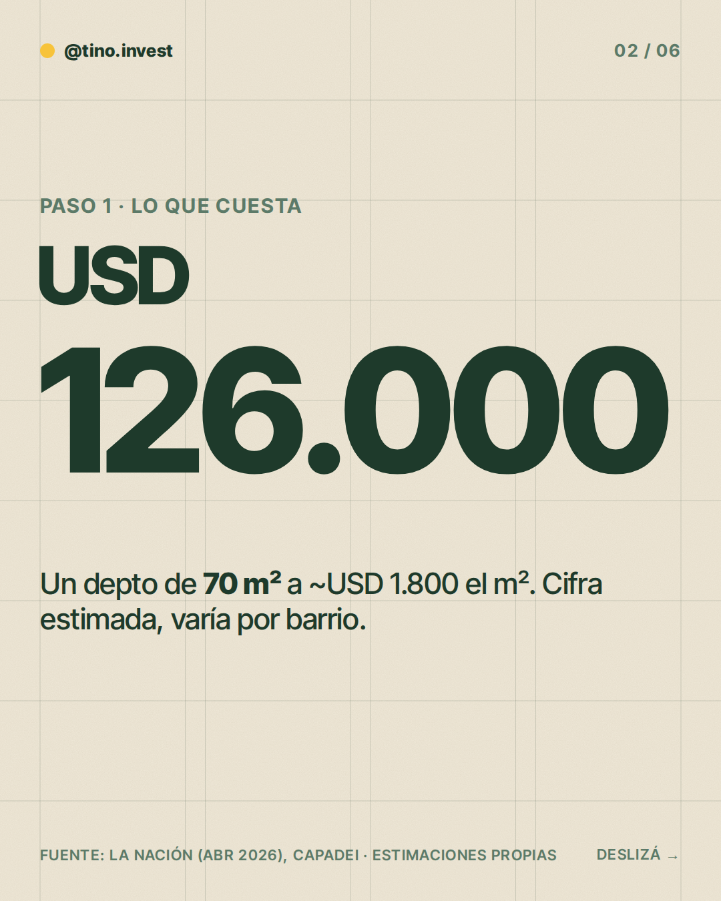
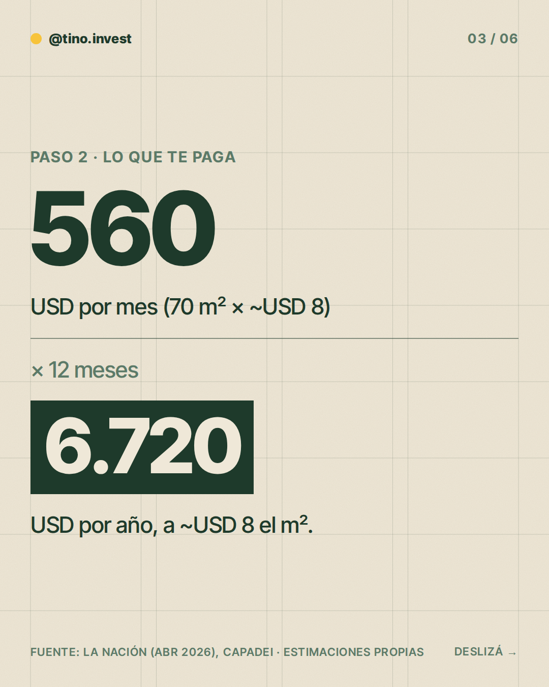
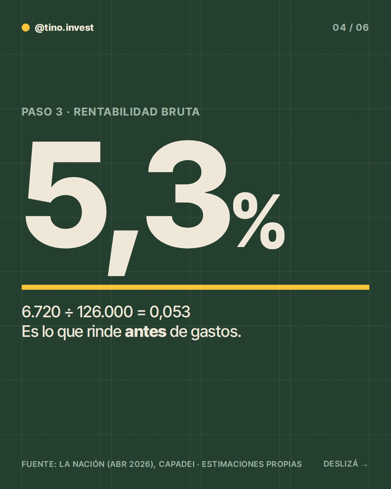
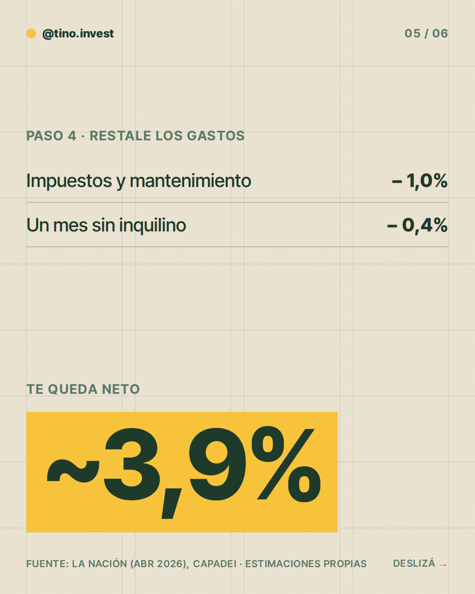
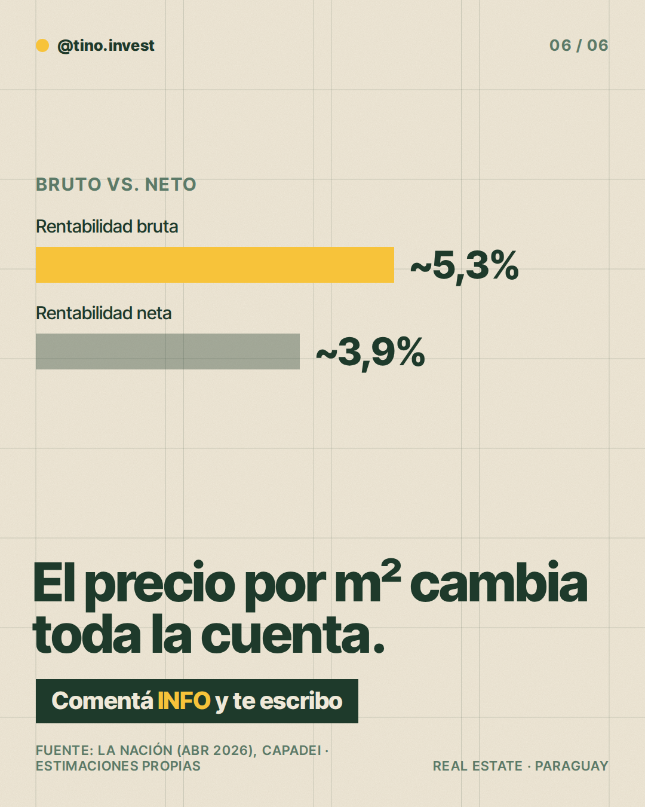

**Pilar:** Hagamos la cuenta · **Tema:** Depto de 2 dormitorios para familia en Asunción

### Texto (428/500 caracteres)

> ¿Cuánto rinde un depto de 2 dormitorios para alquilar?
>
> Hagamos la cuenta 👇
>
> Un depto de 70 m² a ~USD 1.800 el m² cuesta ~USD 126.000.
> Alquilado a ~USD 8 el m² son ~USD 560/mes → ~USD 6.720 al año.
>
> Eso es ~5,3% bruto.
>
> Restale impuestos, mantenimiento y un mes vacío y quedan ~3,9% neto.
>
> Son estimaciones: el precio por m² cambia mucho el resultado.
>
> En los slides está la cuenta completa.
>
> Comentá INFO y te paso más detalle.

### Slides

### ¿Qué hago?

- Para publicarlo, comentá `/publicar` en este issue.
- Para descartarlo, cerrá el issue.
- Para cambiar algo, editá `posts/2026-11-05/post.json` y después comentá `/publicar`: los slides se vuelven a armar desde ese archivo antes de publicar.

Investigación y fuentes

# Investigación 2026-11-05 · Hagamos la cuenta

**Tema:** Depto de 2 dormitorios para familia (del banco de temas). No repite los de las últimas 6 semanas.

## Datos con fuente
- La Nación, "Barrios exclusivos: conozca precios, la demanda y nuevas reglas del mercado", 13/04/2026: alquiler promedio en Asunción USD 6 a 10 por m² (Raúl Constantino, Capadei); depto de 2 dormitorios de 100 m² en zona premium: USD 1.100 a 1.350/mes (Remax).
- Place Analyzer vía Infonegocios (2 abr 2024): precios de viviendas de ~USD 600 a 790/m² según barrio (metodología no publicada; no se usa como precio de venta actual).
- Impuesto inmobiliario ~1% anual sobre avalúo fiscal, varía por municipalidad (hacecuentas.com/py, tercero, ver investigación 2026-11-03).

## Descartado
- Última Hora, alquiler de 2 dormitorios G. 3,5 a 4,5 millones: la nota es de julio de 2023 (la búsqueda la mostraba como 2026). Desactualizada.
- Precio de venta por m² en Asunción: solo hay un blog extranjero (Cyril Jarnias, ~USD 1.600-2.000/m²) y avisos sueltos. Sin estadística oficial ni de cámara. Se usa solo como rango estimado.
- Tipo de cambio y tasa de plazo fijo: sin dato confiable; no se usan.

## Estimaciones propias (post marca "Estimaciones propias")
- Depto de 70 m², tamaño ilustrativo.
- Precio de compra ~USD 126.000 (70 m² × ~USD 1.800/m², rango razonable 1.600-2.000).
- Alquiler ~USD 560/mes (70 m² × USD 8, punto medio del rango USD 6-10/m² de Capadei). × 12 = USD 6.720/año.
- Bruto: 6.720 ÷ 126.000 = 5,3%.
- Gastos: impuesto y mantenimiento ~1,0% del precio; un mes vacío ~0,4% (560 ÷ 126.000 = 0,44%).
- Neto: 5,3 − 1,0 − 0,4 = ~3,9%, redondeado a ~3,9%.
- Idea del post: mostrar la cuenta y que el resultado depende mucho del precio por m² que se pague (no se compara con otros tipos de depto, no hay dato).

### Comentaron INFO (últimos 7 días)

Nadie por ahora.
