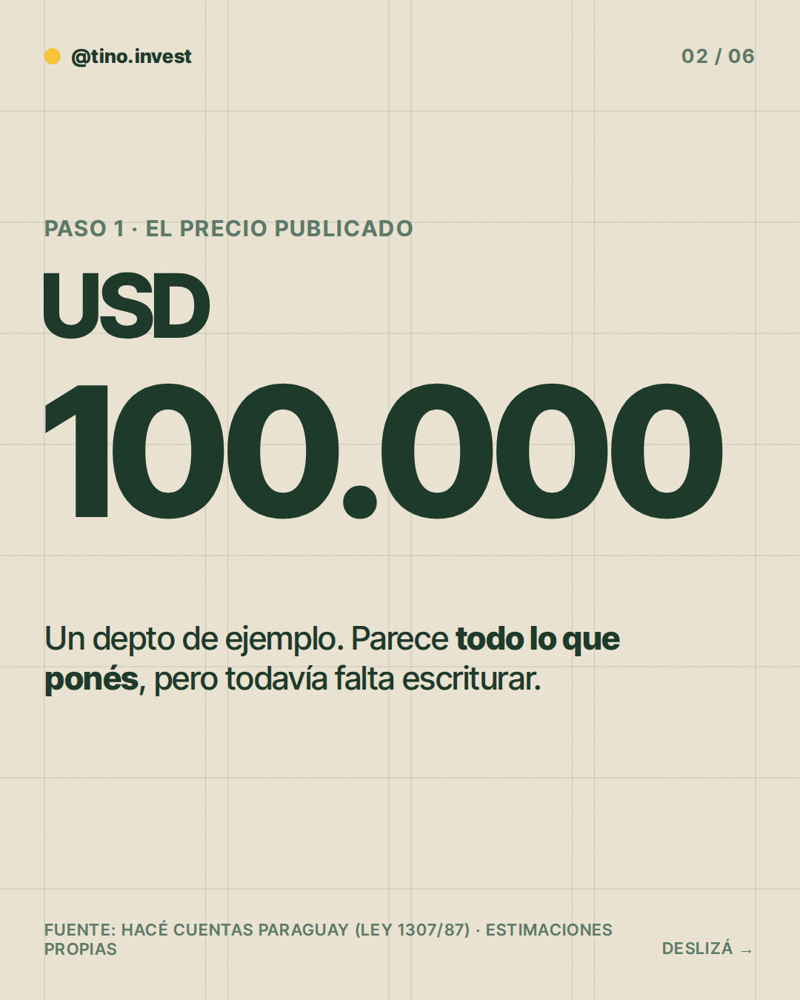
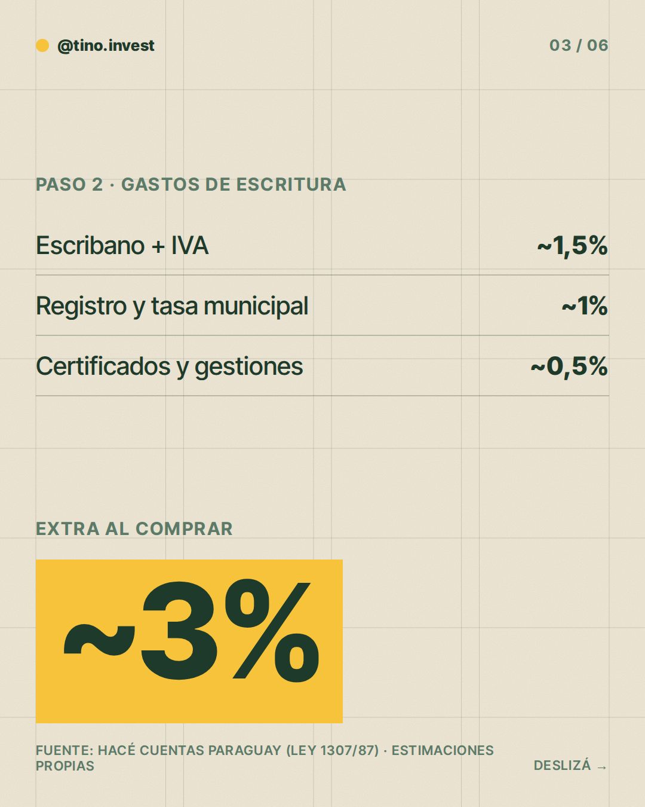
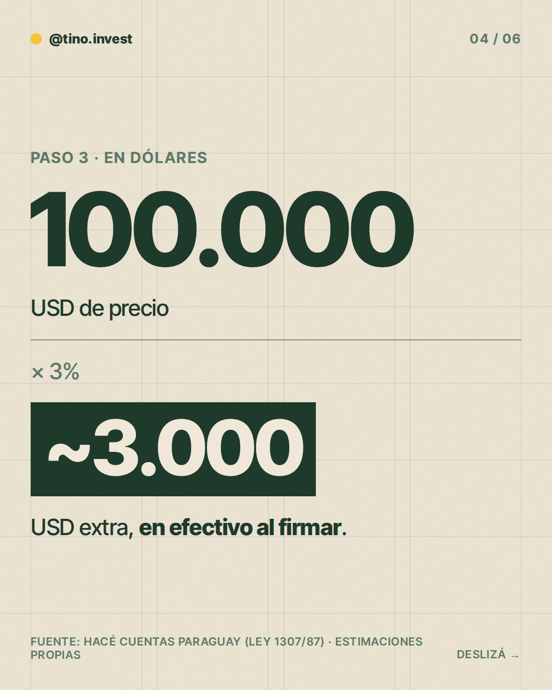
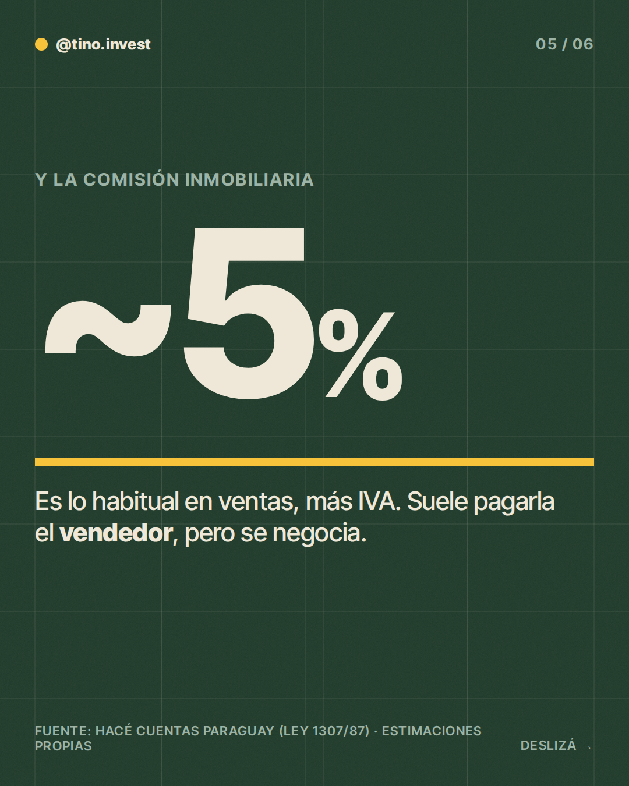
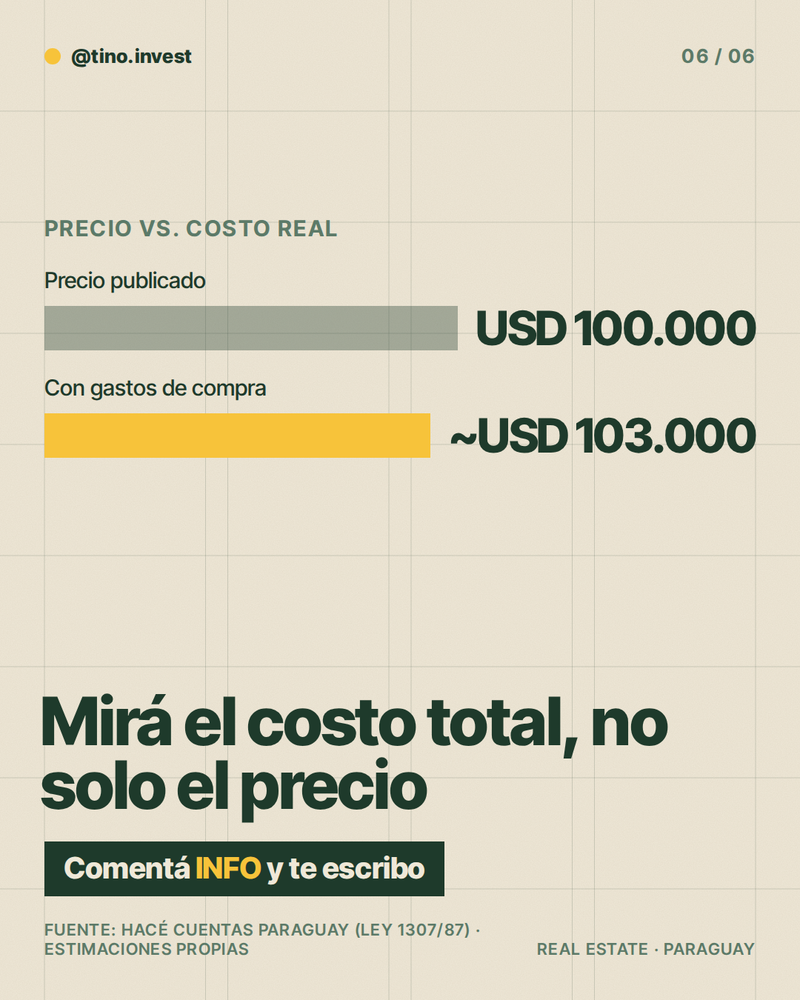

**Pilar:** Errores y mitos · **Tema:** Gastos de escritura y comisiones al comprar

### Texto (426/500 caracteres)

> ¿El precio publicado es todo lo que pagás al comprar un depto? No.
>
> Hagamos la cuenta 👇
>
> En un depto de USD 100.000, escribano, registro, tasa municipal y gestiones suman ~3%: ~USD 3.000 extra, en efectivo al firmar. El crédito no los cubre.
>
> La comisión de venta (~5% + IVA) suele pagarla el vendedor, pero se negocia.
>
> Pedí el presupuesto completo antes de firmar. Detalle en los slides.
>
> Comentá INFO y te paso más detalle.

### Slides

### ¿Qué hago?

- Para publicarlo, comentá `/publicar` en este issue.
- Para descartarlo, cerrá el issue.
- Para cambiar algo, editá `posts/2026-11-06/post.json` y después comentá `/publicar`: los slides se vuelven a armar desde ese archivo antes de publicar.

Investigación y fuentes

# Investigación 2026-11-06 · Errores y mitos
**Tema:** Gastos de escritura y comisiones ("el precio publicado no es lo que pagás"). Del banco de temas, no publicado en las últimas 6 semanas.

## Datos clave
- Honorario del escribano: arancel Ley 1307/87, escala decreciente de ~2% (operaciones chicas) a ~0,75% (grandes), más 10% de IVA, mínimo 5 jornales. Lo suele pagar el comprador al firmar, en efectivo; el crédito no lo cubre. Fuente: Hacé Cuentas Paraguay (calculadora gastos de escritura, revisión 2026-08-16). Es una calculadora, no la norma.
- Inscripción en Registros Públicos y tasa municipal de transferencia: la fuente no da porcentaje confirmado (otra referencia habla de ~0,8% y ~0,3%, sin verificar). Además hay fojas, certificados y sellados.
- Comisión inmobiliaria en venta: ~5% + IVA, costumbre de mercado, negociable, no fijada por ley; suele pagarla el vendedor. Fuente: Hacé Cuentas Paraguay (calculadora comisión inmobiliaria).
- Comisión en alquiler: un mes de renta + IVA, habitualmente dividida entre inquilino y propietario.
- Descartado: una guía habla de "3% de impuesto a la transferencia"; contradice las otras fuentes, no se usa.

## Estimaciones (propias)
- Gastos totales de compra a cargo del comprador: ~3% del precio (rango razonable 2%–3,5%). Desglose del slide (escribano ~1,5%, registro y tasa ~1%, gestiones ~0,5%) es ilustrativo.
- Ejemplo de USD 100.000: ilustrativo.
- Confirmar siempre con escribanía y municipalidad.

### Comentaron INFO (últimos 7 días)

Nadie por ahora.
