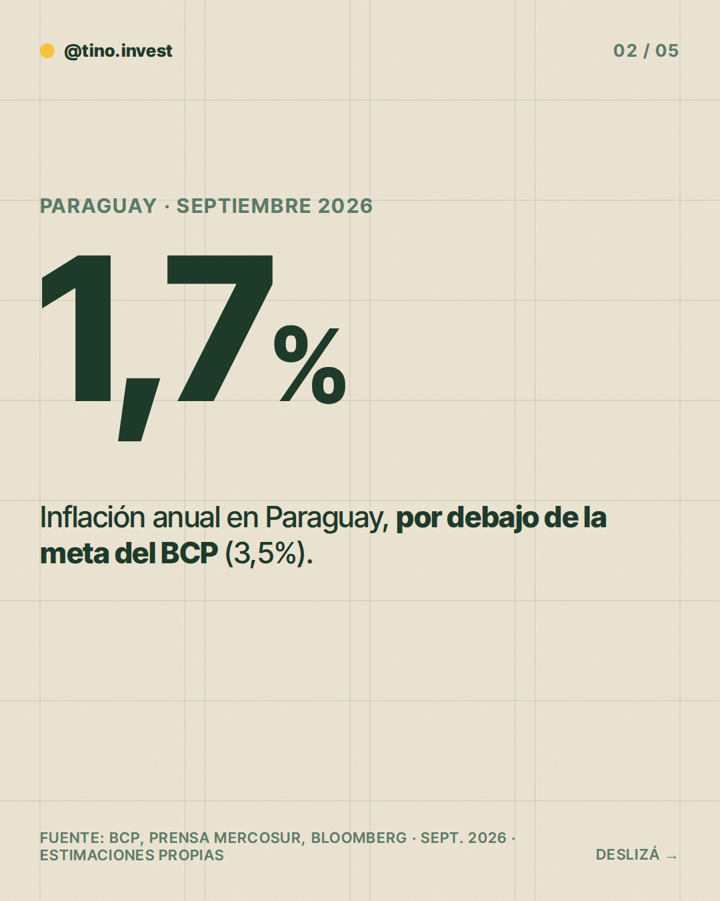
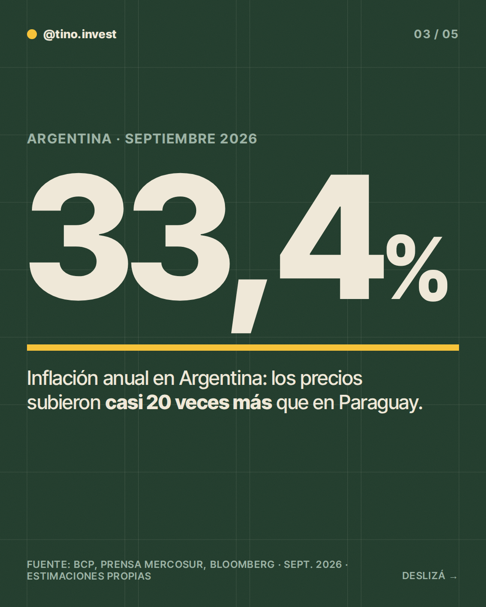
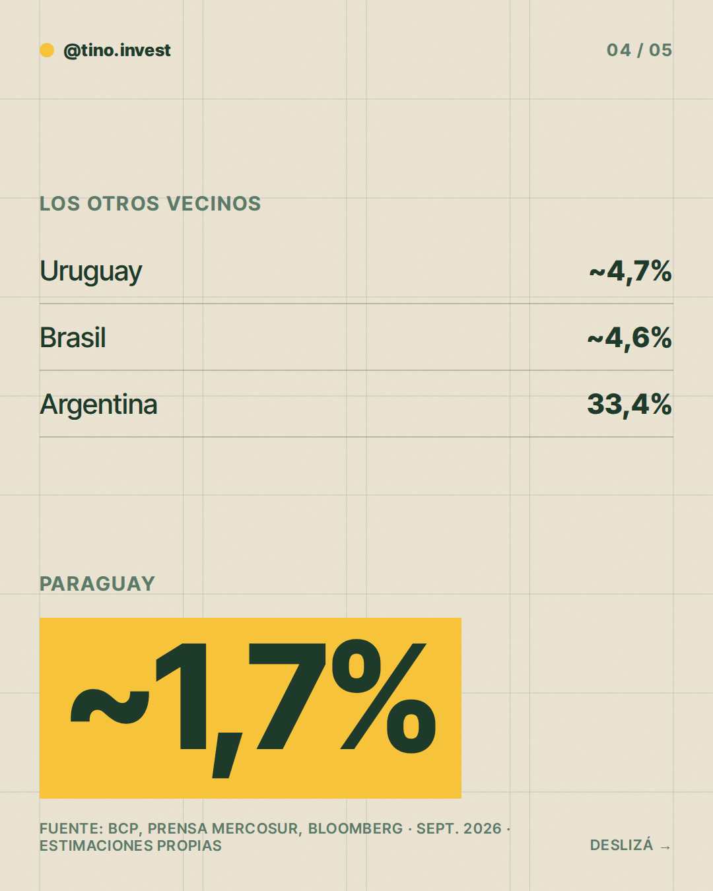
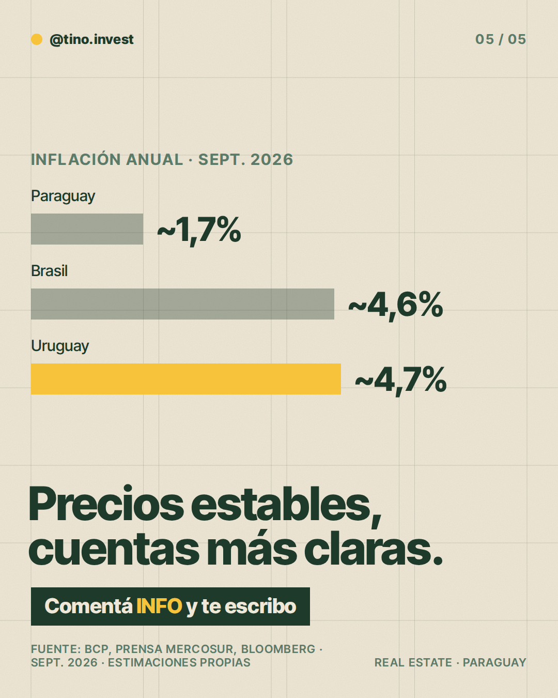

**Pilar:** Paraguay vs. la región · **Tema:** Inflación: Paraguay vs. la región

### Texto (392/500 caracteres)

> ¿Cuánto te come la inflación cuando invertís?
>
> Mirá la inflación anual de septiembre 👇
>
> Argentina: 33,4%
> Uruguay: ~4,7%
> Brasil: ~4,6%
> Paraguay: ~1,7%
>
> Con precios más estables es más fácil hacer cuentas a largo plazo: alquileres, expensas y costos no se mueven tanto.
>
> No garantiza nada, pero es un punto a favor.
>
> En los slides te muestro la comparación.
>
> Comentá INFO y te paso más detalle.

### Slides

### ¿Qué hago?

- Para publicarlo, comentá `/publicar` en este issue.
- Para descartarlo, cerrá el issue.
- Para cambiar algo, editá `posts/2026-11-07/post.json` y después comentá `/publicar`: los slides se vuelven a armar desde ese archivo antes de publicar.

Investigación y fuentes

# Investigación 2026-11-07 · Paraguay vs. la región

**Tema elegido:** Estabilidad de precios: inflación de Paraguay vs. Argentina, Brasil y Uruguay (variante del banco "Estabilidad del guaraní y precios en dólares").

**Por qué no impuestos al alquiler (IRP):** las fuentes encontradas se contradicen en tasas y deducciones (8%, 9-10%, renta presunta 50%); sin dato oficial confiable de DNIT, se descartó para no inventar cifras.

## Datos clave (inflación interanual, septiembre 2026)
- Paraguay: ~1,7% (Trading Economics, dato de BCP; se mantuvo igual en octubre 2026). Meta del BCP: 3,5%. Otra nota cita 1,12% para agosto.
- Argentina: 33,4% (Noticias NQN, 13/10/2026; Prensa Mercosur 16/10/2026 citando Bloomberg).
- Brasil: 4,58% (IPCA, Prensa Mercosur 16/10/2026).
- Uruguay: 4,68% (Prensa Mercosur 16/10/2026; mes no especificado, se asume septiembre).
- Fuente nota regional: Prensa Mercosur, 16/10/2026, "Paraguay entre los tres países con menor aumento de precios de América Latina" (ABC Color / MF Economía e Inversiones).

## Estimaciones / cautelas
- Redondeos: 4,58% → ~4,6%; 4,68% → ~4,7%. Los meses de referencia pueden diferir levemente entre países.
- "Casi 20 veces más" = 33,4 / 1,7 ≈ 19,6 (cálculo propio).
- No se afirma rentabilidad alguna; inflación baja es contexto, no garantía.

### Comentaron INFO (últimos 7 días)

Nadie por ahora.
