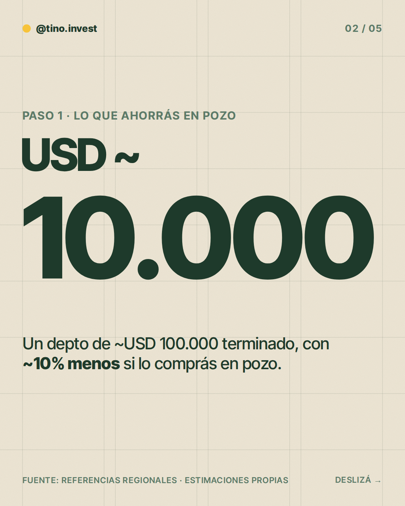
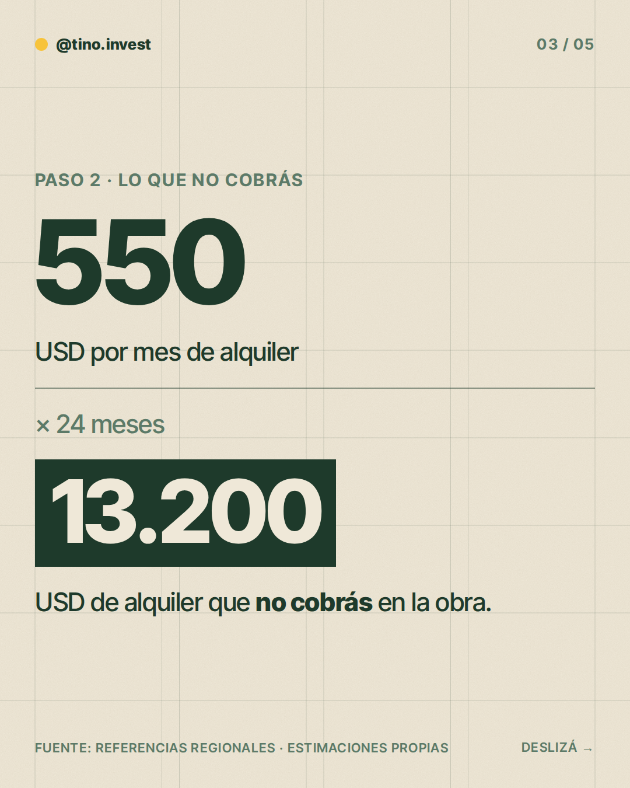
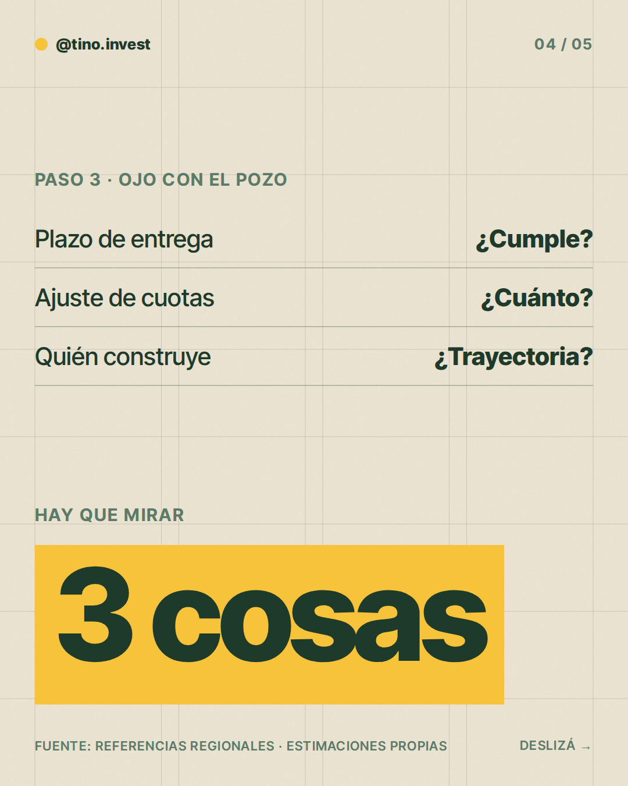
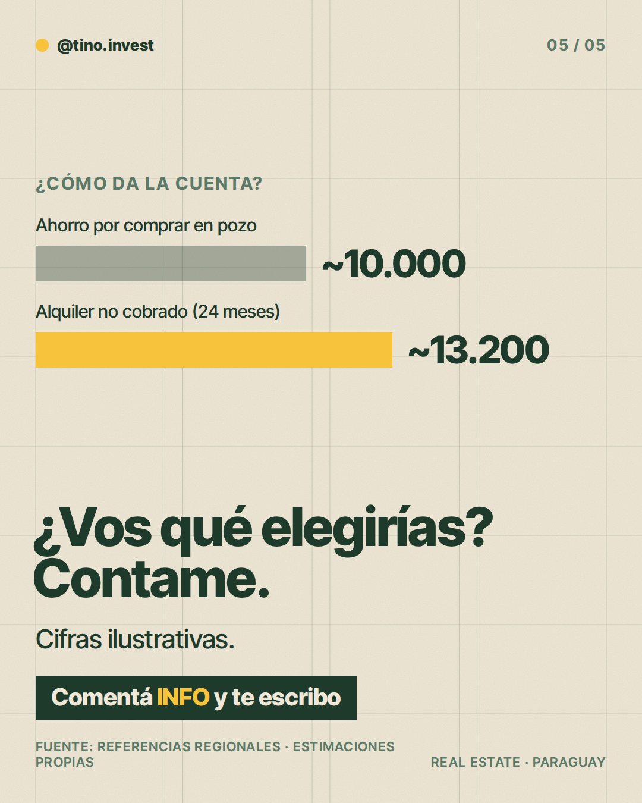

**Pilar:** Pregunta abierta · **Tema:** ¿Comprarías en pozo o terminado?

### Texto (343/500 caracteres)

> ¿Comprarías en pozo o terminado?
>
> El pozo suele ser más barato. Pero esperás la obra.
>
> Cuenta ilustrativa 👇
> Terminado: ~USD 100.000.
> En pozo, con ~10% menos: ~USD 90.000. Ahorrás ~USD 10.000.
>
> Pero 24 meses de espera, a ~USD 550/mes de alquiler, son ~USD 13.200 que no cobrás.
>
> ¿Qué elegirías vos? Contame.
>
> Comentá INFO y te paso más detalle.

### Slides

### ¿Qué hago?

- Para publicarlo, comentá `/publicar` en este issue.
- Para descartarlo, cerrá el issue.
- Para cambiar algo, editá `posts/2026-11-08/post.json` y después comentá `/publicar`: los slides se vuelven a armar desde ese archivo antes de publicar.

Investigación y fuentes

# Investigación 2026-11-08 · Pregunta abierta

**Tema:** ¿Comprarías en pozo o terminado? (banco: Primera inversión → "Comprar en pozo vs. terminado"). No publicado en las últimas 6 semanas.

## Qué encontré
- Búsqueda web: no apareció ningún dato paraguayo confiable y actual sobre el descuento de pozo vs. terminado en Asunción.
- Referencias de la región (Argentina/Uruguay, no aplican directo a Paraguay): el pozo suele ser más barato que lo terminado (rangos citados ~10-25% en Argentina; en Montevideo la brecha varía mucho según el barrio) y hay riesgo de sobrecostos/ajustes durante la obra. Fuentes: iProfesional (ago. 2026), Mudafy, El Observador (UY).

## Enfoque elegido
Post conceptual con cuenta ilustrativa. Ninguna cifra es dato de mercado paraguayo.

## Estimaciones (todas propias, ilustrativas)
- Depto terminado: ~USD 100.000.
- Descuento por comprar en pozo: ~10% → ~USD 10.000 (rango razonable 5-20%).
- Alquiler: ~USD 550/mes (≈6,6% bruto anual sobre USD 100.000).
- Espera de obra: 24 meses → ~USD 13.200 de alquiler que no cobrás.
- Conclusión: el descuento puede quedar por debajo del alquiler que dejás de cobrar; depende del plazo y del descuento real.

### Comentaron INFO (últimos 7 días)

Nadie por ahora.
