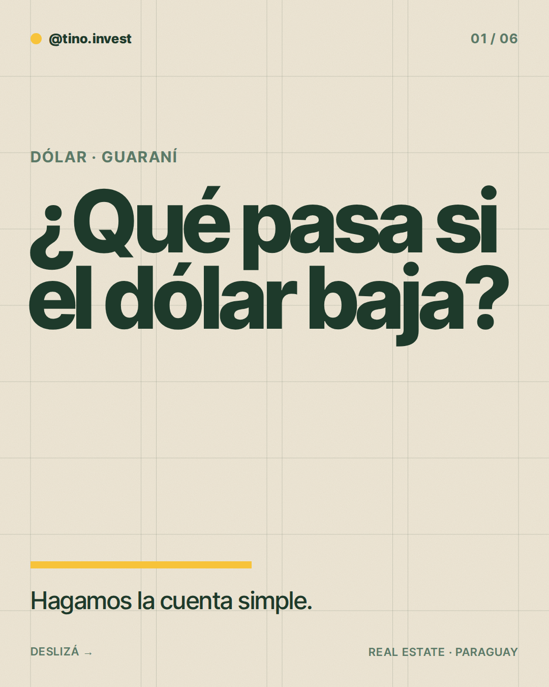
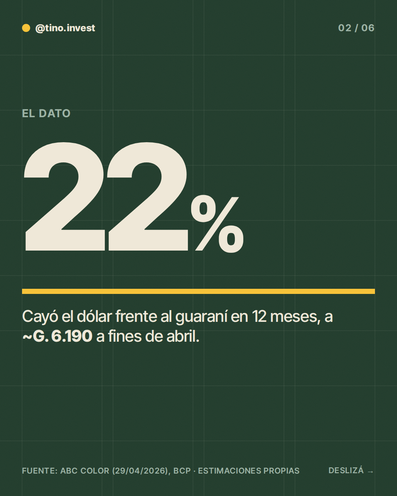
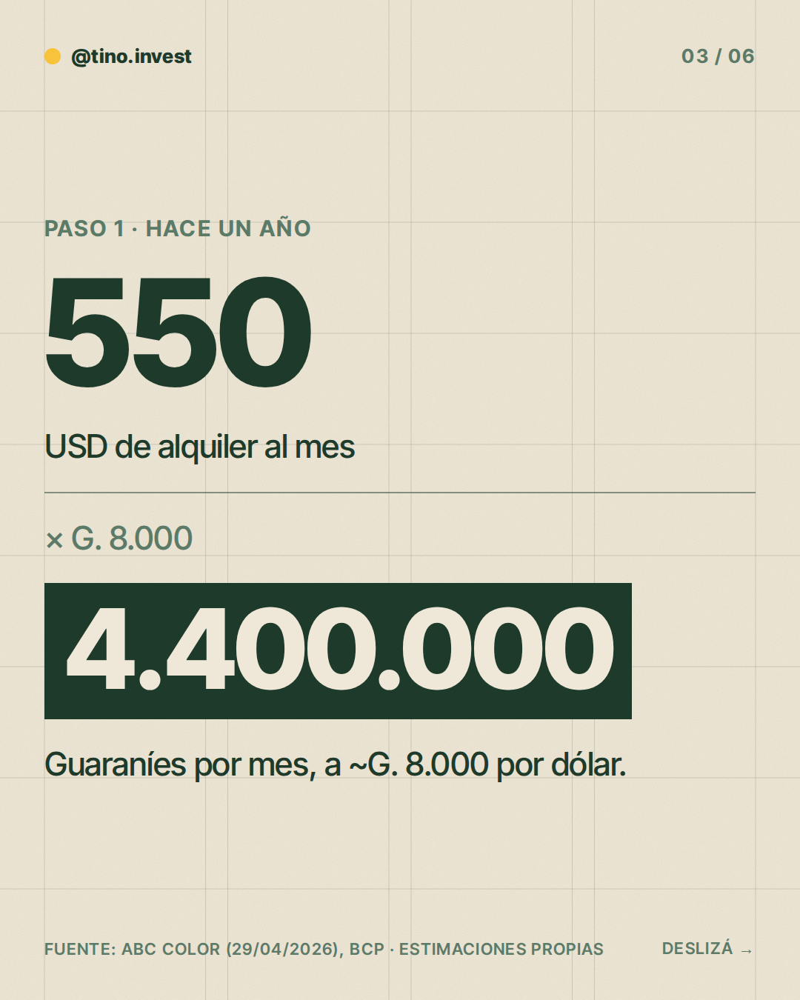
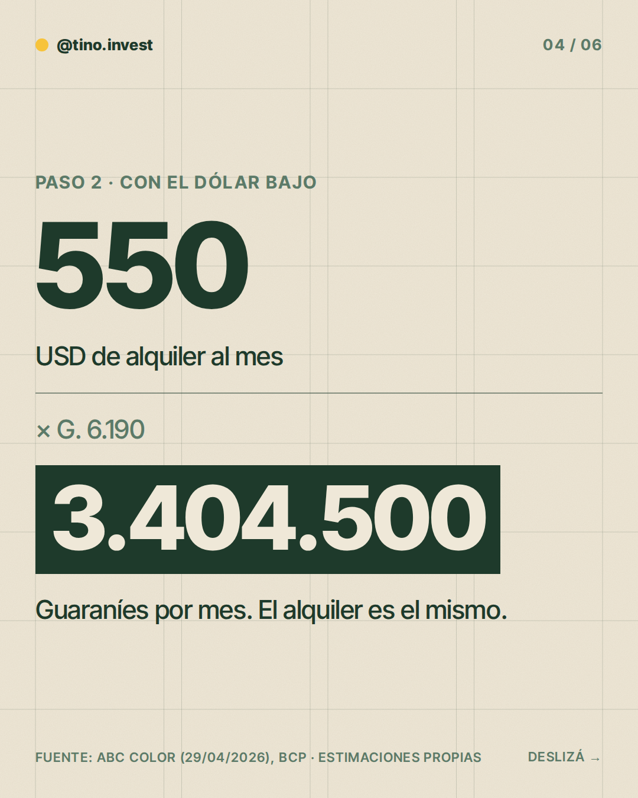
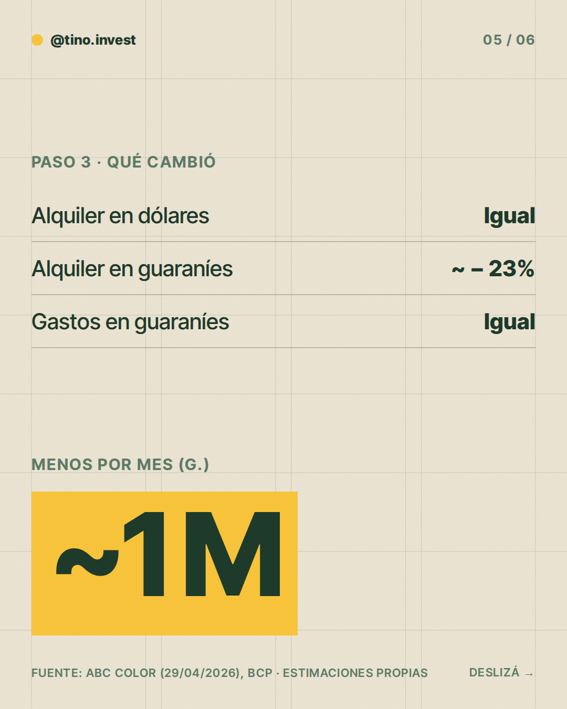
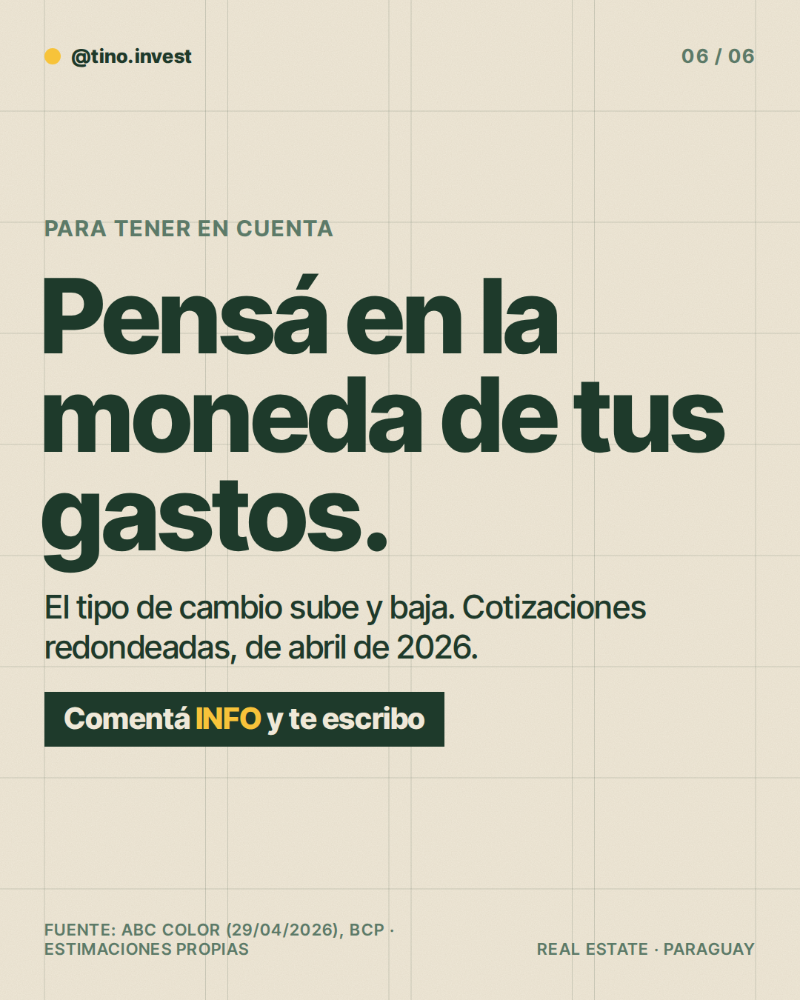

**Pilar:** El dato de la semana · **Tema:** Dólar a la baja: qué pasa con un alquiler en USD

### Texto (424/500 caracteres)

> ¿El dólar cayó ~22% frente al guaraní en 12 meses y tu alquiler en USD lo sintió?
>
> Hagamos la cuenta 👇
>
> Alquiler de USD 550:
> • Hace un año (~G. 8.000): G. 4.400.000
> • A fines de abril (~G. 6.190): G. 3.404.500
>
> Son ~G. 1.000.000 menos al mes en guaraníes, con el mismo depto.
>
> Si tus gastos son en guaraníes, se nota. Si tu meta es en dólares, no cambia.
>
> ¿Querés ver cómo da la cuenta en tu caso? Comentá INFO y te escribo.

### Slides

### ¿Qué hago?

- Para publicarlo, comentá `/publicar` en este issue.
- Para descartarlo, cerrá el issue.
- Para cambiar algo, editá `posts/2026-11-09/post.json` y después comentá `/publicar`: los slides se vuelven a armar desde ese archivo antes de publicar.

Investigación y fuentes

# Investigación 2026-11-09 · El dato de la semana

**Tema:** Dólar a la baja: qué le pasa a un alquiler en USD cuando cae el dólar (banco: "Estabilidad del guaraní y precios en dólares").

## Datos clave
- El dólar cerró en G. 6.190 (casas de cambio) y G. 6.144 (interbancario), mínimo desde marzo de 2019. Acumula -6% en 2026 y -22% en 12 meses (un año antes rondaba G. 8.000). Fuente: ABC Color, 29/04/2026.
- Causas citadas: dólar débil a nivel global, más oferta de divisas por exportaciones, el BCP no interviene (libre flotación). Fuente: ABC Color, 29/04/2026.
- Encuesta EVE del BCP (octubre 2026): inflación 2026 esperada ~3%; 2027 ~3,5% (= meta del BCP). Son expectativas, no proyección oficial.

## Estimaciones / cuidado
- Cuenta del alquiler de USD 550 (monto ilustrativo): 550 × 8.000 = G. 4.400.000; 550 × 6.190 = G. 3.404.500; diferencia ~G. 995.500 (~23%). Es estimación propia con cotizaciones redondeadas de abril.
- Las fuentes de octubre/noviembre 2026 tienen cifras inconsistentes entre sí (G. 5.8xx a 6.4xx; reversión en noviembre); NO se usaron. La cotización actual puede diferir de la de abril.
- No se encontró un índice confiable de precio por m² en Asunción para 2026, por eso se descartó ese tema.

### Comentaron INFO (últimos 7 días)

Nadie por ahora.
