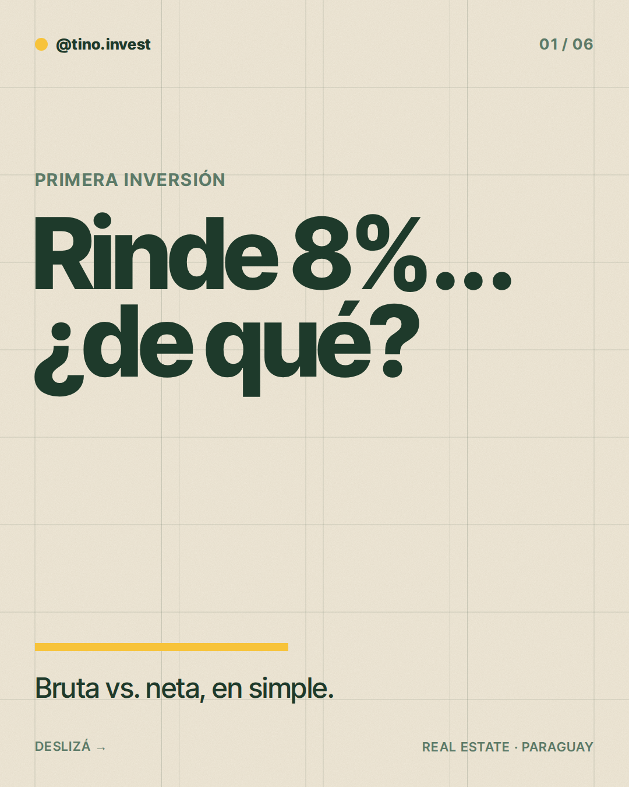
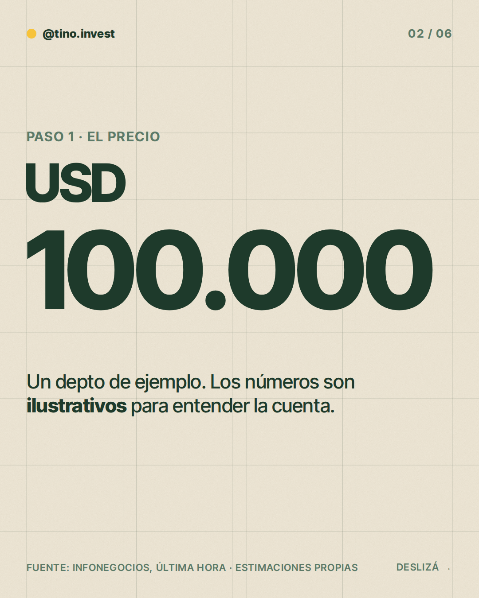
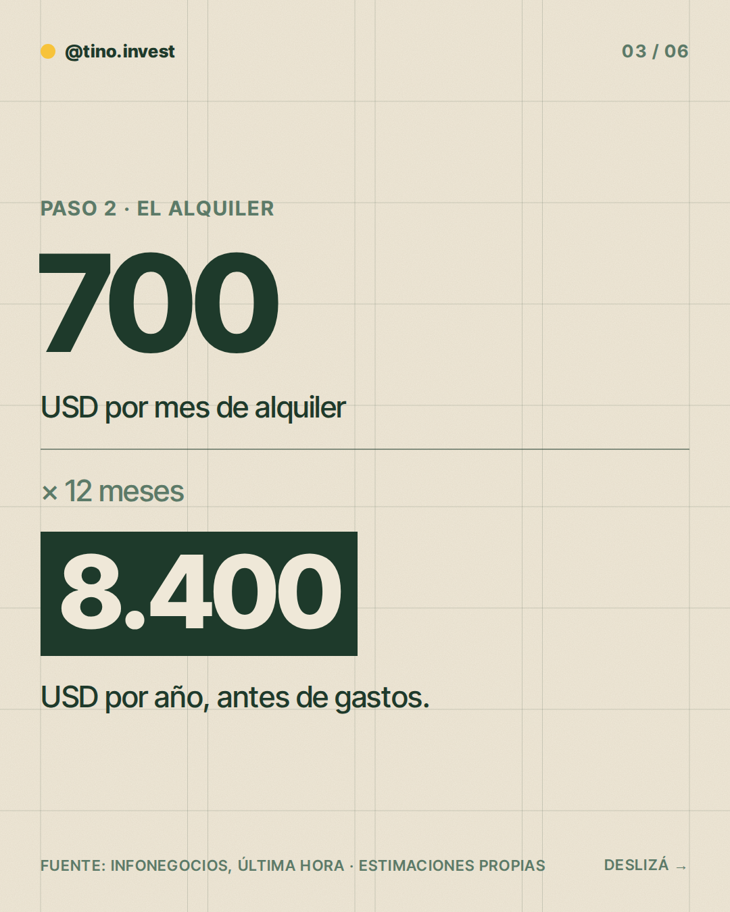
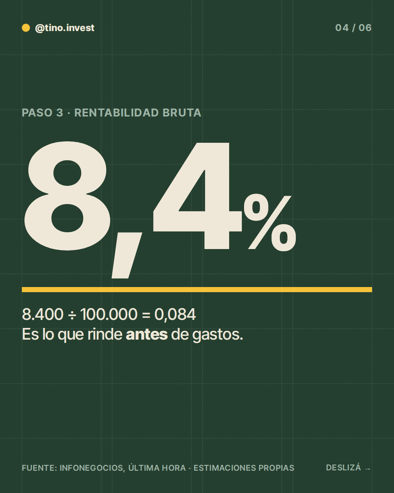
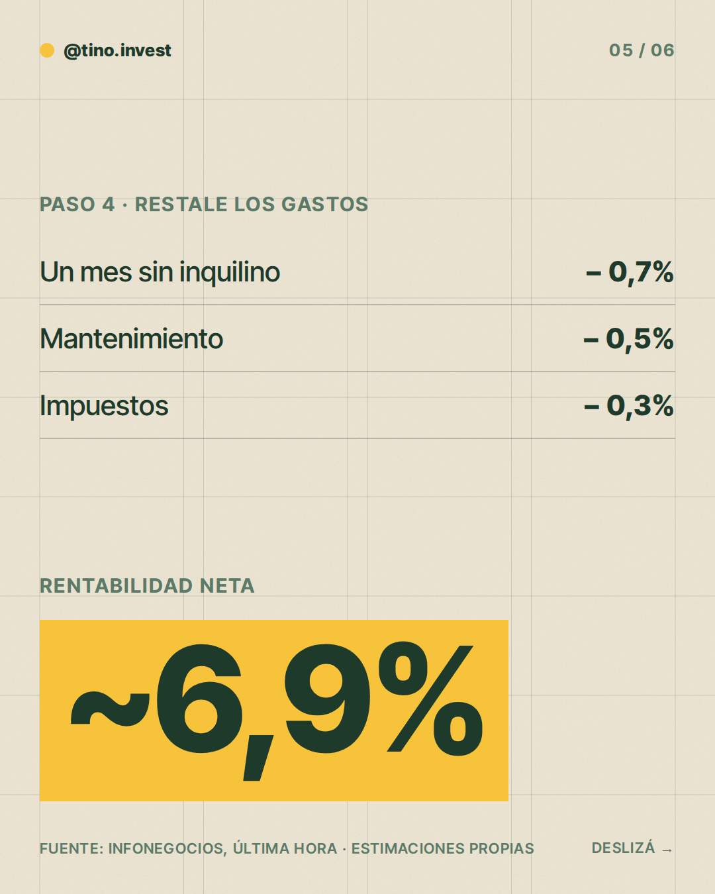
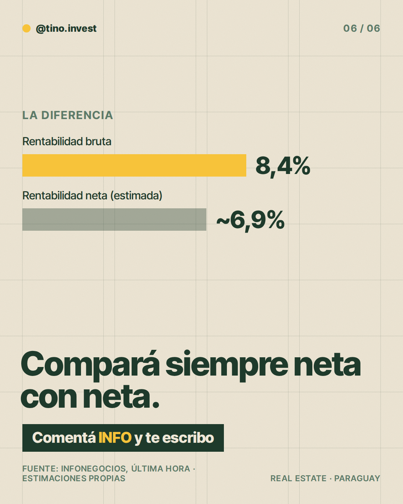

**Pilar:** Primera inversión · **Tema:** Rentabilidad bruta vs. neta

### Texto (394/500 caracteres)

> Te dicen "rinde 8%". ¿8% de qué?
>
> Hay dos números y no son lo mismo 👇
>
> Bruta: el alquiler del año ÷ el precio. En un depto de ~USD 100.000 que alquilás a ~USD 700/mes: 8,4%.
>
> Neta: lo que queda después de mes vacío, mantenimiento e impuestos: ~6,9%.
>
> Compará siempre neta con neta.
>
> En los slides está la cuenta completa.
>
> Si estás pensando en tu primera inversión, comentá INFO y lo charlamos.

### Slides

### ¿Qué hago?

- Para publicarlo, comentá `/publicar` en este issue.
- Para descartarlo, cerrá el issue.
- Para cambiar algo, editá `posts/2026-11-10/post.json` y después comentá `/publicar`: los slides se vuelven a armar desde ese archivo antes de publicar.

Investigación y fuentes

# Investigación 2026-11-10 · Primera inversión

**Tema:** Rentabilidad bruta vs. neta (banco de temas; no publicado en las últimas 6 semanas).

## Datos con fuente
- Rangos de rentabilidad por alquiler citados en prensa paraguaya: ~6% a 8% (Infonegocios, nota sobre invertir por primera vez); estudio que ubica a Asunción entre las 3 ciudades más rentables de Sudamérica con 7%–11% (Infonegocios). Son cifras comerciales de intermediarios, no un índice oficial.
- Alquileres en Asunción 2026: USD 6–10 por m² según Capadei; depto 2 dorm. ~G. 3.500.000–4.500.000 (Última Hora, ago 2026).
- No existe índice oficial anual de rentabilidad por alquiler en Asunción (BCP/INE no lo publican).

## Estimaciones (propias, ilustrativas)
- Propiedad de USD 100.000, alquiler USD 700/mes → 8.400/año → 8,4% bruto.
- Gastos: un mes vacío (−0,7%), mantenimiento (−0,5%), impuestos (−0,3%) → neto ~6,9%.
- Todo el ejemplo es ilustrativo; el enfoque es conceptual.

### Comentaron INFO (últimos 7 días)

Nadie por ahora.
