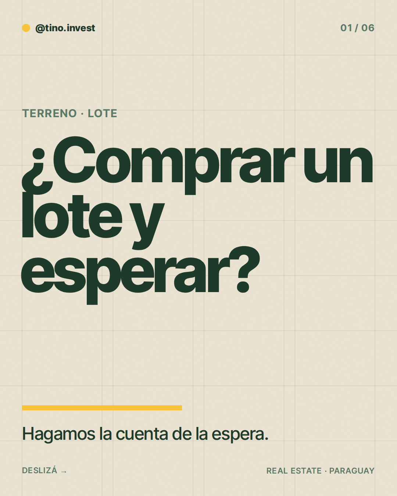
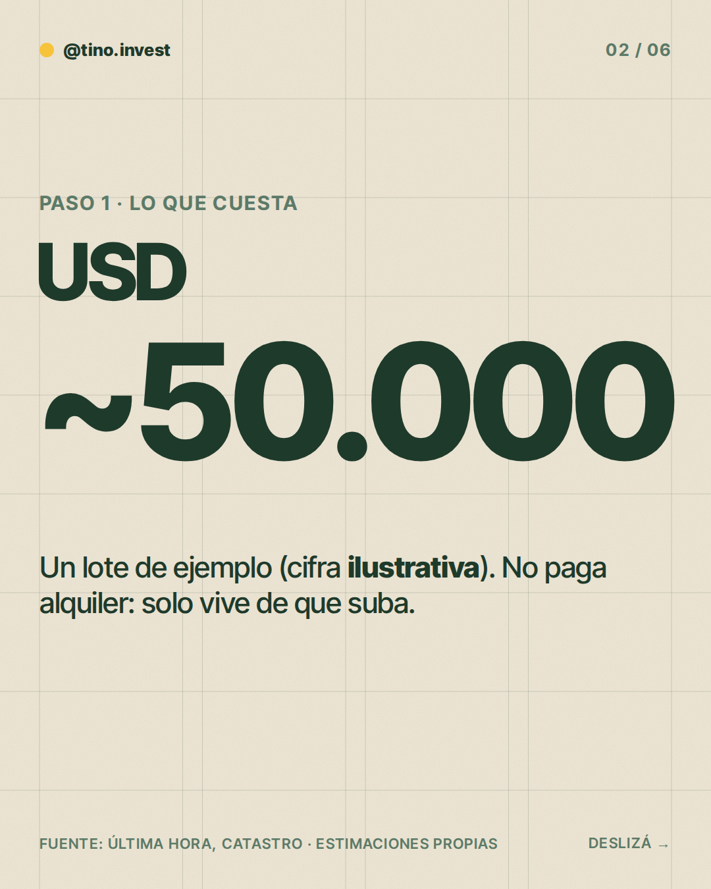
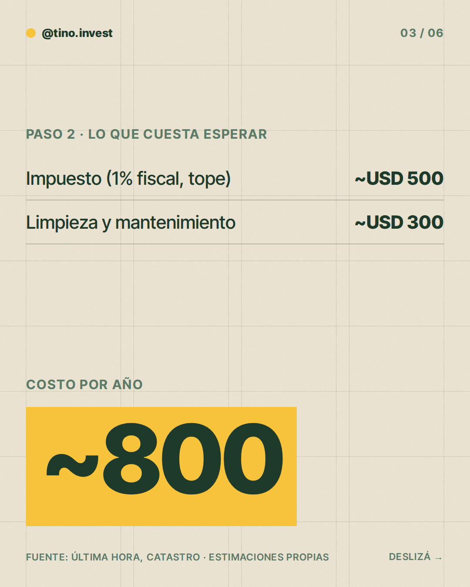
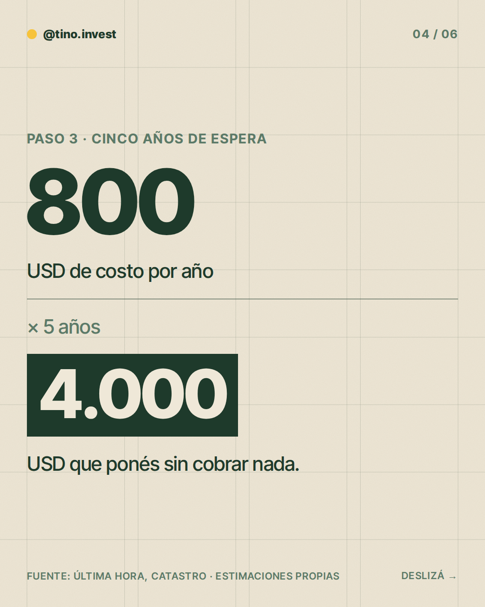
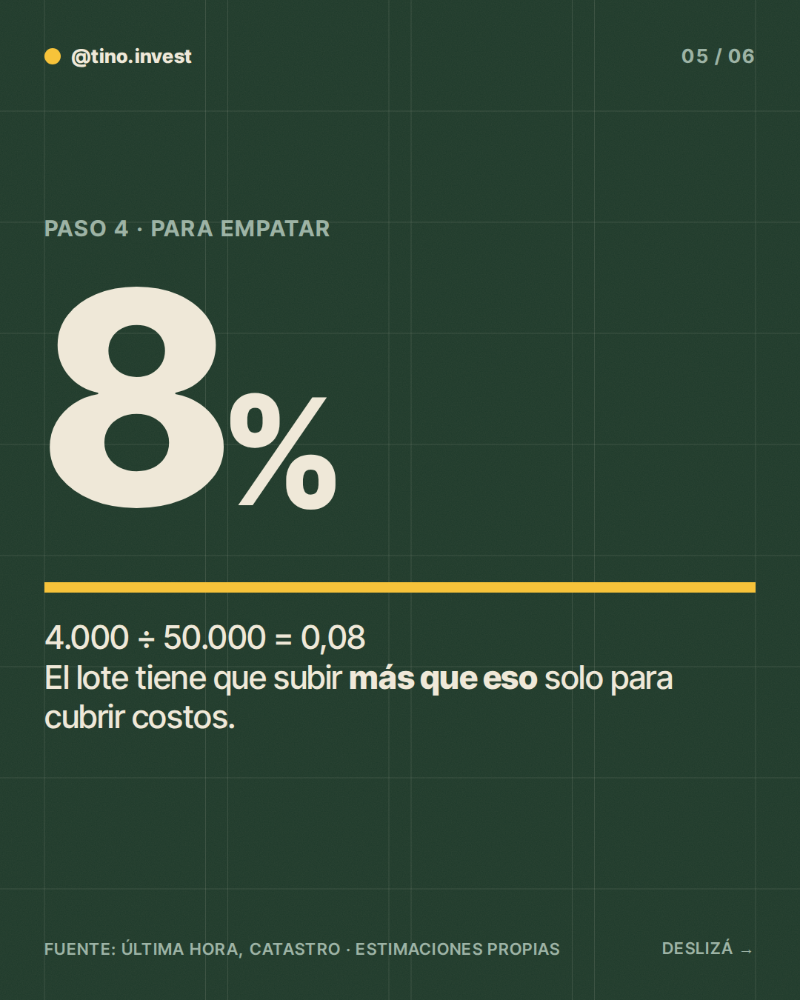
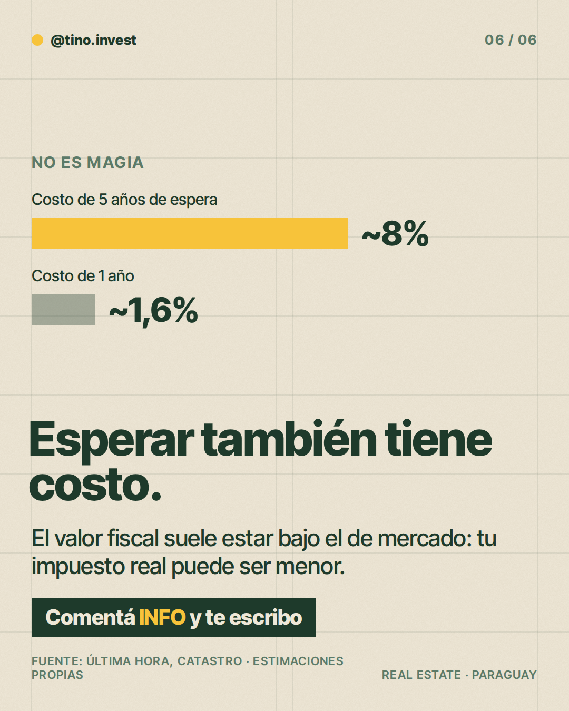

**Pilar:** Hagamos la cuenta · **Tema:** Terreno o lote: compra y espera

### Texto (372/500 caracteres)

> ¿Comprar un lote y esperar a que suba conviene?
>
> Hagamos la cuenta 👇
>
> Un lote de ~USD 50.000 no paga alquiler, pero sí tiene costos:
>
> Impuesto inmobiliario (1% del valor fiscal, hasta ~USD 500) + limpieza y mantenimiento (~USD 300).
>
> Son ~USD 800 al año. En 5 años, ~USD 4.000 → 8%.
>
> O sea: tiene que subir más de 8% solo para empatar.
>
> Comentá INFO y te paso más detalle.

### Slides

### ¿Qué hago?

- Para publicarlo, comentá `/publicar` en este issue.
- Para descartarlo, cerrá el issue.
- Para cambiar algo, editá `posts/2026-11-12/post.json` y después comentá `/publicar`: los slides se vuelven a armar desde ese archivo antes de publicar.

Investigación y fuentes

# Investigación 2026-11-12 · Hagamos la cuenta

**Tema:** Terreno o lote: compra y espera (banco de temas; no publicado en las últimas 6 semanas).

## Datos con fuente
- Impuesto inmobiliario: 1% del valor fiscal, urbano o rural (Última Hora; Ley 125/91).
- El valor fiscal lo fija el Servicio Nacional de Catastro y suele quedar bien por debajo del precio de mercado (Última Hora). Por eso 1% del precio de mercado es un tope.
- Reajuste del valor fiscal 2026: 4,1% (Última Hora, decreto del Ejecutivo). La tasa no cambia.
- La proyección de que terrenos del área metropolitana valdrían 10 veces más en 10 años es opinión de un asesor (Última Hora): NO se usa como dato.

## No se encontró dato confiable
- Precio por m² de lotes en Gran Asunción 2026 y valorización anual medida.

## Estimaciones (marcadas como tal en el post)
- Lote de ejemplo: ~USD 50.000 (ilustrativo).
- Impuesto: hasta ~USD 500/año (tope: 1% del precio; el real es menor).
- Limpieza/cerramiento/mantenimiento: ~USD 300/año (estimación propia).
- Costo de espera: ~USD 800/año → ~1,6%; 5 años ~USD 4.000 → ~8% del precio.
- Enfoque conceptual: cuánto tiene que subir el lote solo para empatar.

### Comentaron INFO (últimos 7 días)

Nadie por ahora.
