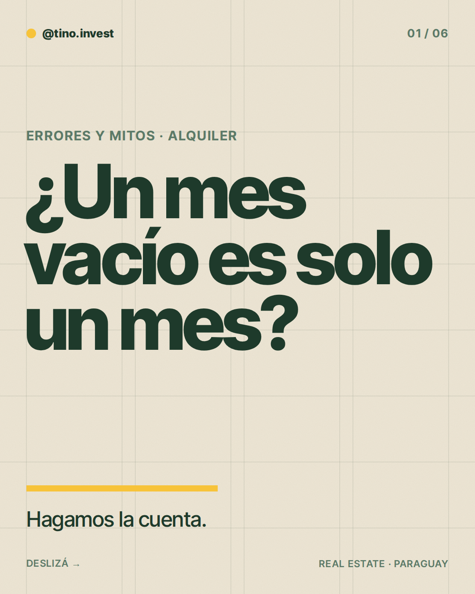
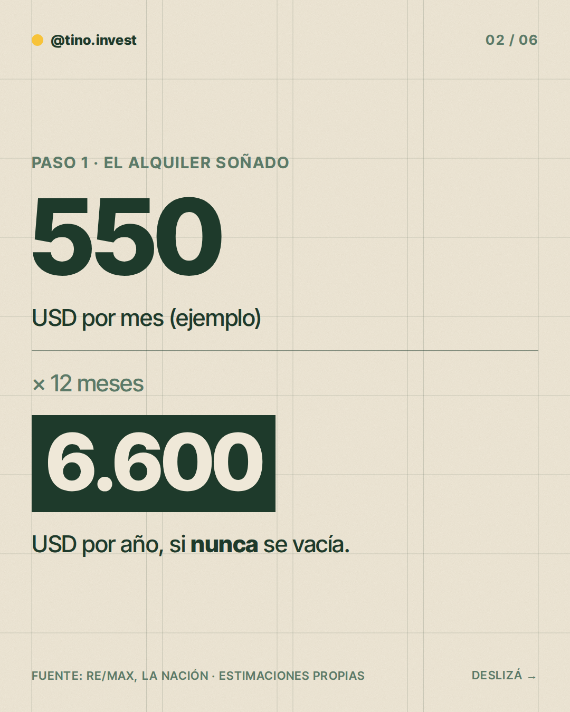
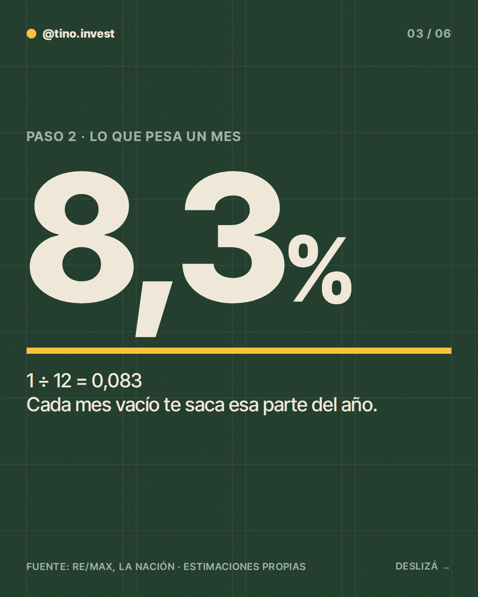
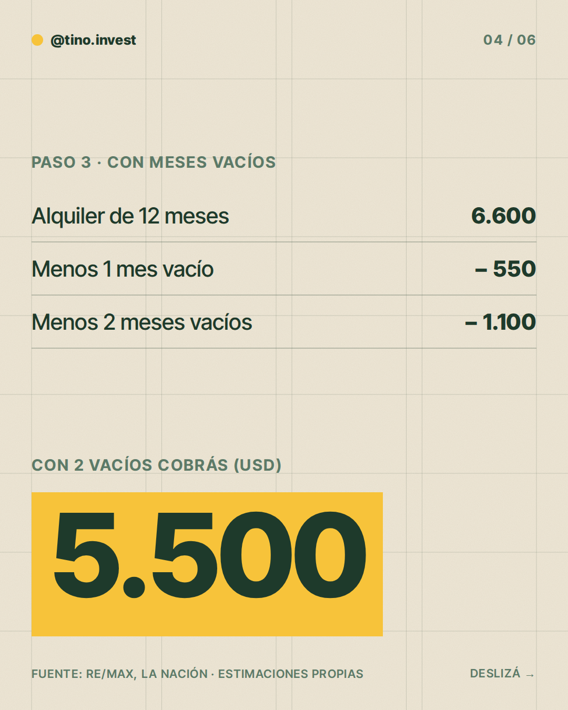
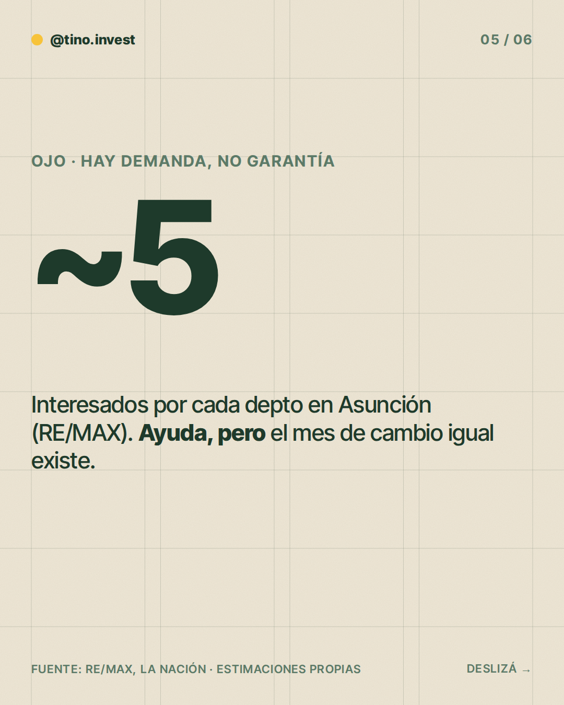
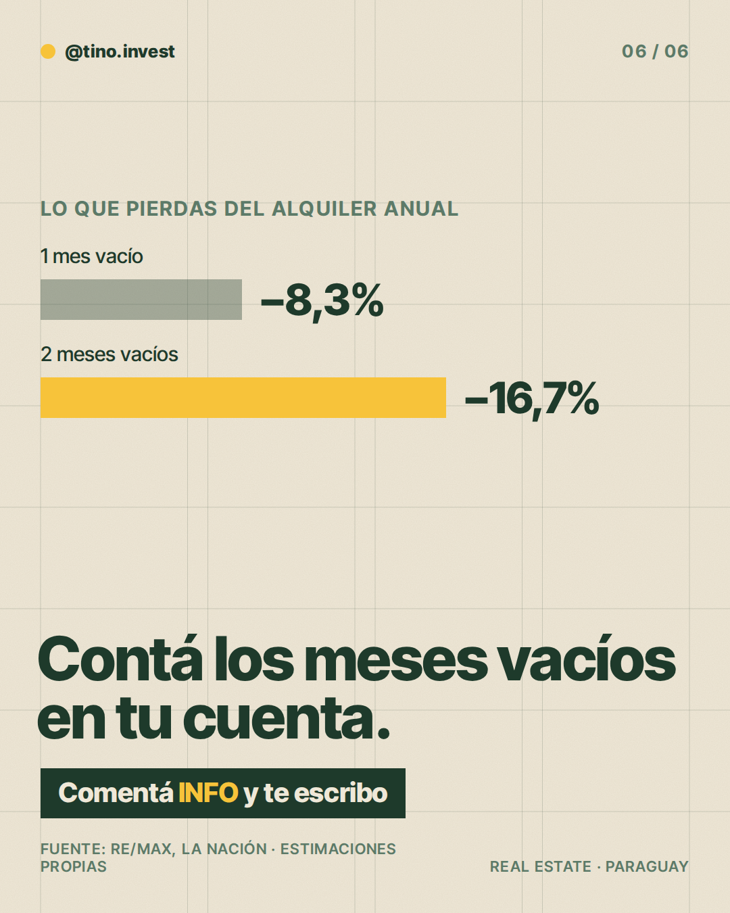

**Pilar:** Errores y mitos · **Tema:** Subestimar los meses sin inquilino

### Texto (376/500 caracteres)

> ¿Un mes sin inquilino es "solo un mes"?
>
> Hagamos la cuenta 👇
>
> Un mes vacío es 1/12 del año: te saca 8,3% del alquiler anual.
>
> Con un alquiler de ~USD 550/mes:
> · 1 mes vacío = ~USD 550 menos
> · 2 meses vacíos = ~USD 1.100 menos
>
> Hay demanda, pero contá con algún mes sin cobrar.
>
> En los slides va el detalle.
>
> ¿Querés ver cómo da la cuenta en tu caso? Comentá INFO y te escribo.

### Slides

### ¿Qué hago?

- Para publicarlo, comentá `/publicar` en este issue.
- Para descartarlo, cerrá el issue.
- Para cambiar algo, editá `posts/2026-11-13/post.json` y después comentá `/publicar`: los slides se vuelven a armar desde ese archivo antes de publicar.

Investigación y fuentes

# Investigación 2026-11-13 · Errores y mitos

**Tema elegido:** Subestimar los meses sin inquilino (banco de temas, pilar Errores y mitos). No repetido en las últimas 6 semanas.

## Datos clave
- Demanda de alquiler alta: por cada departamento en Asunción hay ~5 personas que buscan alquilar (RE/MAX, vía Infonegocios; fecha exacta no verificada).
- Los barrios premium tienen demanda constante y menor riesgo de vacancia (La Nación, 13/04/2026).
- Un monoambiente ronda G. 2.000.000 de alquiler mensual (Última Hora, ago 2026).
- Ninguna fuente publica meses de vacancia residencial promedio en Asunción.

## Estimaciones / conceptuales
- Alquiler de ~USD 550/mes: cifra ilustrativa (la del ejemplo de la guía), estimación propia.
- 1 mes vacío = 1/12 del año = 8,3%; 2 meses = 16,7%: aritmética pura, no depende de datos de mercado.
- No se encontró dato confiable de meses vacíos promedio; el post usa 1 y 2 meses como escenarios, no como promedio.

### Comentaron INFO (últimos 7 días)

Nadie por ahora.
