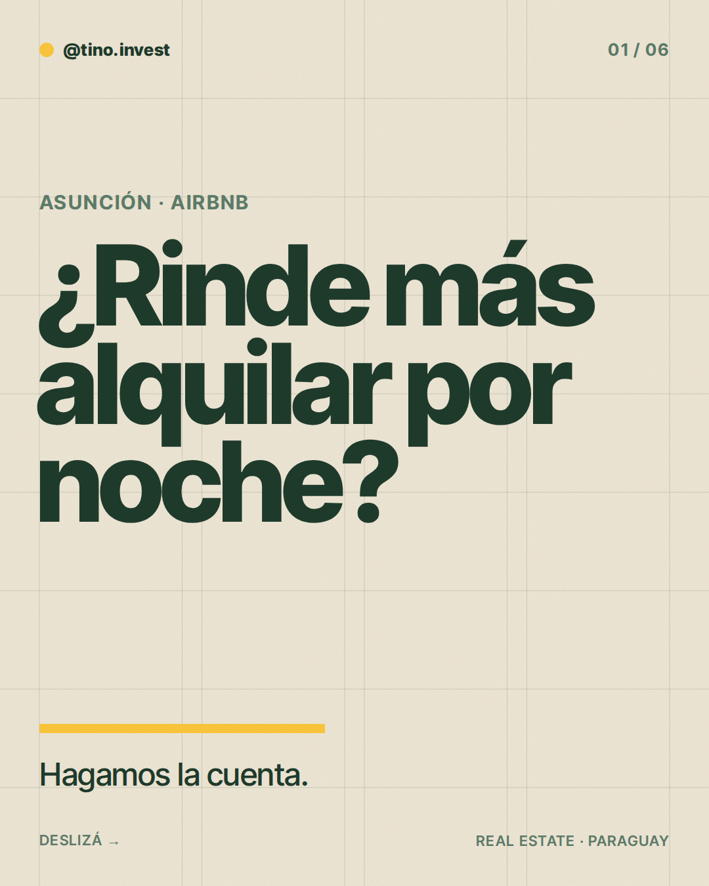
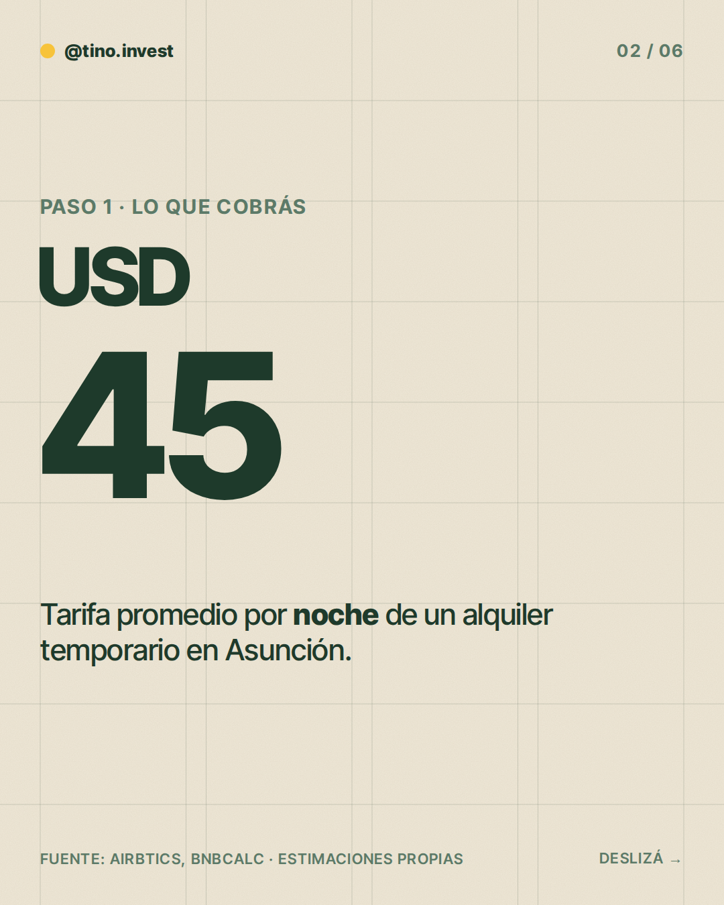
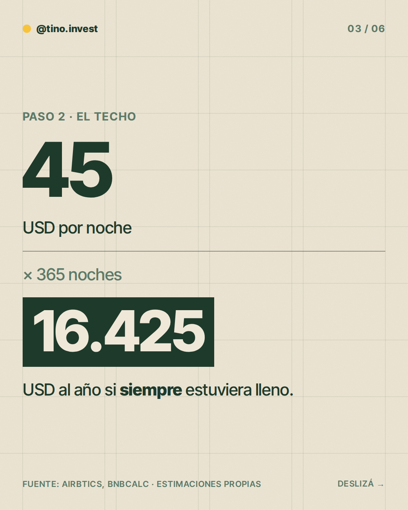
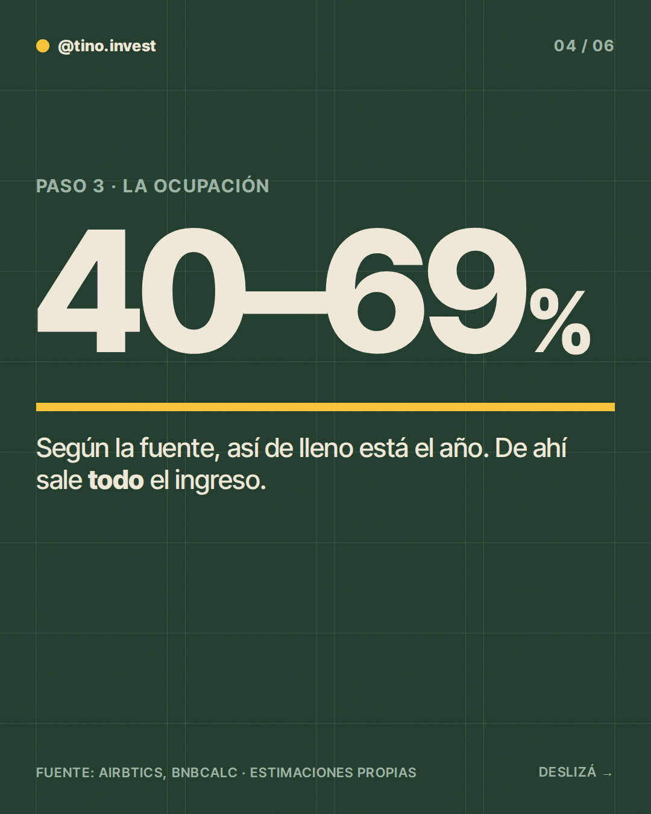
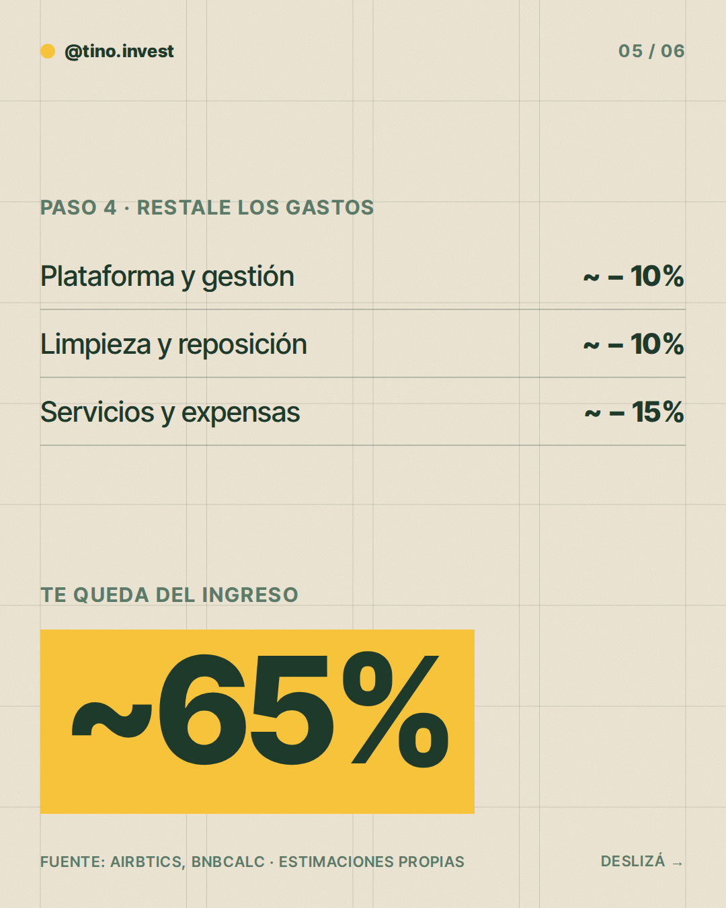
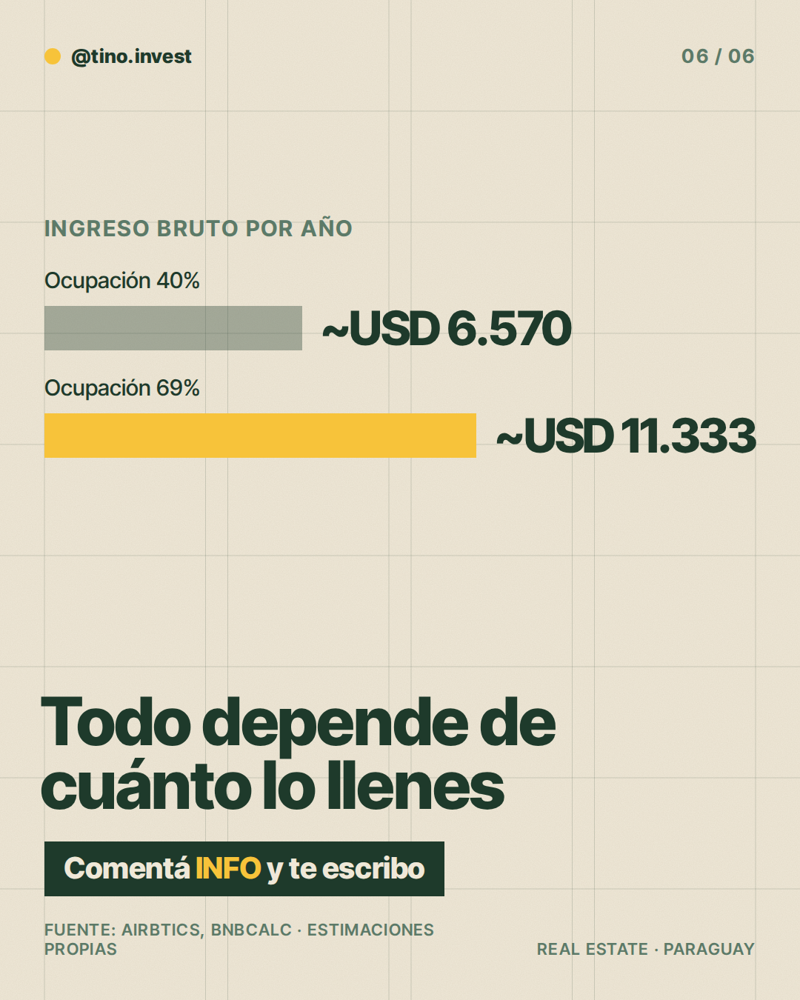

**Pilar:** Hagamos la cuenta · **Tema:** Unidad en Airbnb: ocupación y gastos

### Texto (430/500 caracteres)

> ¿Alquilar por noche en Asunción rinde más?
>
> Hagamos la cuenta 👇
>
> Una noche sale ~USD 45.
> Si estuviera lleno todo el año: ~USD 16.425.
>
> Pero la ocupación real va de 40% a 69% según la fuente: entre ~USD 6.570 y ~USD 11.333 al año.
>
> Y a eso restale limpieza, servicios y comisiones: te queda ~65%.
>
> Todo depende de cuánto lo llenes. Los slides tienen el detalle.
>
> ¿Querés ver cómo da la cuenta en tu caso? Comentá INFO y te escribo.

### Slides

### ¿Qué hago?

- Para publicarlo, comentá `/publicar` en este issue.
- Para descartarlo, cerrá el issue.
- Para cambiar algo, editá `posts/2026-11-14/post.json` y después comentá `/publicar`: los slides se vuelven a armar desde ese archivo antes de publicar.

Investigación y fuentes

# Investigación 2026-11-14 · Hagamos la cuenta

**Tema elegido:** Unidad en Airbnb: ocupación y gastos (del banco de temas; no publicado en las últimas 6 semanas).

## Datos clave
- **Airbtics** (datos hasta oct. 2025): Asunción, ocupación mediana 69%, tarifa diaria promedio (ADR) ~USD 47, ~252 noches reservadas/año, ingreso anual del anfitrión ~USD 11.000.
  https://airbtics.com/annual-airbnb-revenue-in-asuncion-paraguay-es
- **BnBCalc** (datos a mayo 2026): 1.635 anuncios activos en Asunción (+21% interanual), ocupación promedio 40%, tarifa ~Gs. 350.000/noche (~USD 45), ingreso anual promedio ~Gs. 50 millones.
  https://www.bnbcalc.com/es/markets/py/asuncion
- Las dos fuentes son agregadores privados (no oficiales) y no coinciden en ocupación: **rango 40%–69%**. Coinciden en tarifa ~USD 45–47.

## Cuenta
- USD 45 × 365 noches = USD 16.425 (techo, 100% ocupado).
- 40% → ~USD 6.570/año; 69% → ~USD 11.333/año (consistente con ~USD 11 mil de Airbtics).

## Estimaciones (no son datos de fuente)
- Tarifa "USD 45": redondeo entre USD 45 (BnBCalc) y 47 (Airbtics).
- Gastos: plataforma/gestión ~10%, limpieza y reposición ~10%, servicios y expensas ~15% del ingreso → queda ~65%. **Estimación propia**, sin fuente paraguaya; no se verificó la normativa municipal.
- No se comparó con alquiler tradicional por falta de dato confiable.

### Comentaron INFO (últimos 7 días)

Nadie por ahora.
