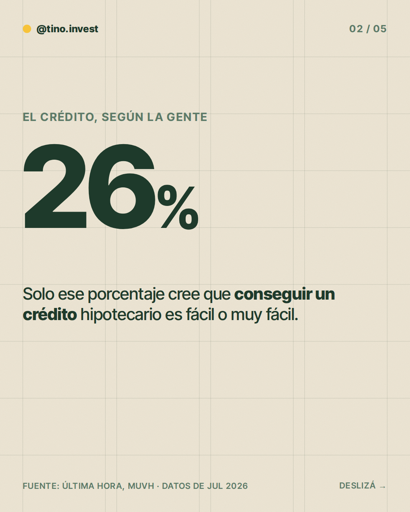
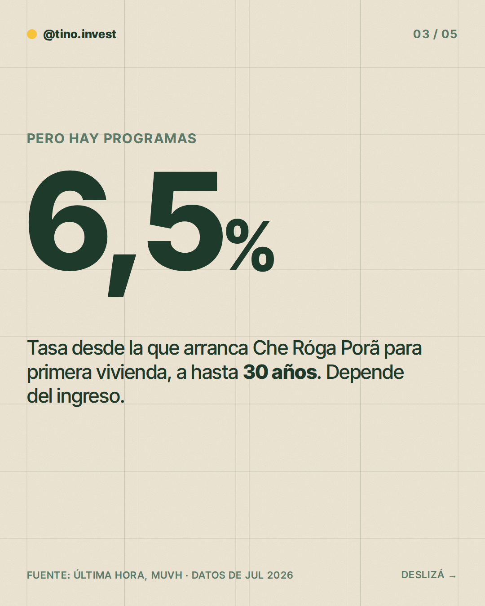
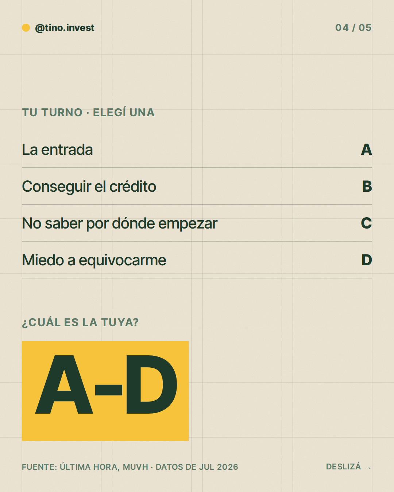

**Pilar:** Pregunta abierta · **Tema:** ¿Qué te frena para dar el primer paso?

### Texto (401/500 caracteres)

> Pregunta para charlar 👇
>
> Una encuesta reciente dice que solo ~26% cree que conseguir un crédito hipotecario en Paraguay es fácil.
>
> Y existen programas para primera vivienda, con tasas desde 6,5% y hasta 30 años de plazo.
>
> ¿Qué es lo que más te frena para invertir?
> A) La entrada
> B) El crédito
> C) No saber por dónde empezar
> D) Miedo a equivocarme
>
> Contame en los comentarios. Comentá INFO y te escribo.

### Slides

### ¿Qué hago?

- Para publicarlo, comentá `/publicar` en este issue.
- Para descartarlo, cerrá el issue.
- Para cambiar algo, editá `posts/2026-11-15/post.json` y después comentá `/publicar`: los slides se vuelven a armar desde ese archivo antes de publicar.

Investigación y fuentes

# Investigación 2026-11-15 · Pregunta abierta

**Tema:** ¿Qué te frena para dar el primer paso? (financiación / acceso al crédito para la primera vivienda). Enfoque conceptual, para generar charla.

## Datos clave
- Encuesta citada por Última Hora (jul 2026): solo ~26% percibe que conseguir un crédito hipotecario es fácil o muy fácil. (Leído en el resumen del buscador; no se abrió la nota completa.)
- Che Róga Porã 2.0 (MUVH, jul 2026, vía Última Hora / Infonegocios): crédito para primera vivienda con tasa desde 6,5% anual y plazo de hasta 30 años. Varía según tramo de ingreso.

## Estimaciones / dudas
- Las condiciones difieren entre fuentes y tramos (otra fuente menciona 9,9% para otro tramo; AFD 7,50% en nota antigua). No se usan en el post.
- El resto del post es conceptual (opciones A-D), sin cifras propias.

### Comentaron INFO (últimos 7 días)

Nadie por ahora.
