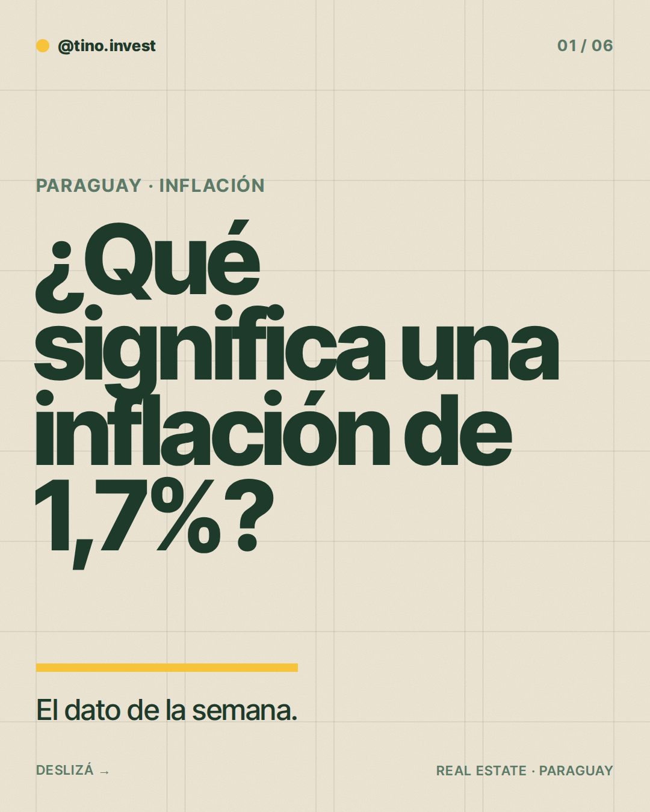
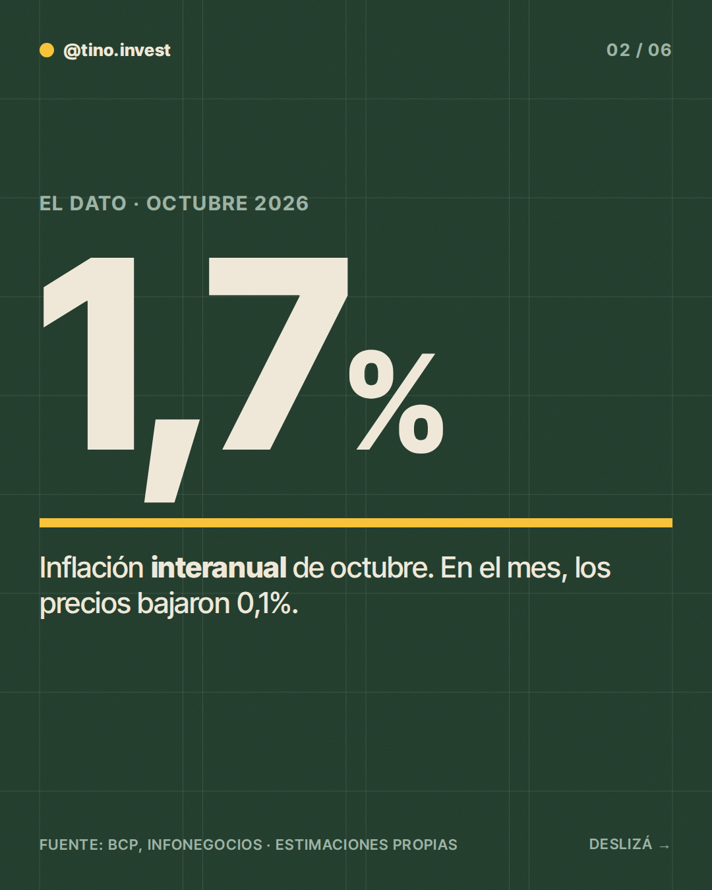
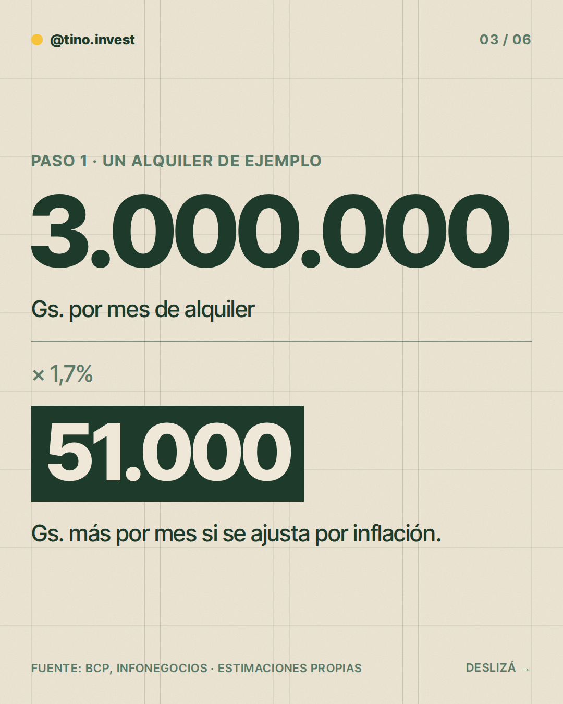
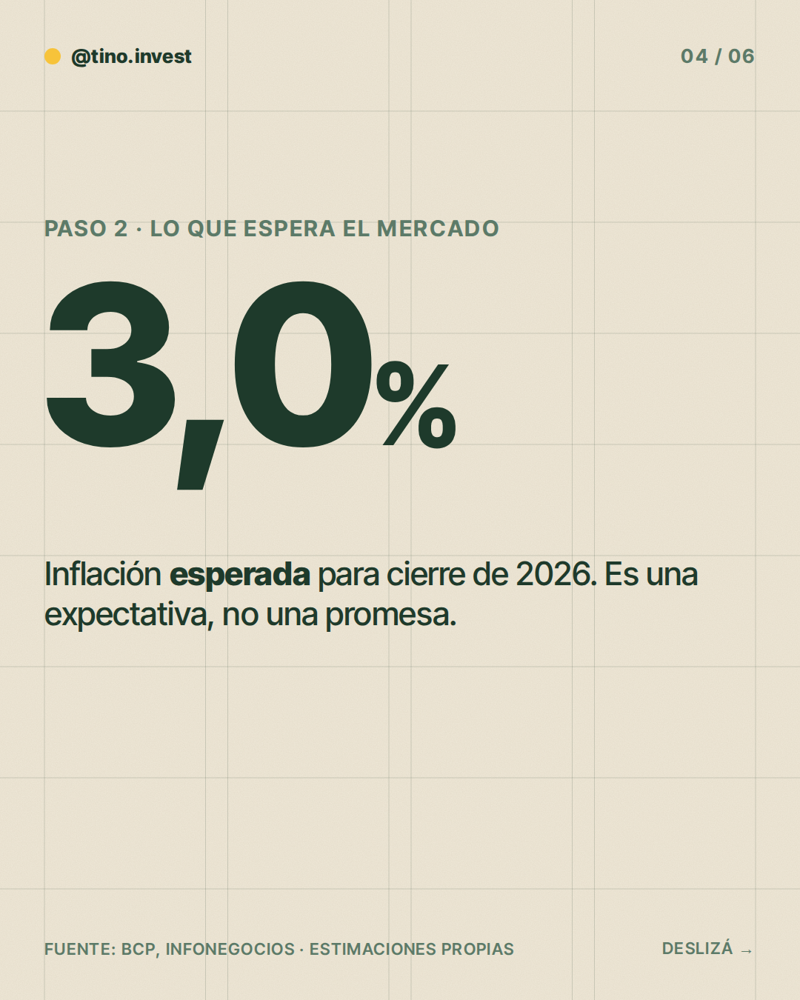
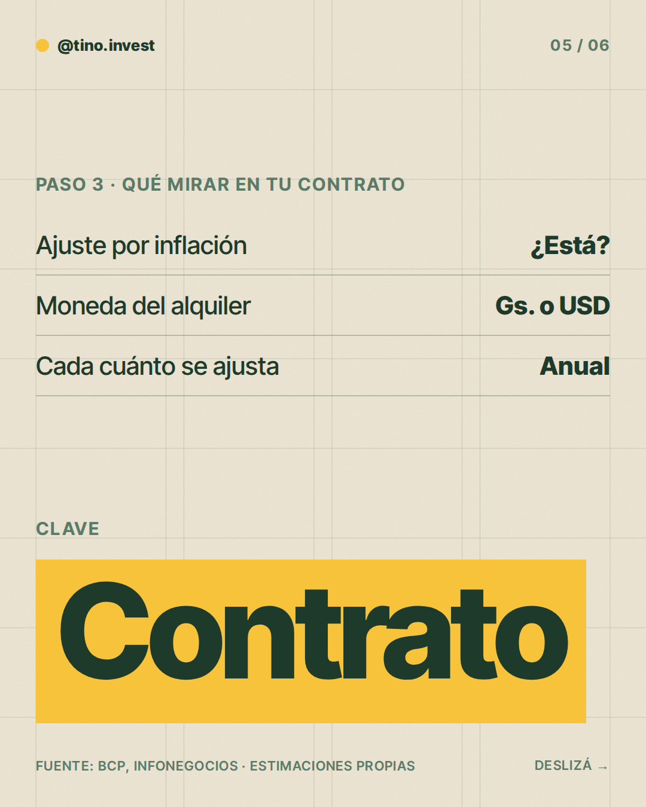
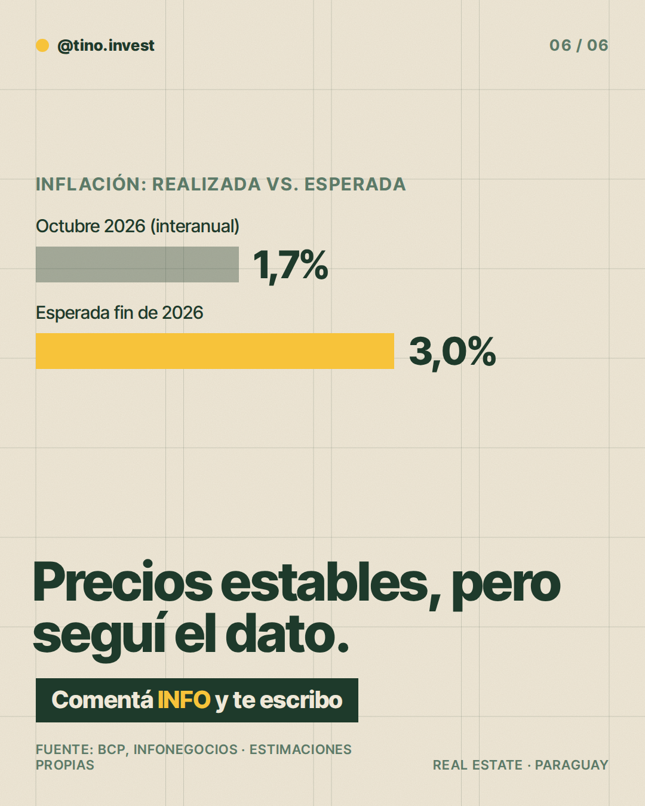

**Pilar:** El dato de la semana · **Tema:** Inflación de 1,7%: qué significa para un alquiler

### Texto (385/500 caracteres)

> ¿Cuánto subió el costo de vida en Paraguay? Un 1,7% en 12 meses (octubre, BCP).
>
> ¿Y eso qué tiene que ver con tu inversión?
>
> Hagamos la cuenta 👇
> Un alquiler de Gs. 3.000.000 ajustado por 1,7% sube ~Gs. 51.000 al mes.
>
> Poco movimiento. Pero el mercado espera ~3% para fin de año.
>
> En los slides te muestro la cuenta.
>
> ¿Querés ver cómo da la cuenta en tu caso? Comentá INFO y te escribo.

### Slides

### ¿Qué hago?

- Para publicarlo, comentá `/publicar` en este issue.
- Para descartarlo, cerrá el issue.
- Para cambiar algo, editá `posts/2026-11-16/post.json` y después comentá `/publicar`: los slides se vuelven a armar desde ese archivo antes de publicar.

Investigación y fuentes

# Investigación 2026-11-16 · El dato de la semana

**Tema:** Inflación de 1,7% interanual (octubre 2026): qué significa para un alquiler. Ángulo: cuánto "sube" un alquiler si se ajusta por inflación (el 07/11 se publicó la comparación regional; acá el foco es el efecto concreto en el bolsillo del propietario).

## Datos clave
- Inflación interanual octubre 2026: **1,7%**. Mensual: -0,1%. Acumulada en 10 meses: 1,8%. Fuente: informe del BCP publicado por InfoNegocios (5/11/2026).
- Expectativa de mercado de inflación para cierre 2026: **3,0%**; 2027 y horizontes de política: 3,5%. Fuente: Encuesta EVE del BCP, cerrada 9/10/2026, publicada 20/10/2026 (InfoNegocios). Son expectativas, no proyección oficial.
- Expectativa de dólar fin de 2026: Gs. 5.905 (EVE octubre). No se usa en el post (tema cubierto el 09/11).

## Estimaciones (propias, ilustrativas)
- Alquiler de ejemplo Gs. 3.000.000/mes; ajuste de 1,7% = +Gs. 51.000/mes (3.000.000 × 0,017). El monto del alquiler es hipotético.
- Se asume que el contrato se ajusta por inflación; no todos lo hacen.

### Comentaron INFO (últimos 7 días)

Nadie por ahora.
