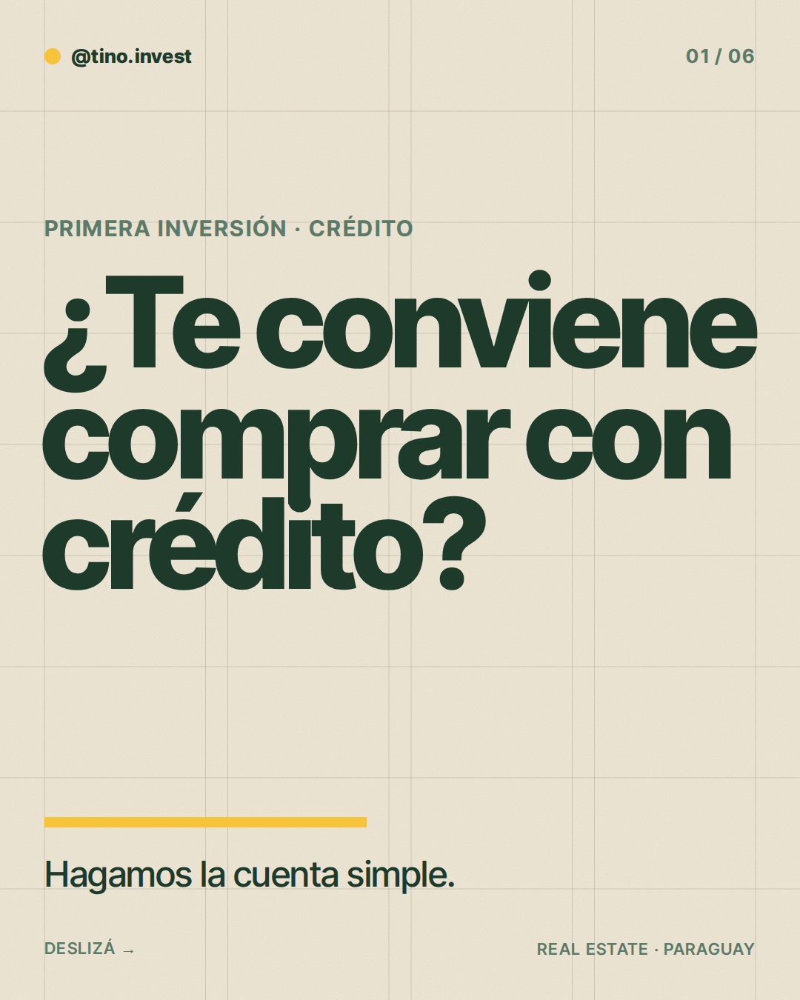
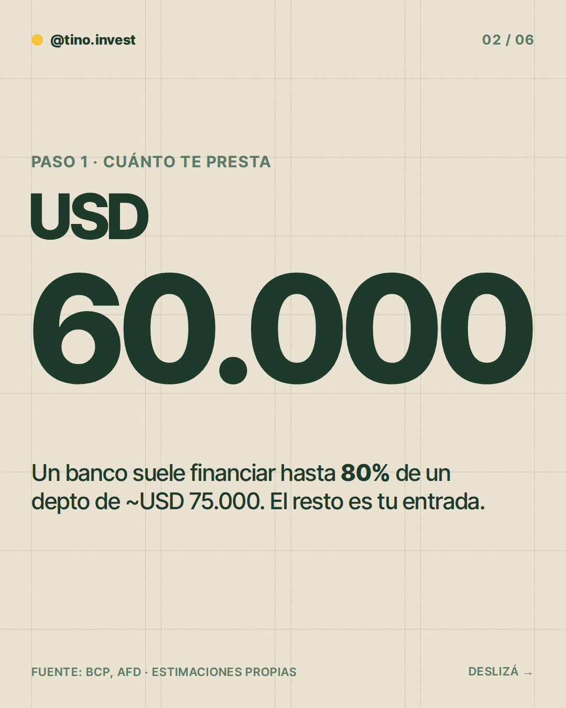
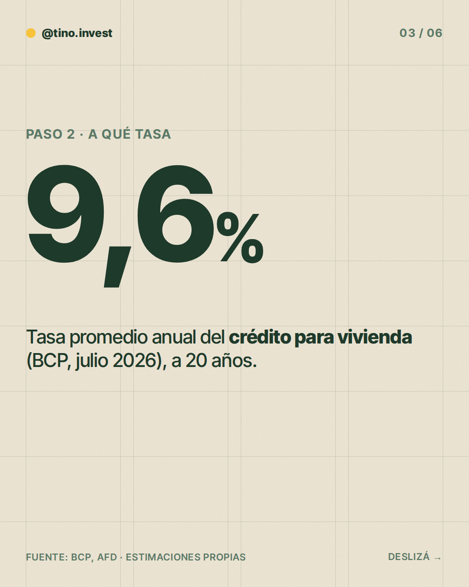
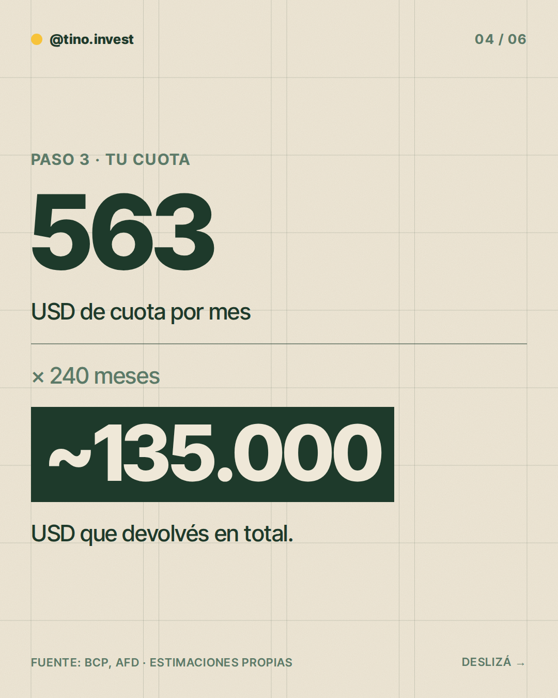
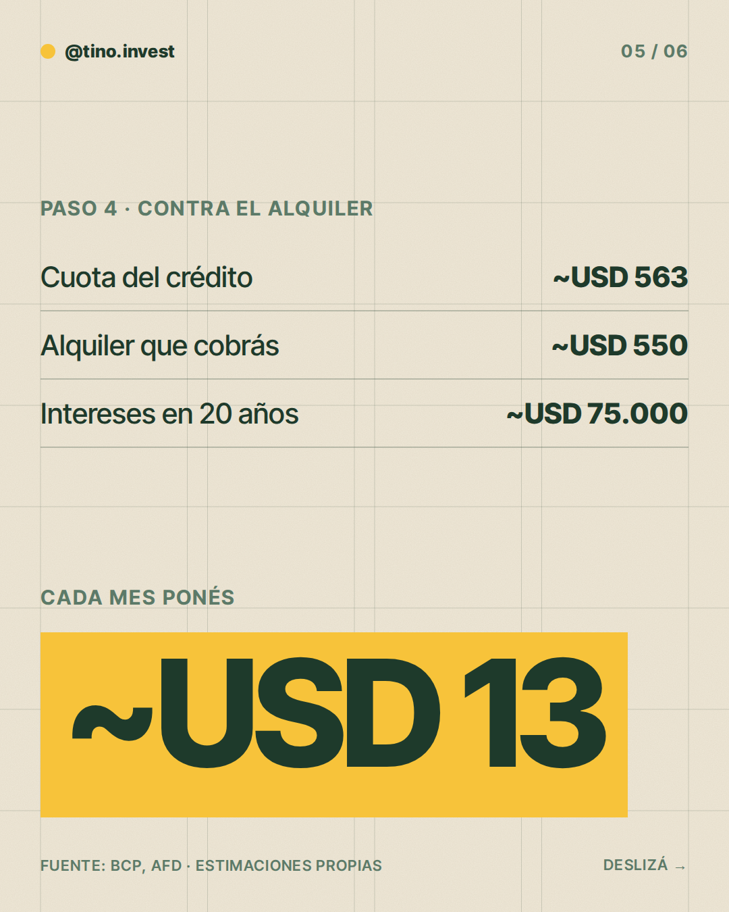
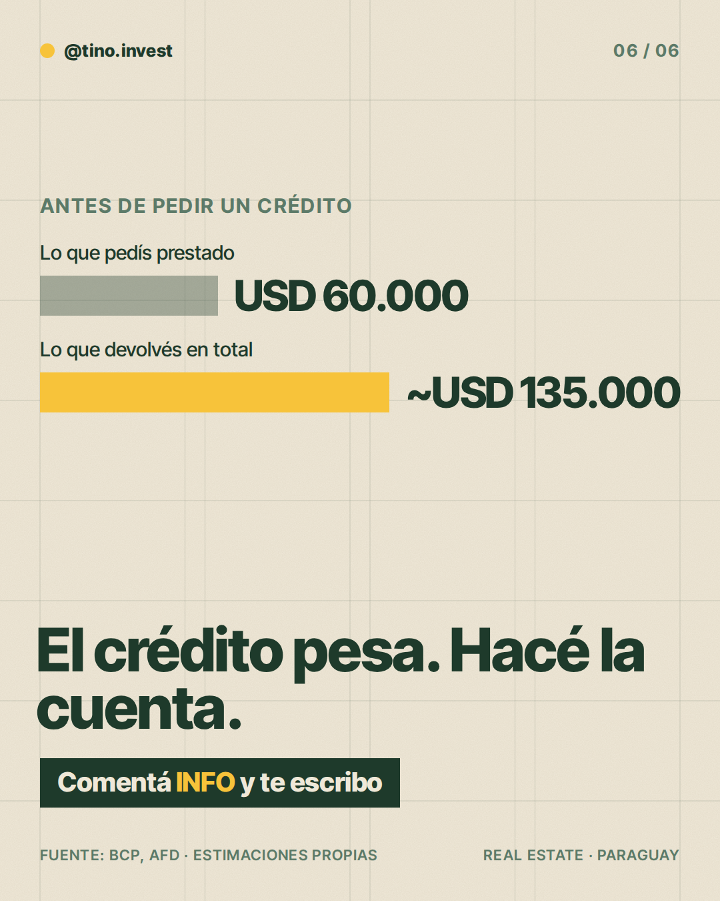

**Pilar:** Primera inversión · **Tema:** Financiación: cómo funciona un crédito hipotecario

### Texto (450/500 caracteres)

> ¿Comprar con crédito hipotecario cierra la cuenta?
>
> Hagamos la cuenta simple 👇
>
> Depto de ~USD 75.000. El banco suele financiar hasta 80%: ~USD 60.000, a 20 años y ~9,6% anual.
>
> La cuota da ~USD 563/mes. Un alquiler de ~USD 550 casi ni la cubre.
>
> En 20 años pagás ~USD 135.000: ~USD 75.000 son intereses.
>
> No es malo, pero hay que hacer la cuenta.
>
> En los slides ves el detalle.
>
> Si estás pensando en tu primera inversión, comentá INFO y lo charlamos.

### Slides

### ¿Qué hago?

- Para publicarlo, comentá `/publicar` en este issue.
- Para descartarlo, cerrá el issue.
- Para cambiar algo, editá `posts/2026-11-17/post.json` y después comentá `/publicar`: los slides se vuelven a armar desde ese archivo antes de publicar.

Investigación y fuentes

# Investigación 2026-11-17 · Primera inversión

**Tema elegido:** Financiación: cómo funciona un crédito hipotecario (banco de temas, no publicado en las últimas 6 semanas).

## Datos clave
- Tasa promedio del crédito para vivienda en guaraníes: ~9,6% anual (BCP, datos de julio 2026; reportado por Última Hora, 12 sept 2026).
- Condiciones de un banco con fondos AFD: financia hasta 80% de la vivienda, plazo máx. 240 meses / 20 años (BBVA Paraguay, página institucional, sin fecha clara).
- AFD: banca de segundo piso (da fondos y garantías a bancos y cooperativas); plazos hasta 20 años con garantía hipotecaria y hasta 30 con fiduciaria (Infonegocios).
- Tasa activa promedio en dólares: 7,90% (BCP, septiembre 2026; Infonegocios). Es tasa general, no hipotecaria.
- Che Róga Porã / AFD tienen tasas subsidiadas para primera vivienda propia según ingresos (MUVH, Última Hora jul 2026); no se usan en la cuenta porque no es inversión.

## Estimaciones (no son datos de fuente)
- Precio del depto USD 75.000 y alquiler ~USD 550/mes: ilustrativos (los mismos de la guía de estilo).
- Cuota: cálculo propio con fórmula francesa, USD 60.000 (80%), 9,6% anual, 240 meses = ~USD 563/mes; total ~USD 135.000; intereses ~USD 75.000.
- Simplificación: se aplica la tasa de vivienda en guaraníes (9,6%) a un préstamo en USD; en dólares la tasa real puede variar.
- Las condiciones varían por banco y perfil; no se mencionan entidades puntuales en el post.

### Comentaron INFO (últimos 7 días)

Nadie por ahora.
