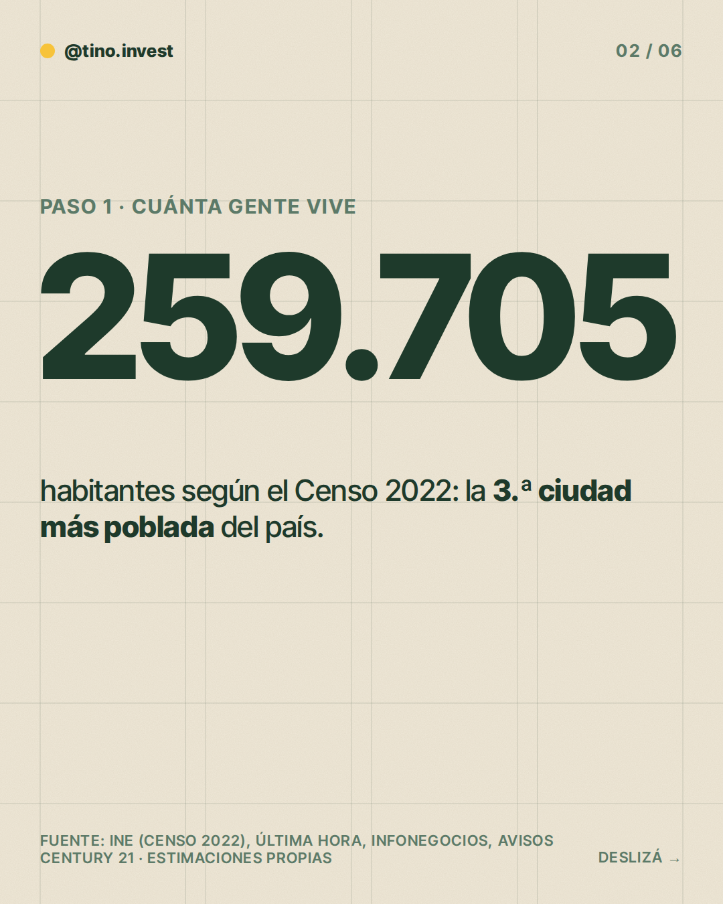
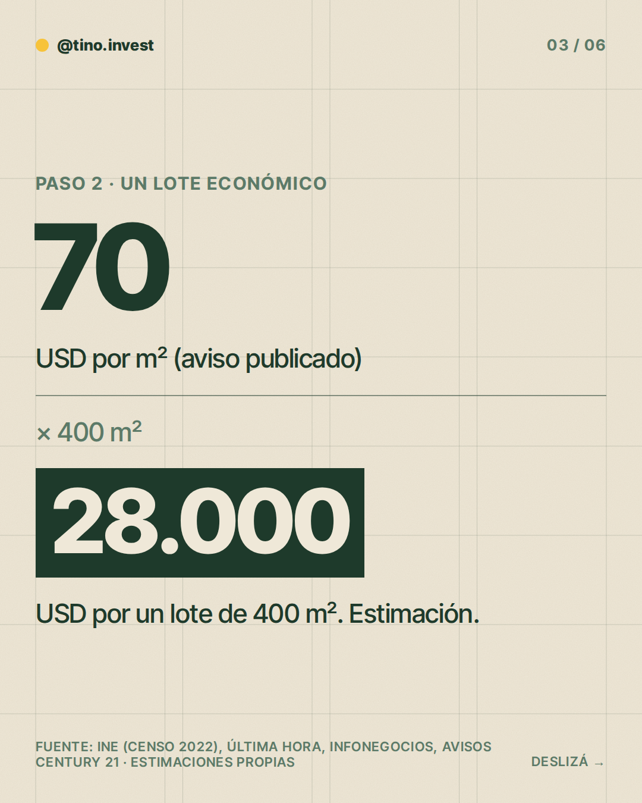
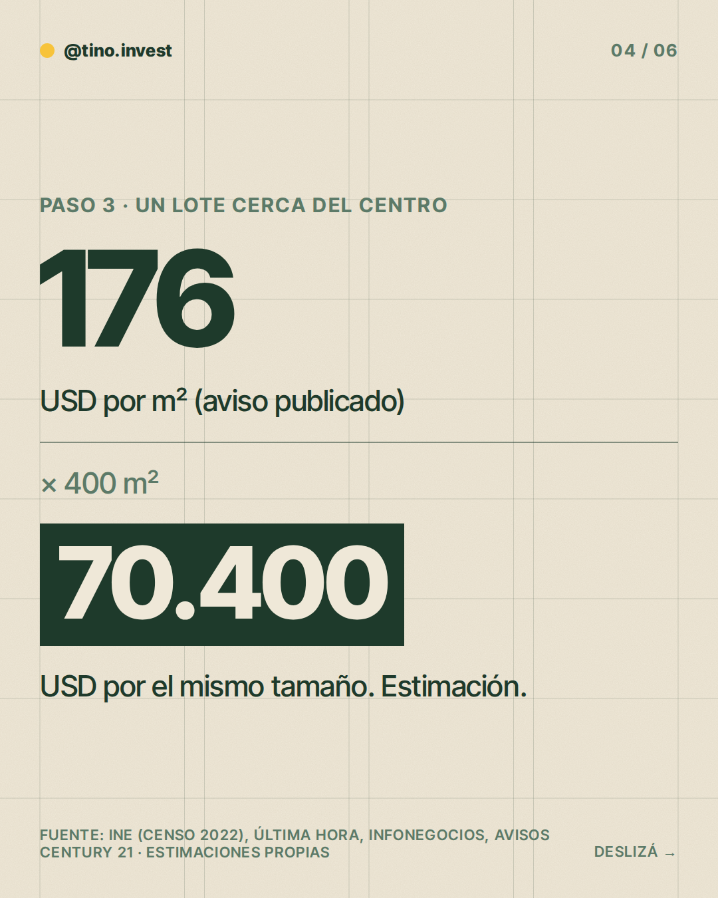
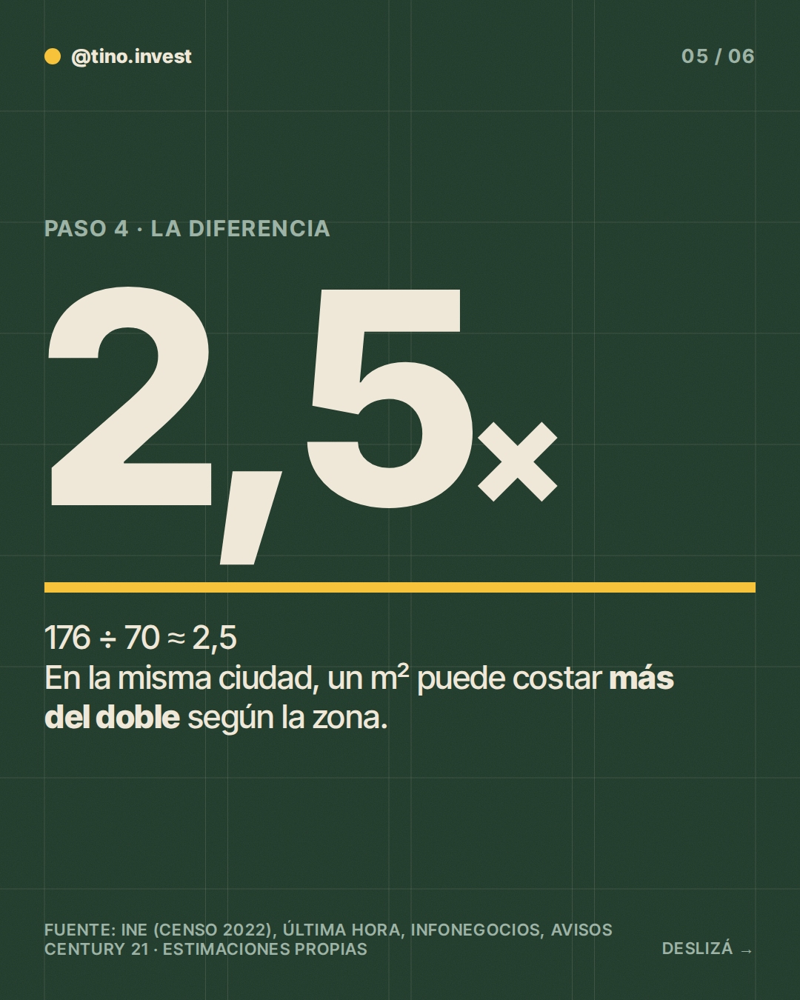
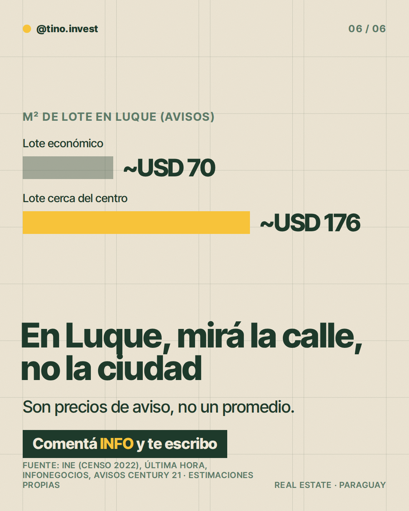

**Pilar:** Barrios y ciudades · **Tema:** Luque: por qué la miran y por qué la zona exacta pesa

### Texto (438/500 caracteres)

> ¿Por qué tanta gente mira Luque?
>
> Tiene ~260.000 habitantes: es la 3.ª ciudad más poblada del país (Censo 2022). Y está cerca del aeropuerto y de grandes avenidas.
>
> Pero ojo 👇
> Según avisos de lotes, el m² va de ~USD 70 a ~USD 176.
>
> En un lote de 400 m², eso es ~USD 28.000 vs. ~USD 70.400.
>
> En Luque no alcanza con elegir la ciudad: importa la calle. Son avisos, no un promedio. Detalle en los slides.
>
> Comentá INFO y te paso más detalle.

### Slides

### ¿Qué hago?

- Para publicarlo, comentá `/publicar` en este issue.
- Para descartarlo, cerrá el issue.
- Para cambiar algo, editá `posts/2026-11-18/post.json` y después comentá `/publicar`: los slides se vuelven a armar desde ese archivo antes de publicar.

Investigación y fuentes

# Investigación 2026-11-18 · Barrios y ciudades

**Tema elegido:** Luque (Gran Asunción): por qué la miran los inversores y por qué la zona exacta pesa tanto.
Del banco: "Gran Asunción: Luque, San Lorenzo, Lambaré, Fernando de la Mora". No repite el 11-11 (Asunción vs. Gran Asunción) ni el 11-04 (peso del barrio) porque se centra en una sola ciudad.

## Datos clave
- Luque tiene 259.705 habitantes, 3.ª ciudad más poblada del país, edad promedio 29 años (INE, Censo 2022, vía Última Hora "Top 10 de las ciudades más pobladas").
- Luque figura entre las zonas más buscadas para comprar propiedades (Última Hora, 2026).
- Cercanía al aeropuerto Silvio Pettirossi y corredores como Aviadores del Chaco y Madame Lynch explican el crecimiento inmobiliario de Luque (Infonegocios).
- Avisos de terrenos en Luque (Century 21, precios publicados, no transacciones): ~USD 70/m² en un aviso y ~USD 176/m² en un lote de 1.113 m² cerca del centro.

## Estimaciones / límites
- Los precios por m² son precios publicados en solo dos avisos: **estimación**, no promedio de mercado.
- Cuenta de ejemplo: lote hipotético de 400 m² × USD 70 = 28.000 y × USD 176 = 70.400 (estimación propia).
- Relación 176 ÷ 70 ≈ 2,5 (cálculo propio).
- No se encontraron datos confiables y actuales de alquiler ni de m² de departamentos para Luque, San Lorenzo, Lambaré ni Fernando de la Mora. Un artículo de terrenos de Última Hora es de 2020 y se descartó.

### Comentaron INFO (últimos 7 días)

Nadie por ahora.
