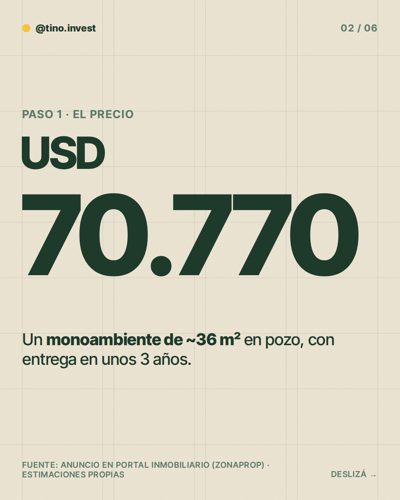
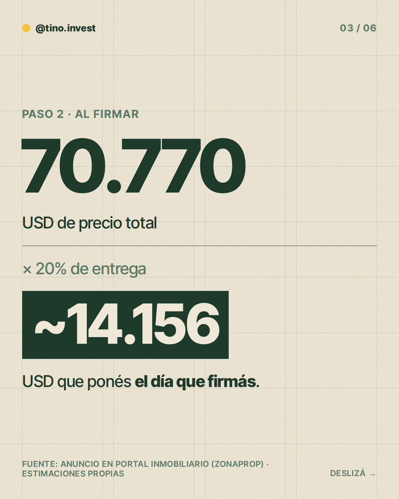
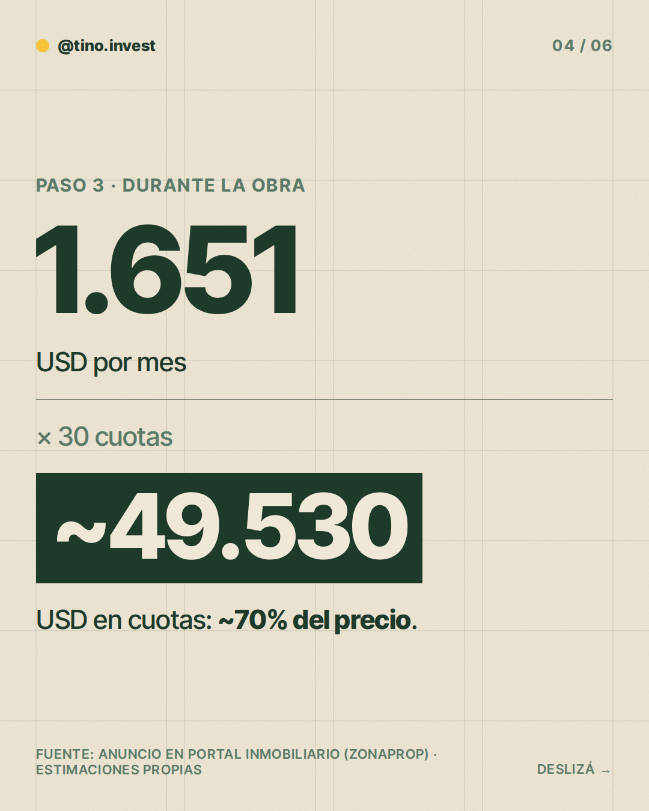
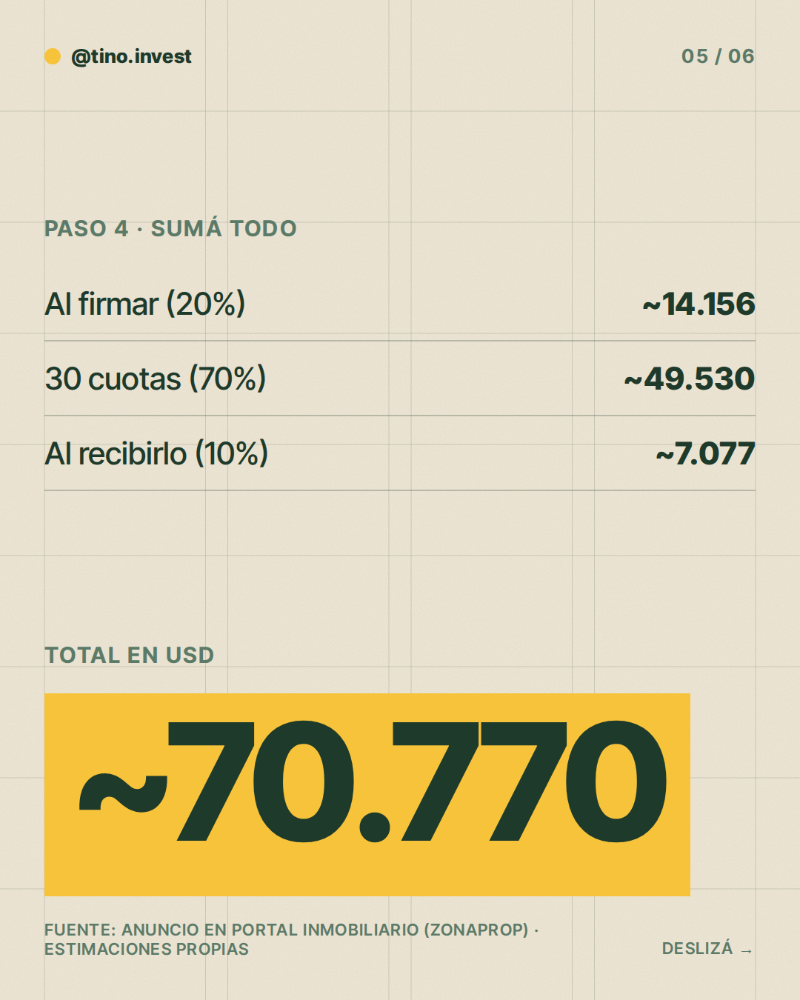
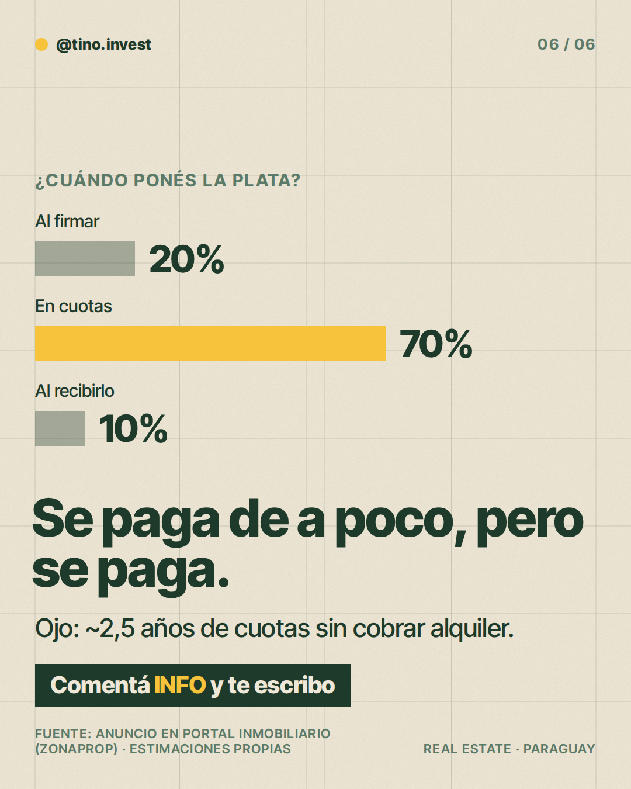

**Pilar:** Hagamos la cuenta · **Tema:** Cuotas en pozo: cuánto pagás hasta la entrega

### Texto (420/500 caracteres)

> ¿Comprar en pozo es pagar "de a poquito"? Hagamos la cuenta 👇
>
> Un monoambiente de ~36 m² cuesta ~USD 70.770:
>
> • Al firmar: ~USD 14.156 (20%)
> • 30 cuotas de ~USD 1.651 = ~USD 49.530 (70%)
> • Al recibirlo: ~USD 7.077 (10%)
>
> Son ~2,5 años de cuotas antes de recibir las llaves y cobrar un alquiler.
>
> No es magia: te financiás, pero te comprometés.
>
> En los slides está la cuenta completa.
>
> Comentá INFO y te paso más detalle.

### Slides

### ¿Qué hago?

- Para publicarlo, comentá `/publicar` en este issue.
- Para descartarlo, cerrá el issue.
- Para cambiar algo, editá `posts/2026-11-19/post.json` y después comentá `/publicar`: los slides se vuelven a armar desde ese archivo antes de publicar.

Investigación y fuentes

# Investigación 2026-11-19: Hagamos la cuenta

**Tema elegido:** Cuotas en pozo: cuánto pagás hasta la entrega (banco de TEMAS.md; no repite "¿Comprarías en pozo o terminado?" del 11-08, que fue pregunta abierta).

## Datos clave
- Caso de un anuncio de portal inmobiliario (Zonaprop, monoambiente en pozo en Asunción, consultado 2026-11-19): 36 m², precio USD 70.770 (~USD 1.966/m², cálculo propio).
  - Entrega inicial al firmar: USD 14.156 (≈20%).
  - 30 cuotas mensuales de USD 1.651 (total USD 49.530, ≈70%).
  - Pago a la posesión: USD 7.077 (≈10%).
  - Suma: 14.156 + 49.530 + 7.077 = 70.763 (diferencia por redondeo).
  - Inicio de obra previsto dic. 2026; posesión 2.º semestre 2029.
- Otros planes vistos en anuncios (Infonegocios / portales): entregas iniciales de 10% a 30% y saldo en cuotas hasta la entrega. El esquema es habitual.

## Estimaciones / advertencias
- Es UN anuncio, no un promedio de mercado: se presenta como ejemplo ("un monoambiente de ~36 m²"), sin nombrar proyecto ni desarrolladora.
- Porcentajes (20/70/10) calculados a partir de los montos publicados.
- Vigencia del precio no verificable: todas las cifras van con "~".
- No se encontró dato confiable de alquiler promedio de monoambiente en USD 2026, por eso el post no calcula rentabilidad.

### Comentaron INFO (últimos 7 días)

Nadie por ahora.
