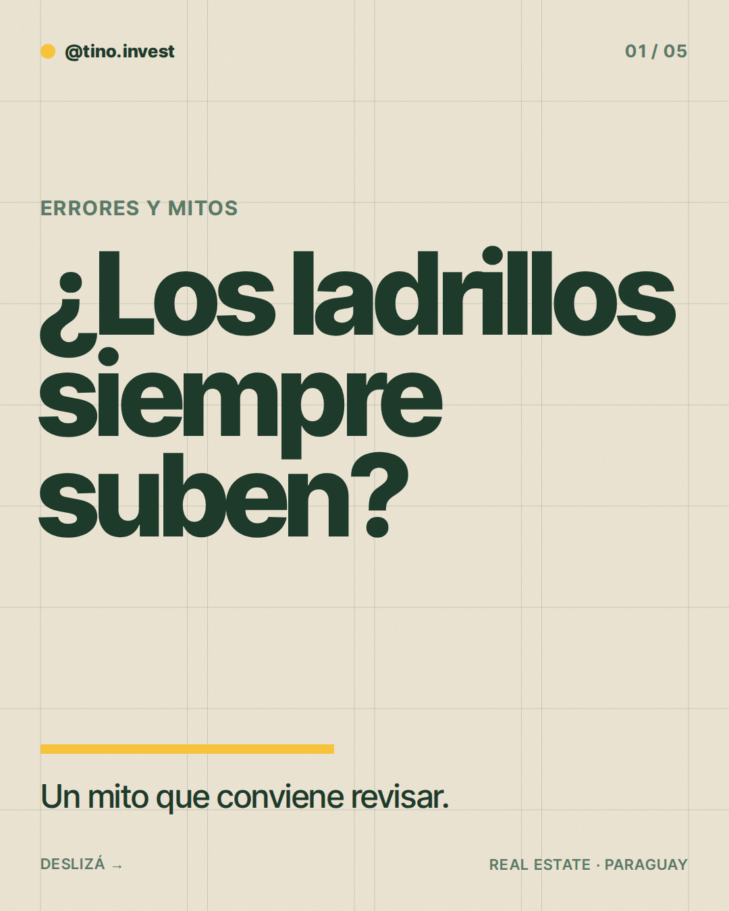
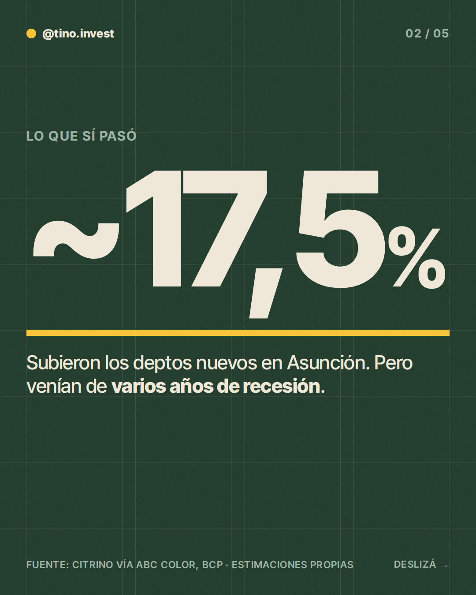
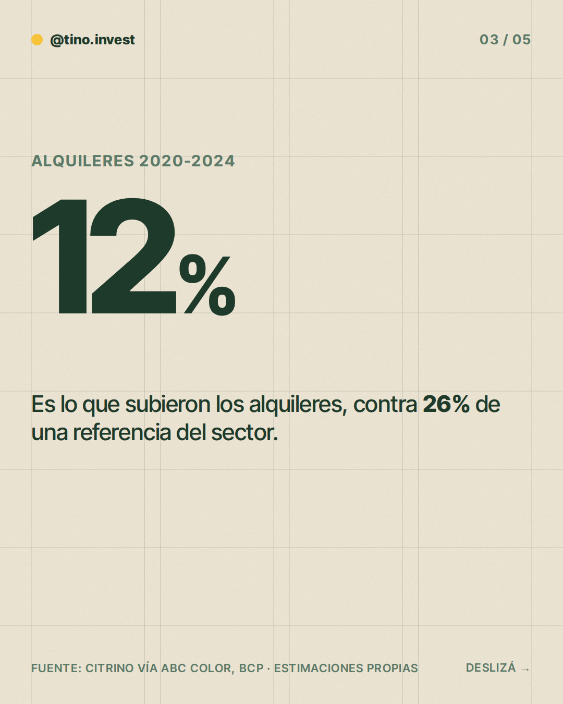
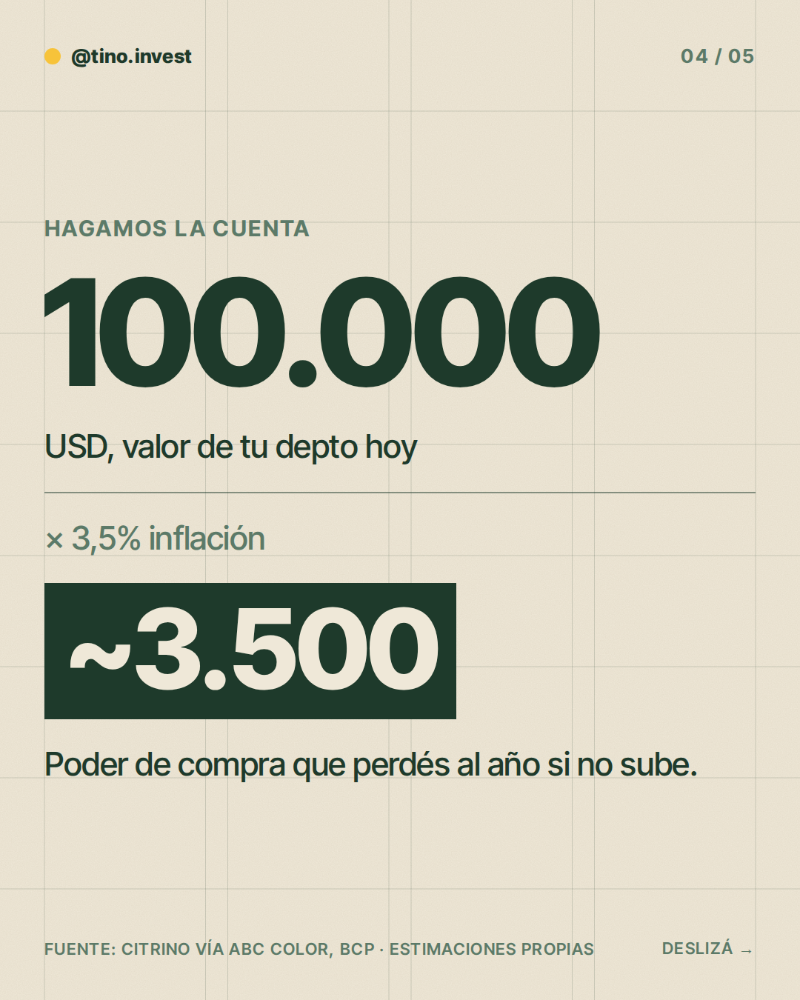
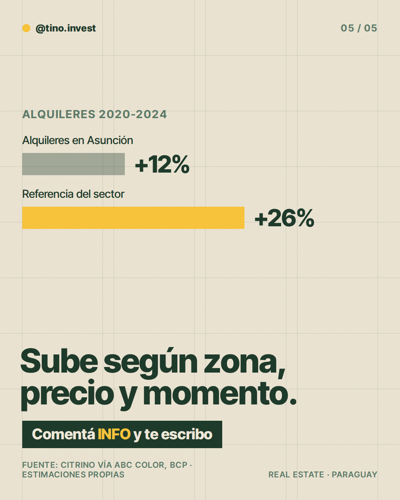

**Pilar:** Errores y mitos · **Tema:** Mito: los ladrillos siempre suben

### Texto (435/500 caracteres)

> ¿Es cierto que los ladrillos siempre suben?
>
> No siempre. Y no parejo.
>
> En Asunción los deptos nuevos subieron ~17,5%, pero el mercado venía de varios años de recesión.
>
> Los alquileres subieron 12% entre 2020 y 2024, contra 26% de una referencia del sector.
>
> Un depto de USD 100.000 que no se mueve pierde ~USD 3.500 al año de poder de compra (con 3,5% de inflación).
>
> En los slides está la cuenta 👇
>
> Comentá INFO y te paso más detalle.

### Slides

### ¿Qué hago?

- Para publicarlo, comentá `/publicar` en este issue.
- Para descartarlo, cerrá el issue.
- Para cambiar algo, editá `posts/2026-11-20/post.json` y después comentá `/publicar`: los slides se vuelven a armar desde ese archivo antes de publicar.

Investigación y fuentes

# Investigación 2026-11-20 · Errores y mitos

**Tema:** "Los ladrillos siempre suben" (banco de temas, no publicado en las últimas 6 semanas).

## Datos clave
- Precio de venta de departamentos nuevos en Asunción: +17,5% (período exacto no indicado). Fuente: Citrino Capitales Inmobiliarios, vía ABC Color, 23/04/2025.
- Alquileres en Asunción: +12% entre 2020 y 2024, frente a un índice de referencia del sector de +26%. Misma fuente.
- El mismo artículo habla de una recesión previa de "varios años" (sin fechas ni magnitud).
- Meta de inflación del BCP: 3,5% (Trading Economics, oct. 2026). Inflación interanual oct. 2026: 1,7% (agregadores; no se verificó el comunicado del BCP).

## Estimaciones
- La cuenta de USD 100.000 × 3,5% = USD 3.500 es **ilustrativa**: usa la meta de inflación del BCP como supuesto y es una cuenta de poder de compra, no un dato de mercado.
- No se encontró un índice paraguayo público de precio por m² con variación anual 2026; por eso el enfoque es conceptual.

### Comentaron INFO (últimos 7 días)

Nadie por ahora.
