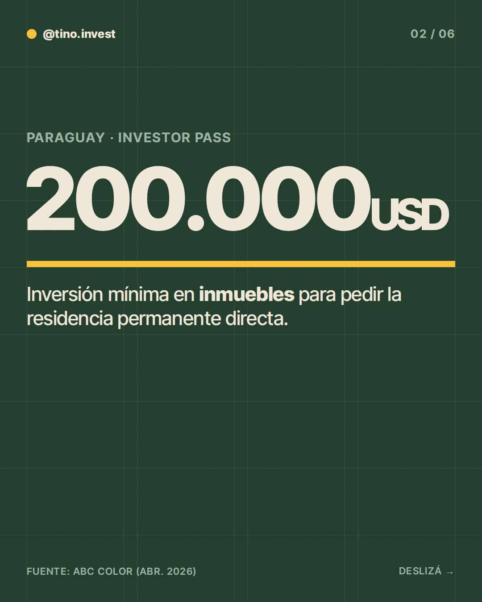
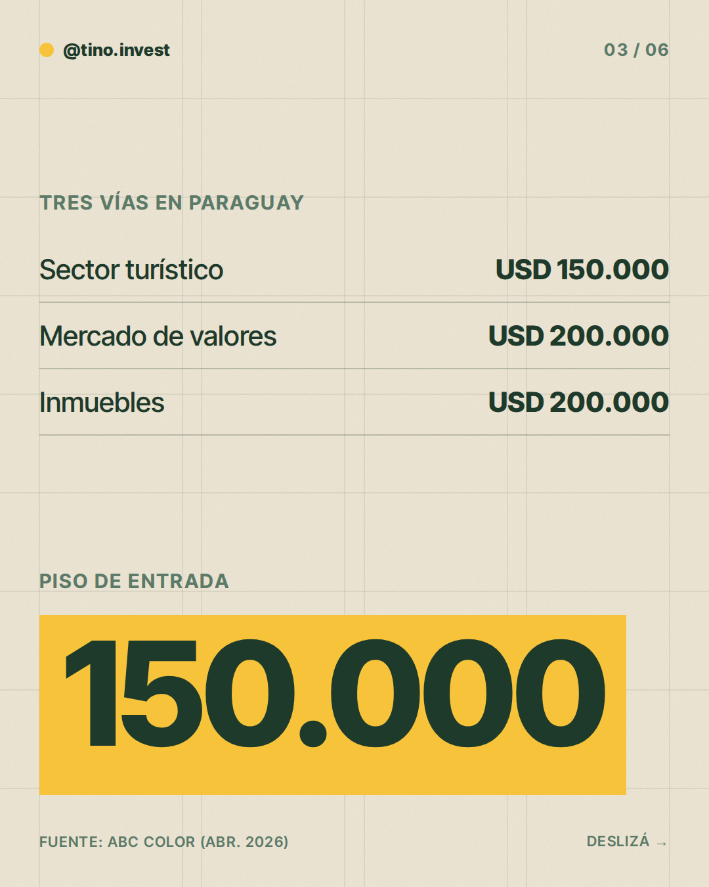
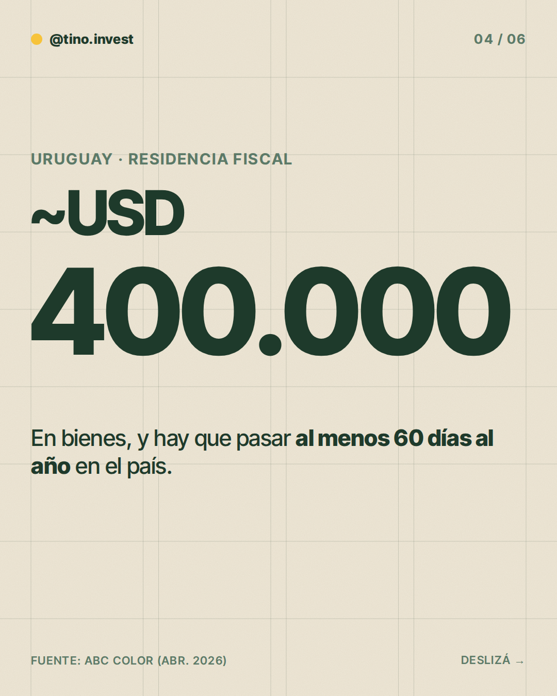
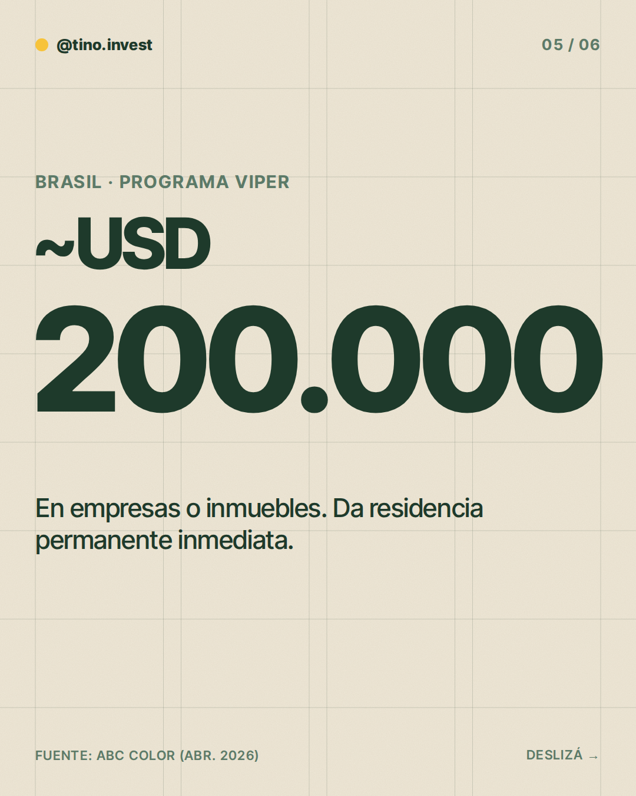
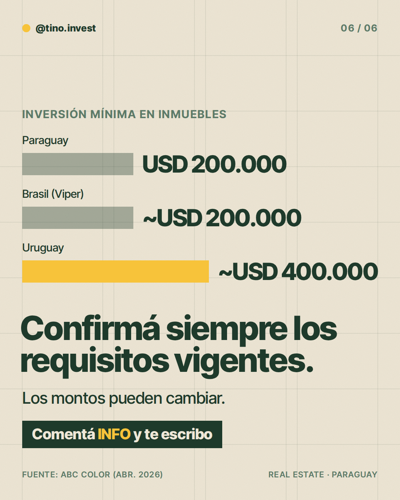

**Pilar:** Paraguay vs. la región · **Tema:** Residencia para extranjeros que invierten: Paraguay vs. la región

### Texto (397/500 caracteres)

> ¿Cuánto hay que invertir para tener residencia en la región?
>
> Hagamos la comparación 👇
>
> 📍 Paraguay (Investor Pass): desde USD 200.000 en inmuebles.
> 📍 Uruguay: ~USD 400.000 en bienes.
> 📍 Brasil (Viper): ~USD 200.000.
>
> En Paraguay, además, el 90% de los trámites es digital.
>
> Ojo: los requisitos cambian, confirmalos en Migraciones. En los slides está el detalle.
>
> Comentá INFO y te paso más detalle.

### Slides

### ¿Qué hago?

- Para publicarlo, comentá `/publicar` en este issue.
- Para descartarlo, cerrá el issue.
- Para cambiar algo, editá `posts/2026-11-21/post.json` y después comentá `/publicar`: los slides se vuelven a armar desde ese archivo antes de publicar.

Investigación y fuentes

# Investigación 2026-11-21 · Paraguay vs. la región

**Tema elegido:** Residencia para extranjeros que invierten (banco de temas, pilar "Paraguay vs. la región"). Oportuno: el Investor Pass se lanzó en abril de 2026.

## Intento descartado
Impuestos al alquiler (IRP): no encontré fuente oficial que confirme la tasa vigente en PY (DNIT confirma solo base del 50% del alquiler, Art. 59 Ley 6380/19) y los datos de AR/UY/BR eran parciales o en discusión. No se usa.

## Datos clave
- Paraguay, Investor Pass (residencia permanente directa por inversión): USD 200.000 en inmuebles (propiedades o proyectos), USD 200.000 en mercado de valores (Bolsa local), USD 150.000 en sector turístico. 90% de los trámites de radicación son digitales. Fuente: ABC Color, 24/04/2026 (https://www.abc.com.py/negocios/2026/04/24/paraguay-investor-pass-entra-a-competir-con-gold-card-express-entry-viper-y-otras-iniciativas/); también ABC 21/04/2026 y La Nación 17/04/2026 (cifra de entrada USD 150.000).
- Uruguay: residencia fiscal con ~USD 400.000 en bienes (o más de USD 1,7 M en empresas con 15 empleos); permanencia física de al menos 60 días al año. Fuente: ABC, 24/04/2026.
- Brasil, programa Viper: USD 200.000 en empresas o inmuebles; residencia permanente inmediata. Fuente: ABC, 24/04/2026 (el artículo escribe "200.0000", error tipográfico; se interpreta como 200.000, tomar con cautela).
- Argentina: sin datos confiables, no se incluye.

## Estimaciones / cautelas
- Ninguna cifra es estimación propia, pero las de Uruguay y Brasil provienen de una sola fuente secundaria (ABC) y van con "~". Los montos pueden cambiar o variar por categoría: verificar en Migraciones/MIC.
- Ferrere también menciona USD 200.000 en inmuebles; inversión productiva USD 70.000 (no usada; no pude abrir la página).

### Comentaron INFO (últimos 7 días)

Nadie por ahora.
