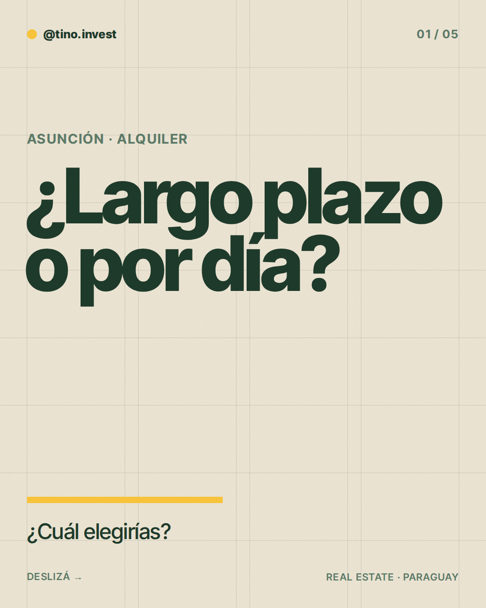
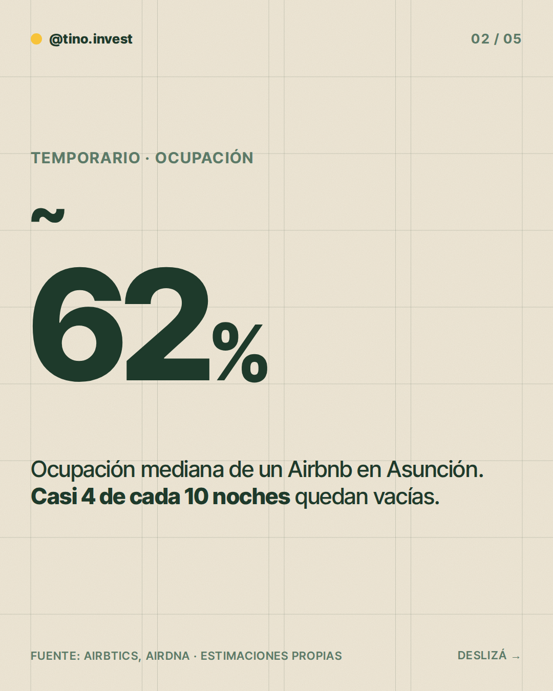
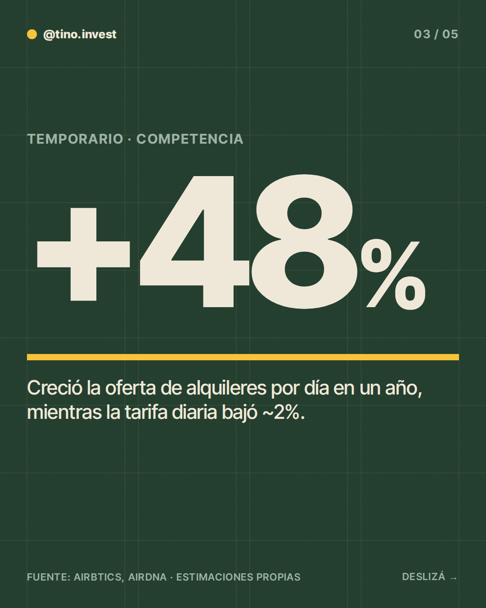
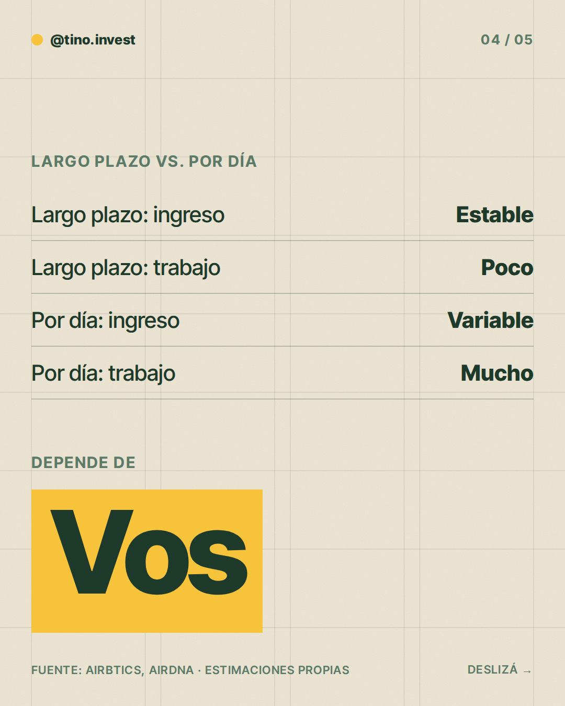
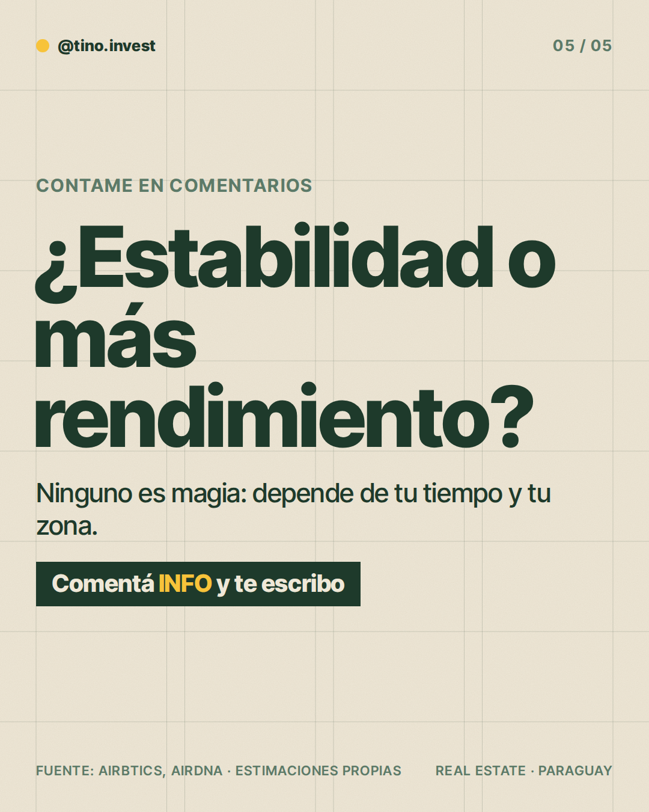

**Pilar:** Pregunta abierta · **Tema:** Alquiler tradicional o temporario: ¿cuál elegirías?

### Texto (389/500 caracteres)

> ¿Alquiler de largo plazo o por día (tipo Airbnb)? ¿Cuál elegirías?
>
> Cada uno tiene su costo 👇
>
> Largo plazo: ingreso más estable, menos trabajo.
>
> Temporario: puede rendir más, pero hay que gestionarlo y la oferta crece rápido. En Asunción, la ocupación ronda ~62%.
>
> Ninguno es magia: depende de tu tiempo y tu zona.
>
> Detalle en los slides. Contame qué elegirías y comentá INFO y te escribo.

### Slides

### ¿Qué hago?

- Para publicarlo, comentá `/publicar` en este issue.
- Para descartarlo, cerrá el issue.
- Para cambiar algo, editá `posts/2026-11-22/post.json` y después comentá `/publicar`: los slides se vuelven a armar desde ese archivo antes de publicar.

Investigación y fuentes

# Investigación 2026-11-22 · Pregunta abierta

**Tema:** ¿Alquiler tradicional o temporario? ¿Cuál elegirías? (banco: Primera inversión). Enfoque conceptual + 2 datos de mercado.

## Datos clave
- Ocupación mediana del Airbnb en Asunción: ~62% (sep 2025–ago 2026). Fuente: Airbtics (airbtics.com), consultado 2026-11-22.
- Oferta activa de alquiler temporario en Asunción: +48,4% entre jun 2025 y jun 2026; tarifa diaria promedio −2,4%. Fuente: AirDNA.
- Las cifras de cantidad de anuncios difieren entre fuentes → no se usan.
- Rentabilidad de Asunción 7%–11% (Infonegocios, fecha no precisada): no se usa por falta de fecha.
- No hay dato confiable 2026 que compare directamente rentabilidad neta tradicional vs. temporario en Asunción → comparación solo conceptual.

## Estimaciones
- La ocupación de 62% y el +48% de oferta son datos de plataformas privadas (no oficiales); se redondean a "~".
- Cualquier lectura de "más rinde / más trabajo" es conceptual, sin cifra propia.

### Comentaron INFO (últimos 7 días)

Nadie por ahora.
