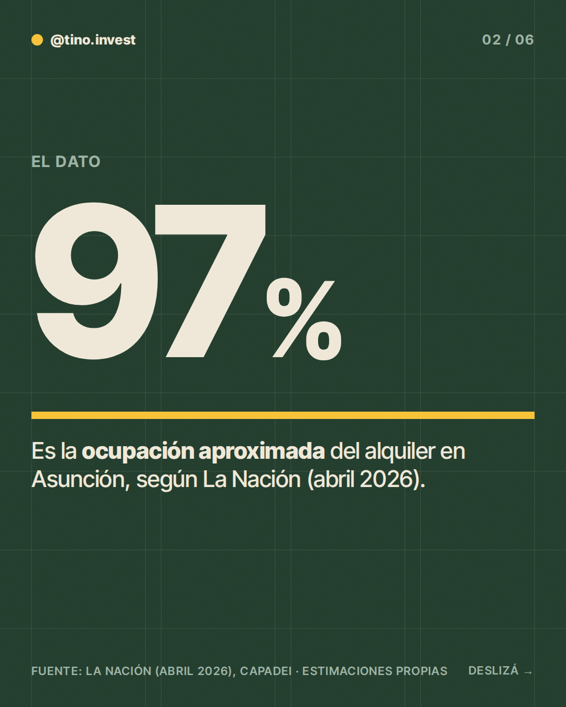
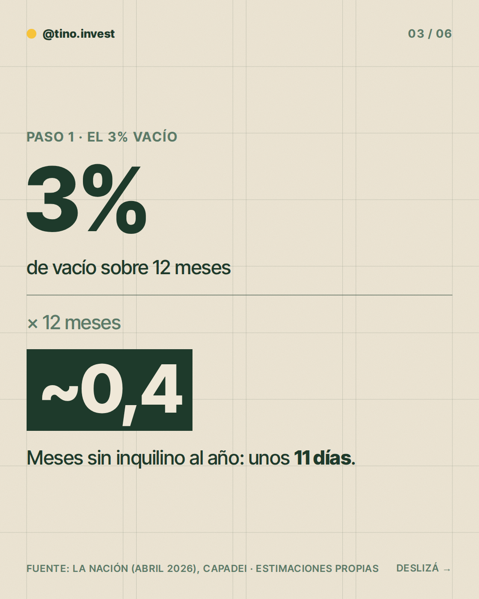
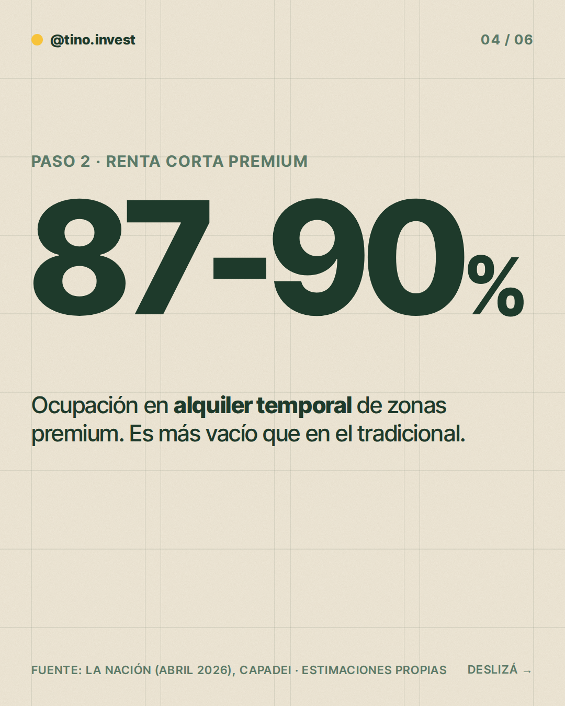
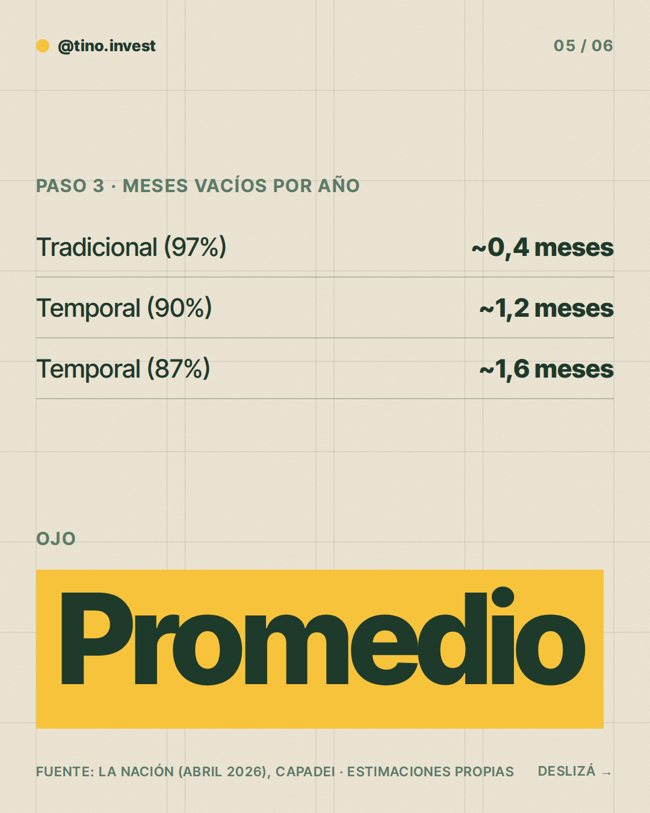
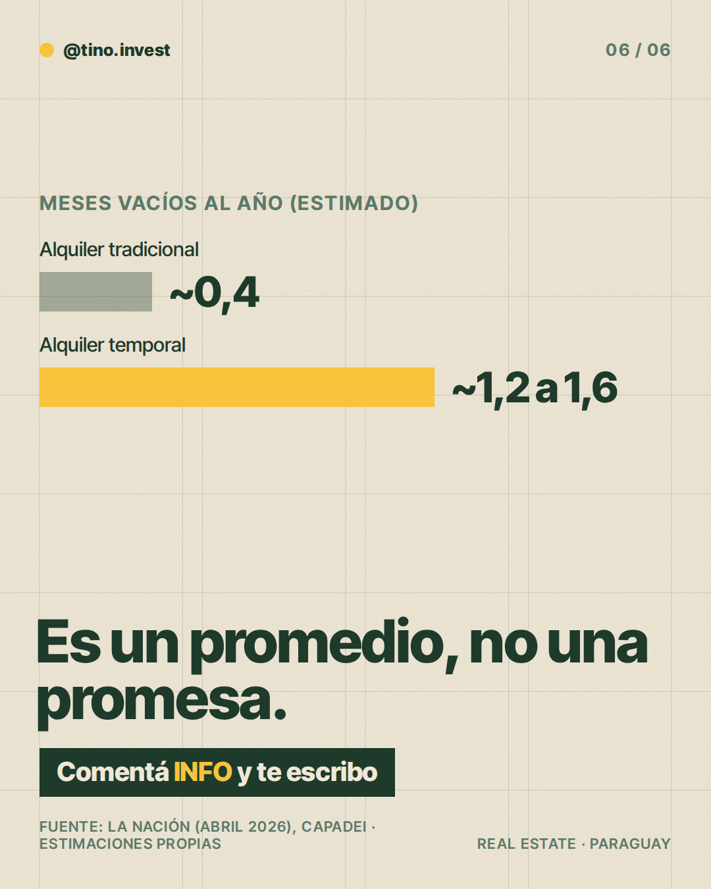

**Pilar:** El dato de la semana · **Tema:** Ocupación del alquiler en Asunción: qué significa el 97%

### Texto (408/500 caracteres)

> ¿Cuántos deptos en alquiler están ocupados en Asunción?
>
> Según La Nación (abril 2026), cerca del 97% 👇
>
> Hagamos la cuenta: el 3% de 12 meses son ~0,4 meses vacíos al año (unos 11 días).
>
> En alquiler corto de zonas premium baja a 87%-90%: ~1,2 a 1,6 meses sin huéspedes.
>
> Ojo: es un promedio de ciudad. Tu unidad puede rendir distinto.
>
> En los slides te muestro la cuenta.
>
> Comentá INFO y te paso más detalle.

### Slides

### ¿Qué hago?

- Para publicarlo, comentá `/publicar` en este issue.
- Para descartarlo, cerrá el issue.
- Para cambiar algo, editá `posts/2026-11-23/post.json` y después comentá `/publicar`: los slides se vuelven a armar desde ese archivo antes de publicar.

Investigación y fuentes

# Investigación 2026-11-23 · El dato de la semana

**Tema elegido:** Ocupación del alquiler en Asunción: ~97% (qué significa el 3% vacío). Es nuevo: no repite "alquilar un m²" (02/11) ni "meses sin inquilino" (13/11, conceptual) ni "Airbnb" (14/11).

## Datos clave
- Ocupación en Asunción ~97% (La Nación, 13/04/2026, nota de Sofía Céspedes; fuentes citadas: Capadei, Remax, Civis).
- Microzonas premium, alquiler tradicional: cerca del 100%.
- Microzonas premium, renta corta: 87% a 90%.
- Contexto: alquiler promedio USD 6 a 10/m² (Capadei, abril 2026), ya usado en otro post.

## Cuentas propias (aritmética, no dato publicado)
- 3% de 12 meses = ~0,36 meses (~11 días) vacíos al año.
- 87%-90% → 10%-13% vacío = ~1,2 a 1,6 meses al año.

## Estimaciones / límites
- Las cuentas de arriba son estimaciones propias sobre el dato publicado.
- El 97% es promedio de ciudad; no garantiza la ocupación de una unidad puntual.

## Descartado
- Precio de venta por m²: solo hallé USD 1.328 de InfoCasas de 2017 (desactualizado). No se usa.

### Comentaron INFO (últimos 7 días)

Nadie por ahora.
