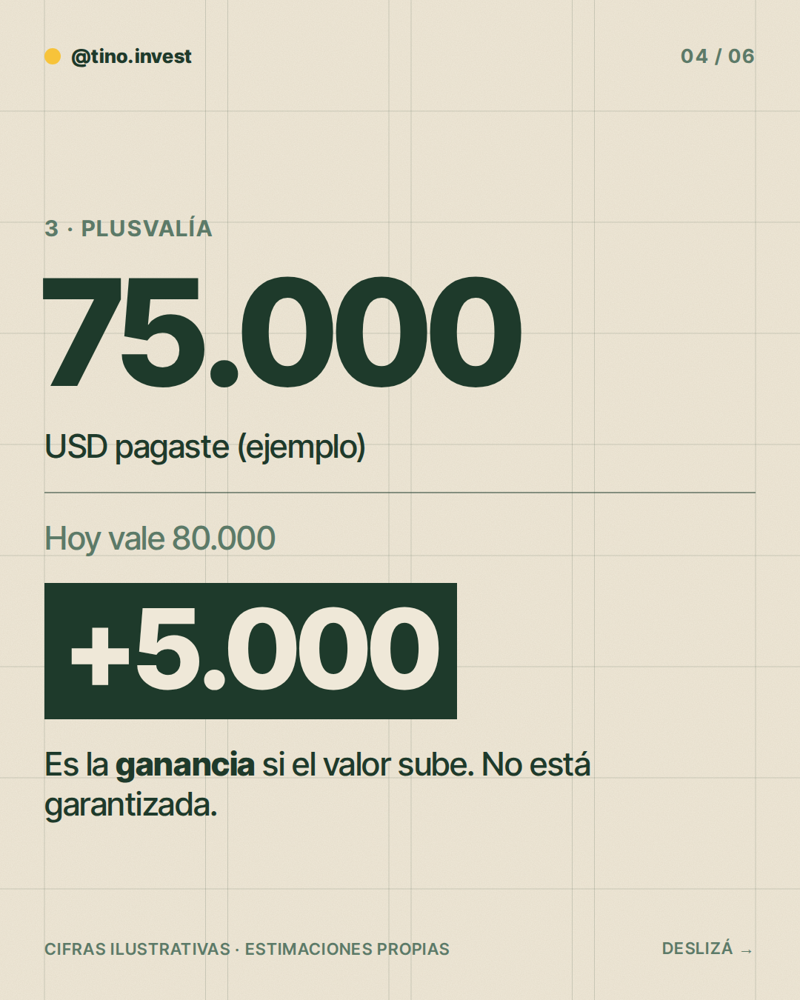
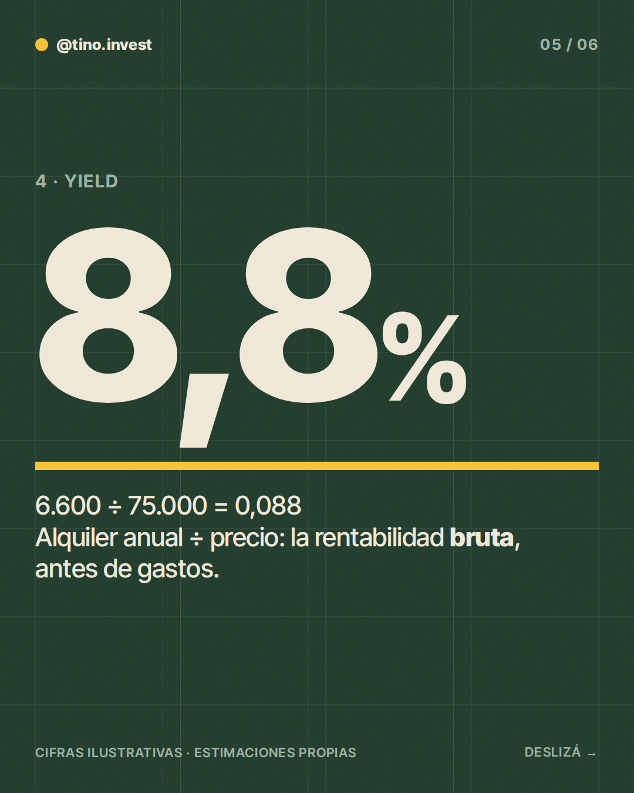

**Pilar:** Primera inversión · **Tema:** Glosario: plusvalía, expensas, escritura, yield

### Texto (422/500 caracteres)

> ¿Te suenan raras las palabras de inversión inmobiliaria?
>
> Cuatro que tenés que conocer 👇
>
> • Expensas: la cuota mensual del edificio.
> • Escritura: el documento que te hace dueño.
> • Plusvalía: lo que sube el valor de tu depto.
> • Yield: alquiler anual ÷ precio.
>
> Ejemplo: USD 6.600 al año ÷ USD 75.000 = 8,8% bruto.
>
> En los slides te lo explico simple.
>
> Si estás pensando en tu primera inversión, comentá INFO y lo charlamos.

### Slides

### ¿Qué hago?

- Para publicarlo, comentá `/publicar` en este issue.
- Para descartarlo, cerrá el issue.
- Para cambiar algo, editá `posts/2026-11-24/post.json` y después comentá `/publicar`: los slides se vuelven a armar desde ese archivo antes de publicar.

Investigación y fuentes

# Investigación 2026-11-24 — Primera inversión

**Tema elegido:** Glosario: plusvalía, expensas, escritura, yield (del banco de temas; no publicado en las últimas 6 semanas).

**Enfoque:** conceptual. Una búsqueda sobre expensas promedio en Asunción (2026) no devolvió datos confiables de Paraguay (solo Argentina/CABA), por lo que no se usa ninguna cifra de expensas ni de gastos de escritura.

**Cifras usadas (todas ilustrativas, sin fuente oficial):**
- Depto de USD 75.000 con alquiler USD 550/mes → 6.600/año → 8,8% bruto (mismo ejemplo de la guía de estilo; estimación propia).
- Plusvalía: 75.000 → 80.000 (+5.000), ejemplo hipotético; no es proyección de precios.

**Estimaciones:** todas las cifras anteriores. Definiciones conceptuales: expensas (gastos comunes del edificio), escritura (documento de propiedad ante escribano), plusvalía (aumento de valor), yield (alquiler anual ÷ precio).

### Comentaron INFO (últimos 7 días)

Nadie por ahora.
