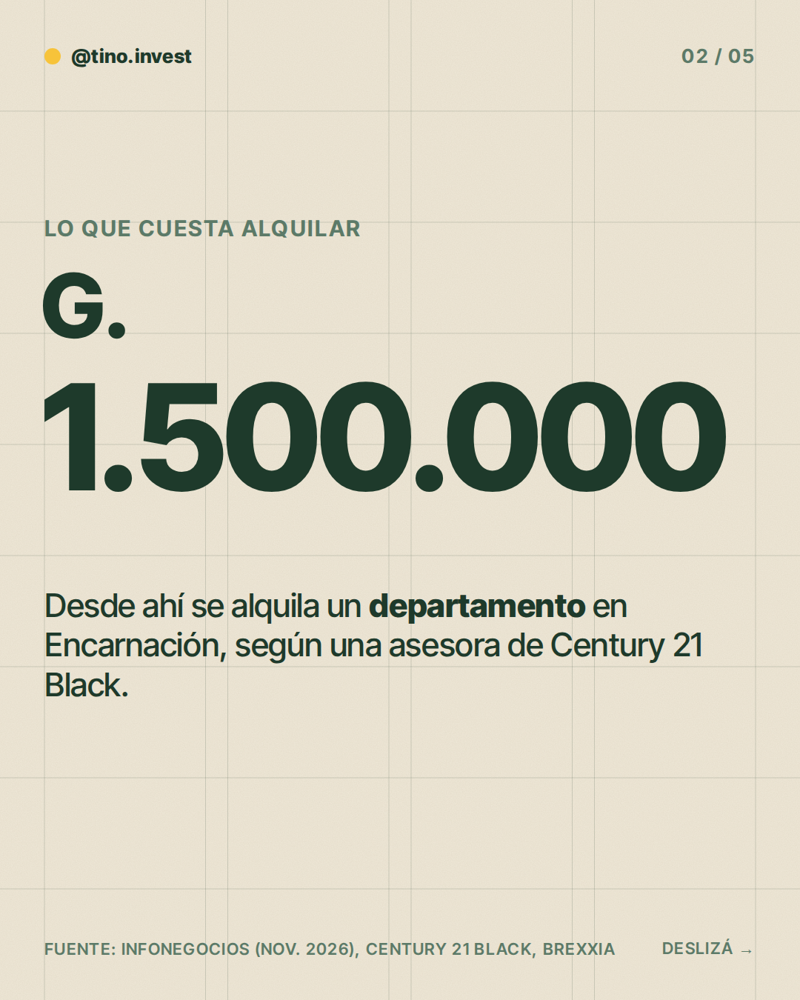
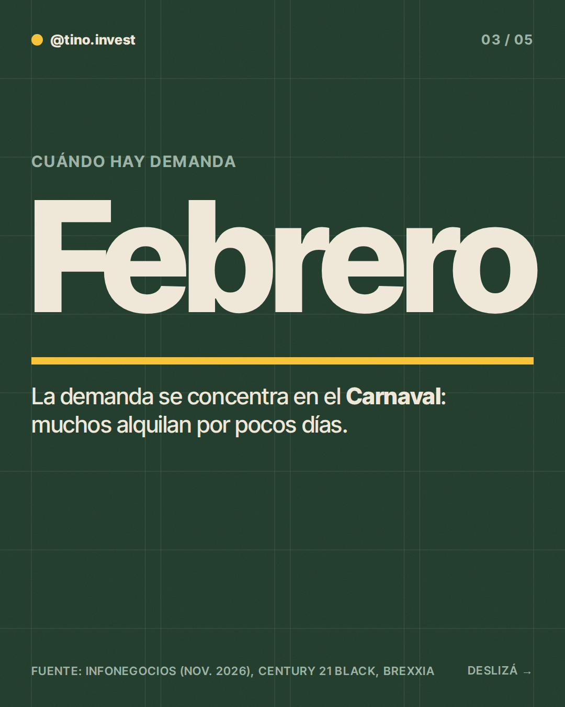
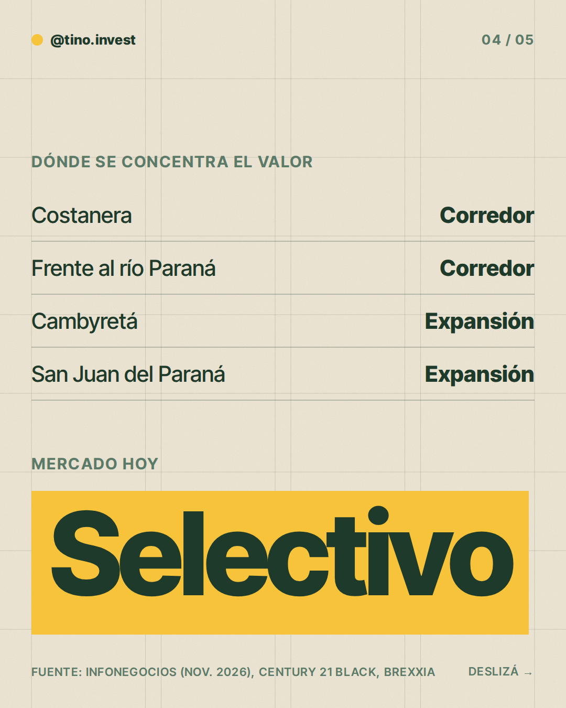
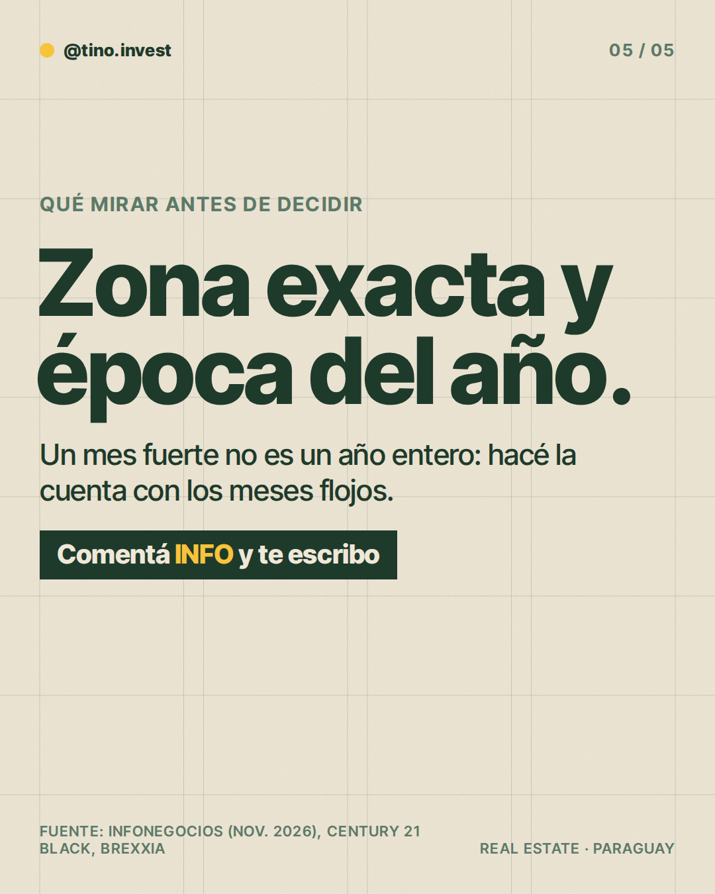

**Pilar:** Barrios y ciudades · **Tema:** Encarnación: la Costanera y el efecto Carnaval

### Texto (452/500 caracteres)

> ¿Por qué tanta gente mira Encarnación?
>
> Según Century 21 Black, un depto se alquila desde ~G. 1.500.000. Pero ojo: la demanda se concentra en febrero, con el Carnaval.
>
> Y el valor no está parejo: los corredores que más subieron son la Costanera y el frente al río Paraná.
>
> Un mercado hoy más selectivo: la zona exacta y la época del año pesan.
>
> En los slides te muestro el detalle 👇
>
> ¿Querés ver cómo da la cuenta en tu caso? Comentá INFO y te escribo.

### Slides

### ¿Qué hago?

- Para publicarlo, comentá `/publicar` en este issue.
- Para descartarlo, cerrá el issue.
- Para cambiar algo, editá `posts/2026-11-25/post.json` y después comentá `/publicar`: los slides se vuelven a armar desde ese archivo antes de publicar.

Investigación y fuentes

# Investigación 2026-11-25 · Barrios y ciudades

**Tema elegido:** Encarnación: dónde se concentra el valor (Costanera) y por qué la demanda de alquiler es estacional (Carnaval). Está en el banco (Interior: Encarnación) y no se publicó en las últimas 6 semanas.

## Datos clave
- InfoNegocios (4/9/2026, voz: Enrique Acosta, Brexxia): Encarnación podría ser, junto a Ciudad del Este, uno de los dos grandes mercados inmobiliarios del interior. En 3 años pasó de compradores locales y terrenos a edificios de mayor estándar, barrios cerrados y loteamientos. Mercado hoy "más racional y selectivo". Corredores de valorización: Costanera y frente al río Paraná. Zonas de expansión: Cambyretá y San Juan del Paraná. Sin cifras de precios.
- InfoNegocios (9/11/2026, Delfina Benítez, Century 21 Black): en Encarnación, departamentos desde G. 1.500.000 (período no especificado) y casas G. 3.000.000 a 7.000.000. La demanda se concentra en febrero (Carnaval), con alquileres por períodos cortos.

## Estimaciones / límites
- No se encontró precio por m² ni rentabilidad de Encarnación. No se usan.
- No se convirtió G. a USD para no inventar un tipo de cambio.
- La advertencia "un mes fuerte no es un año entero" es una lectura propia de que la demanda se concentra en febrero; es conceptual, no una cifra medida.

### Comentaron INFO (últimos 7 días)

Nadie por ahora.
