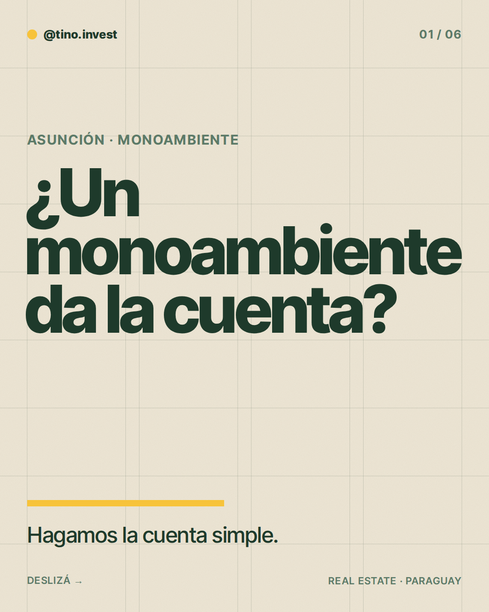
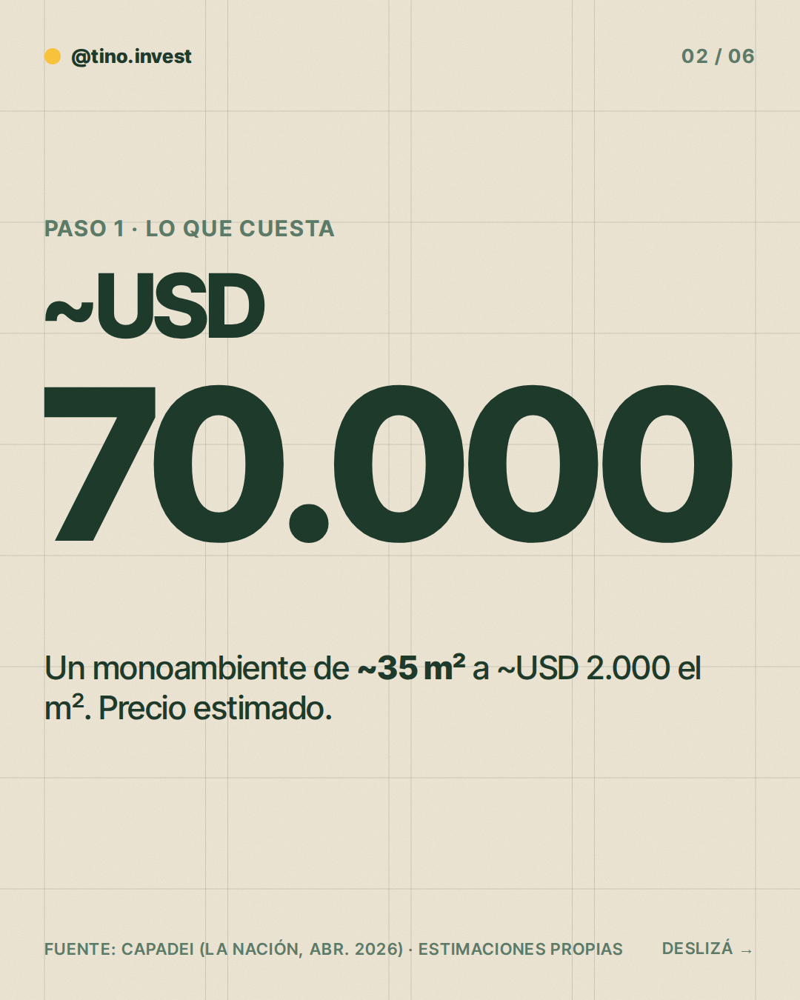
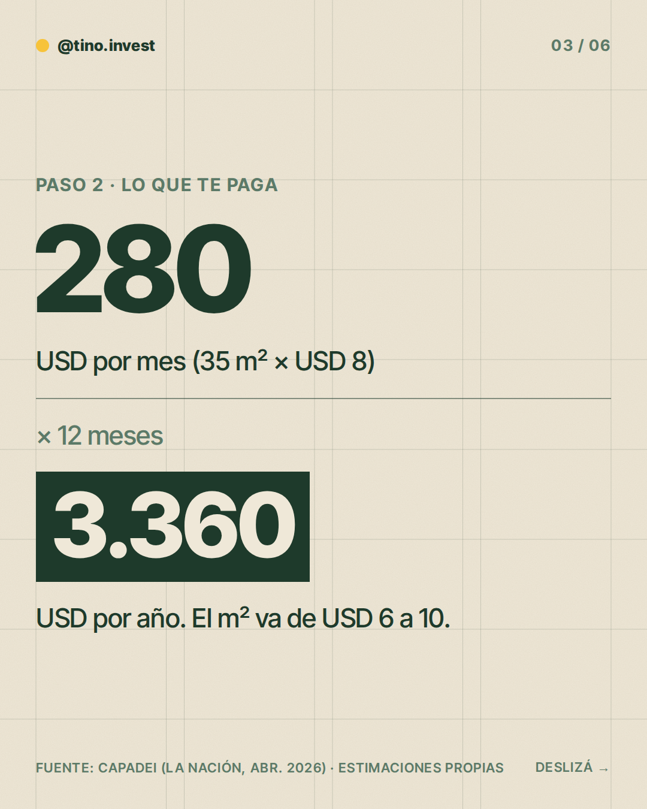
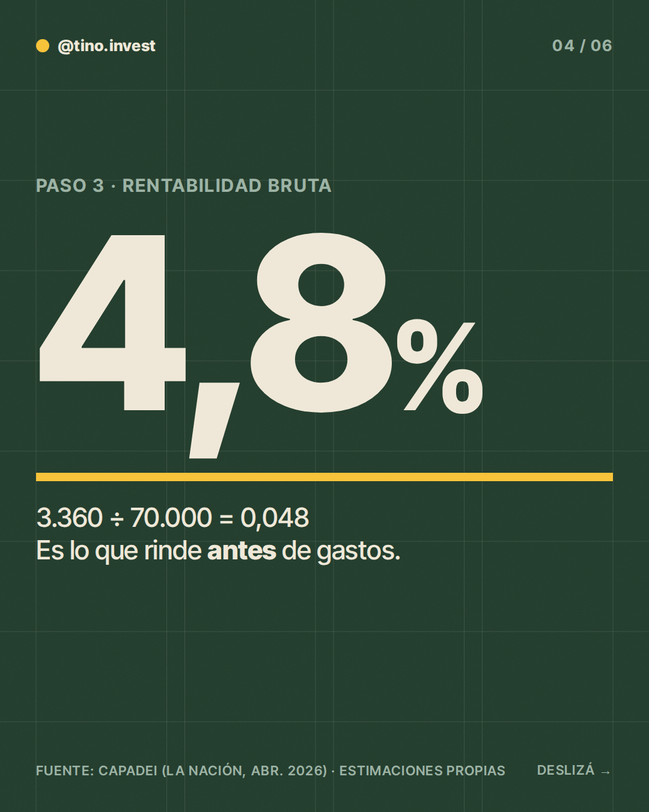
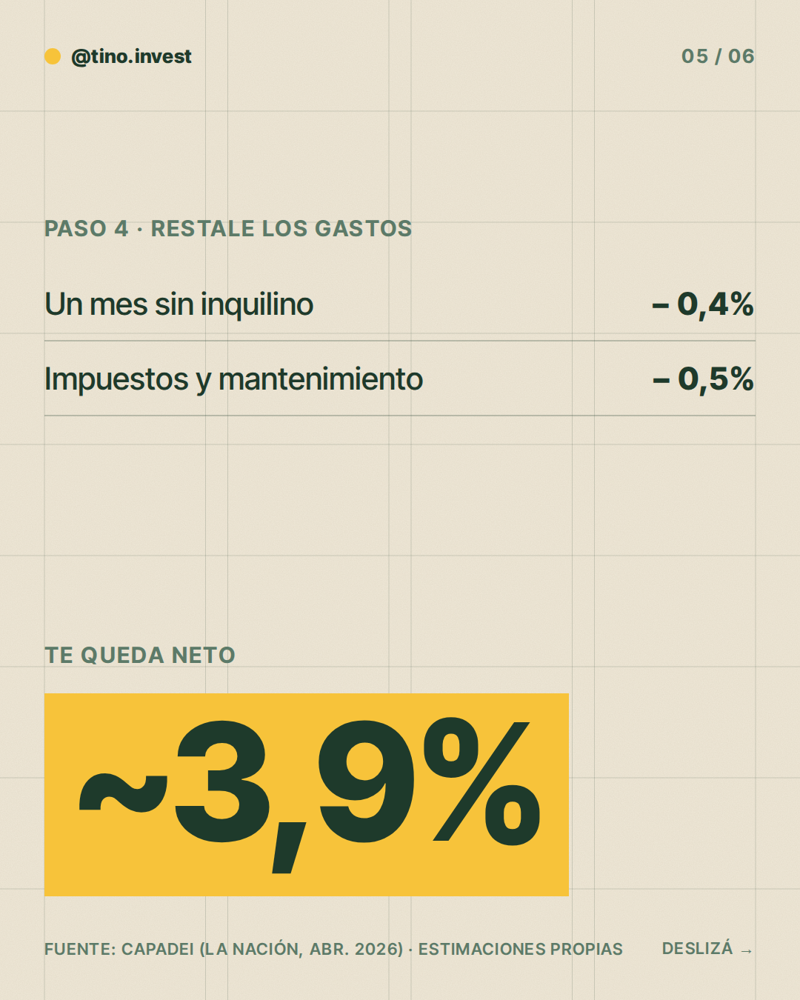
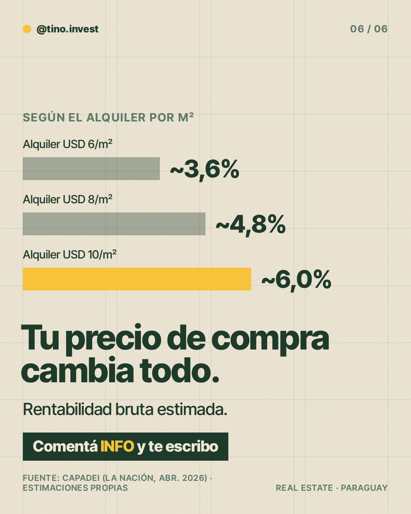

**Pilar:** Hagamos la cuenta · **Tema:** Monoambiente para alquilar en Asunción

### Texto (449/500 caracteres)

> ¿Un monoambiente para alquilar en Asunción da la cuenta?
>
> Hagamos la cuenta simple 👇
>
> El alquiler promedio va de USD 6 a 10 por m² (Capadei).
> Un monoambiente de ~35 m² a ~USD 8/m² = ~USD 280/mes.
>
> ~USD 3.360 al año sobre ~USD 70.000 → ~4,8% bruto.
>
> Restale un mes vacío, impuestos y mantenimiento y queda ~3,9% neto.
>
> El precio de compra mueve todo. Los slides tienen el detalle.
>
> ¿Querés ver cómo da la cuenta en tu caso? Comentá INFO y te escribo.

### Slides

### ¿Qué hago?

- Para publicarlo, comentá `/publicar` en este issue.
- Para descartarlo, cerrá el issue.
- Para cambiar algo, editá `posts/2026-11-26/post.json` y después comentá `/publicar`: los slides se vuelven a armar desde ese archivo antes de publicar.

Investigación y fuentes

# Investigación 2026-11-26 · Hagamos la cuenta

**Tema elegido:** Monoambiente para alquilar en Asunción (banco de temas, "Hagamos la cuenta"). No se publicó en las últimas 6 semanas. "Depto de 2 dormitorios" se descartó porque salió el 2026-11-05.

## Datos con fuente
- Alquiler promedio en Asunción: **USD 6 a USD 10 por m²** según ubicación y características. Raúl Constantino, presidente de Capadei, en La Nación, 13/04/2026. **Dato confirmado.**
- Ocupación de ~97% en la ciudad (misma nota de La Nación). No se usa en el post.
- Referencia de alquiler de monoambiente: G. 2.000.000 base en barrios altos (Remax, citado por Última Hora). La fecha de la nota es ambigua (aparece 2023 y 2026), así que **no se usa**.
- Tipo de cambio: las fuentes encontradas son contradictorias para noviembre 2026. **No se usa ninguna conversión Gs/USD.**
- El precio de venta por m² no se pudo confirmar con una fuente seria. Solo hay un aviso suelto de ~USD 1.966/m² (Zonaprop, un monoambiente de 36 m²), que es débil.

## Estimaciones (marcadas como tales en el post)
- Monoambiente de ~35 m² a ~USD 2.000/m² → ~USD 70.000.
- Alquiler: 35 m² × USD 8/m² (punto medio del rango Capadei) → ~USD 280/mes → USD 3.360/año.
- Bruto: 3.360 ÷ 70.000 = 4,8%. Con el rango USD 6 a USD 10/m² da 3,6% a 6,0%.
- Gastos: 1 mes sin inquilino (~0,4%) e impuestos y mantenimiento (~0,5%) → neto ~3,9%.
- Comparación con un plazo fijo en USD: no se encontró un dato confiable, así que **no se usa**. El cierre compara el bruto en el rango bajo, medio y alto.

## Enfoque
El post es honesto: depende mucho del precio de compra y del alquiler por m². Sirve para que cada persona haga su propia cuenta.

### Comentaron INFO (últimos 7 días)

Nadie por ahora.
