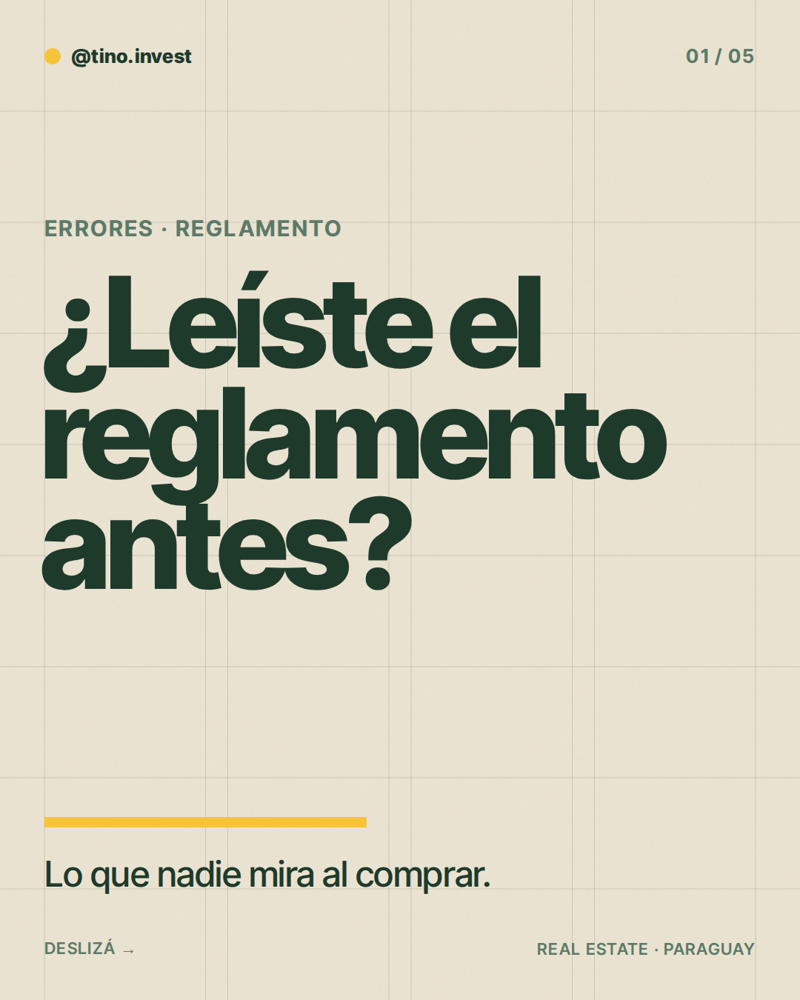
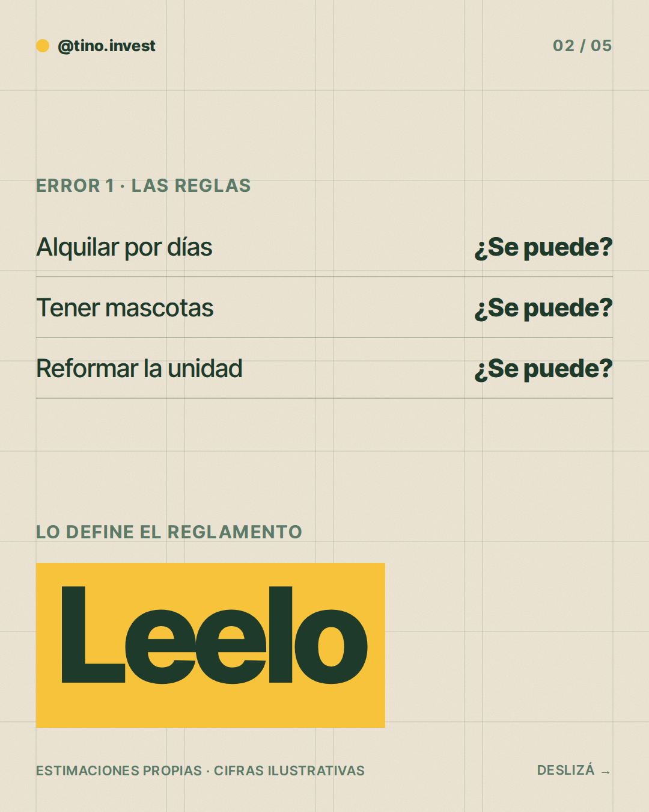
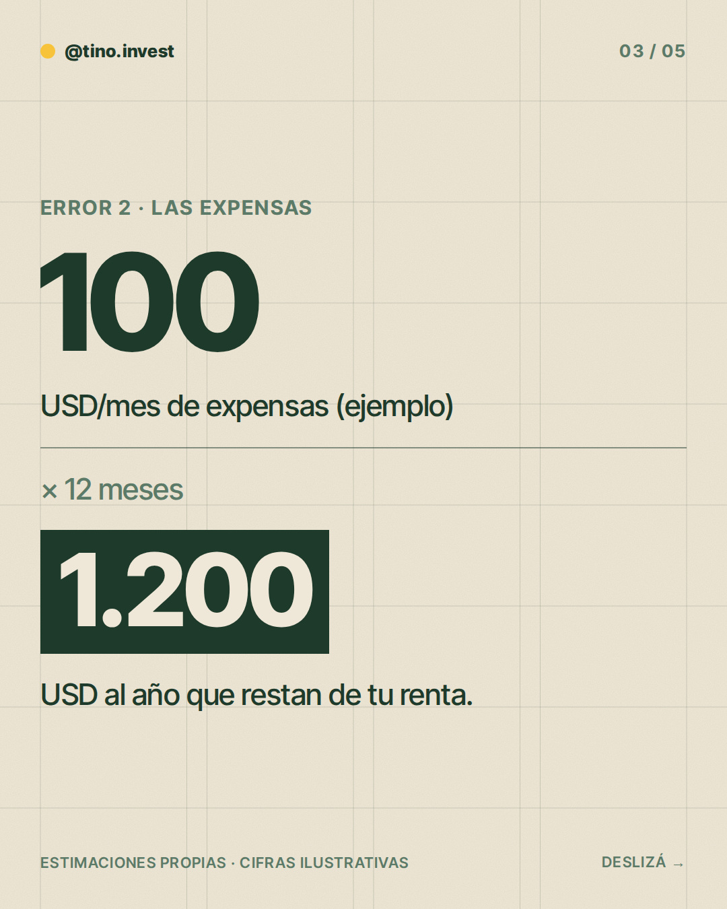
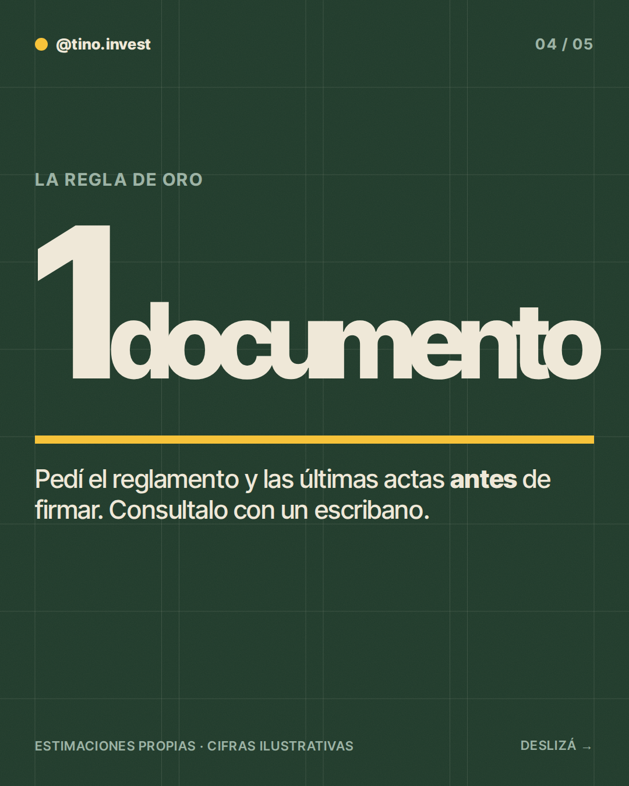

**Pilar:** Errores y mitos · **Tema:** Comprar sin ver el reglamento del edificio

### Texto (407/500 caracteres)

> ¿Leíste el reglamento del edificio antes de comprar?
>
> Mucha gente no. Y ahí aparecen las sorpresas.
>
> El reglamento define qué podés hacer con tu depto: alquilar por días, tener mascotas, reformar. Y cómo se reparten las expensas.
>
> Ejemplo: ~USD 100/mes de expensas son ~USD 1.200 al año que salen de tu rentabilidad.
>
> Pedilo antes de firmar y revisalo con un escribano 👇
>
> Comentá INFO y te paso más detalle.

### Slides

### ¿Qué hago?

- Para publicarlo, comentá `/publicar` en este issue.
- Para descartarlo, cerrá el issue.
- Para cambiar algo, editá `posts/2026-11-27/post.json` y después comentá `/publicar`: los slides se vuelven a armar desde ese archivo antes de publicar.

Investigación y fuentes

# Investigación 2026-11-27 · Errores y mitos

**Tema elegido:** Comprar sin ver el reglamento del edificio (del banco de TEMAS.md; no publicado en las últimas 6 semanas).

## Datos con fuente
- La búsqueda web no devolvió una fuente paraguaya específica y confiable sobre el contenido del reglamento (solo una nota del Poder Judicial, 2012, que menciona la administración de "propiedades horizontales" por los Registros Públicos: pj.gov.py/notas/7455).
- Fuentes de otros países (Argentina) describen el reglamento como escritura que detalla unidades, partes comunes y administrador. No se usan como dato de Paraguay.
- Por eso el post es **conceptual**: recomienda pedir el reglamento y las actas, y consultar con escribano/abogado. No afirma artículos de ley ni reglas concretas.

## Estimaciones
- Expensas de ~USD 100/mes: cifra **ilustrativa/estimación propia** para mostrar la cuenta (×12 = USD 1.200 al año). No es dato de mercado.

### Comentaron INFO (últimos 7 días)

Nadie por ahora.
