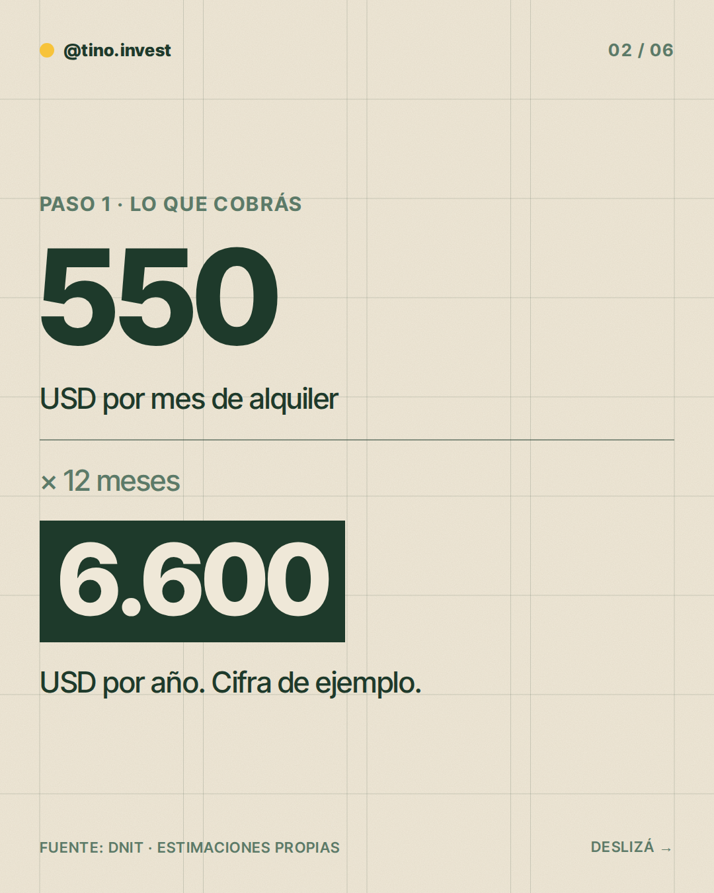
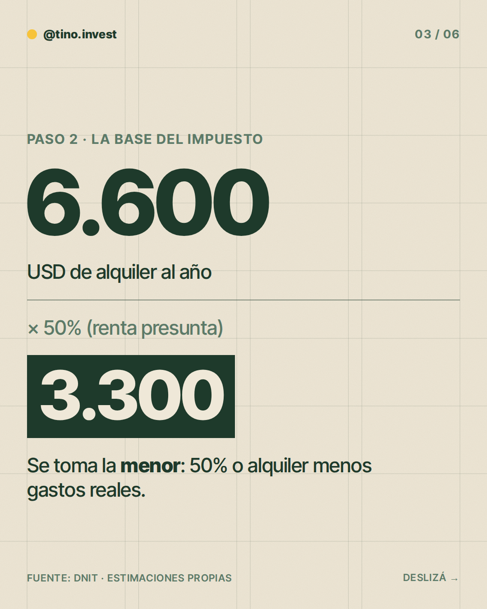
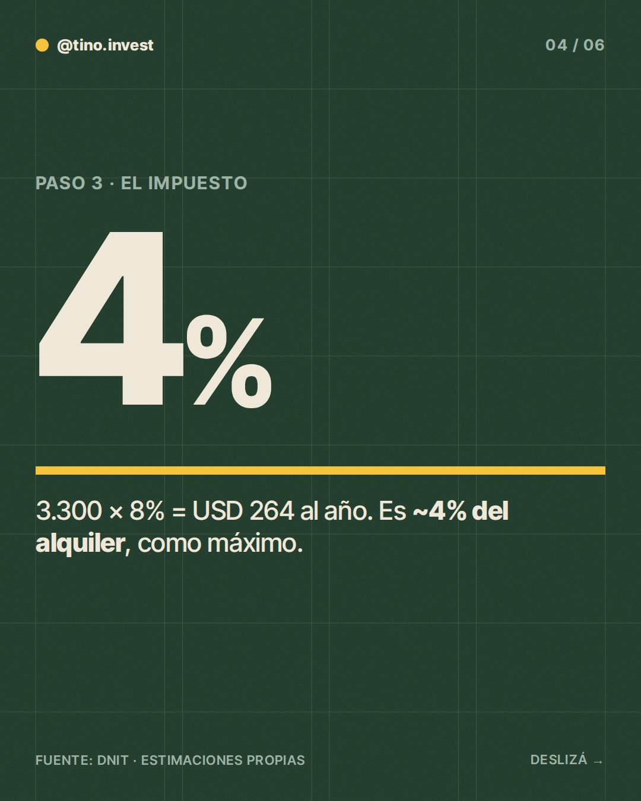
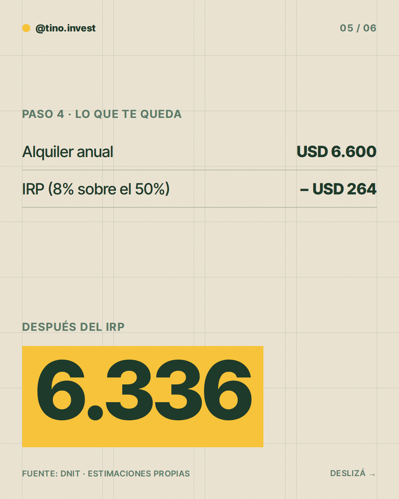
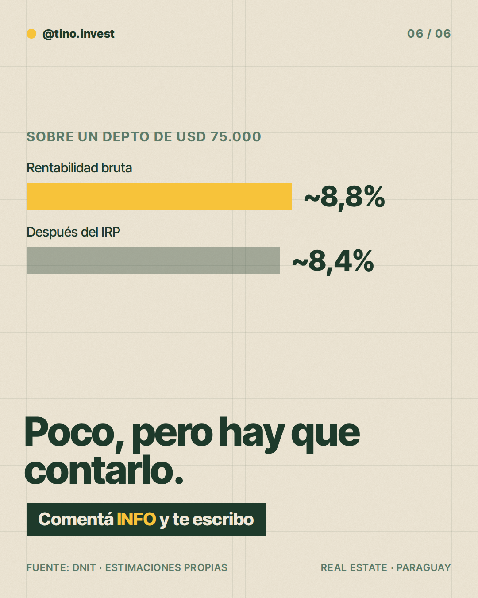

**Pilar:** Hagamos la cuenta · **Tema:** Cuánto IRP pagás por un alquiler

### Texto (395/500 caracteres)

> Alquilás un depto y te preguntás: ¿cuánto se lleva el impuesto?
>
> Hagamos la cuenta 👇
>
> Ejemplo: alquiler de ~USD 550/mes = ~USD 6.600 al año.
>
> El IRP del alquiler es 8%, y se calcula sobre el 50% del alquiler (o menos, si documentás gastos).
>
> 3.300 × 8% = ~USD 264 al año.
> Es ~4% del alquiler, como máximo.
>
> Poco, pero hay que contarlo. Detalle en los slides.
>
> Comentá INFO y te paso más detalle.

### Slides

### ¿Qué hago?

- Para publicarlo, comentá `/publicar` en este issue.
- Para descartarlo, cerrá el issue.
- Para cambiar algo, editá `posts/2026-11-28/post.json` y después comentá `/publicar`: los slides se vuelven a armar desde ese archivo antes de publicar.

Investigación y fuentes

# Investigación 2026-11-28 · Hagamos la cuenta

**Tema elegido:** Cuánto IRP pagás por un alquiler (tema nuevo, no publicado en las últimas 6 semanas; todos los temas "cuenta" del banco ya salieron).

## Datos clave
- El IRP grava "Rentas y Ganancias del Capital" con tasa de **8%** (DNIT, portal IRP, consultado 2026-11-28). Última Hora (2026-04-24) también menciona IRP sobre rentas del capital "hasta 8%".
- Alquiler de inmuebles: se declara como renta gravada la **menor** entre (1) el 50% del precio del arrendamiento o (2) el alquiler menos gastos directos, reales y documentados a nombre del propietario (DNIT, "El IRP se debe liquidar en marzo", 2026-03-05).
- Se liquida en marzo vía Marangatu (DNIT, 2026-03-05).
- No se confirmó en fuente oficial un mínimo no imponible para alquileres: el post no lo afirma.

## Cifras ilustrativas / estimaciones
- Alquiler USD 550/mes y precio USD 75.000: son los valores ilustrativos de la guía de estilo, NO datos reales.
- Cálculo propio: 550×12 = 6.600; ×50% = 3.300; ×8% = 264 (4% del alquiler); neto 6.336; 6.336/75.000 ≈ 8,4% vs 8,8% bruto.
- Caso máximo con base presunta; con gastos documentados altos el impuesto puede ser menor. Cada caso depende del contribuyente: consultar con contador.

### Comentaron INFO (últimos 7 días)

Nadie por ahora.
